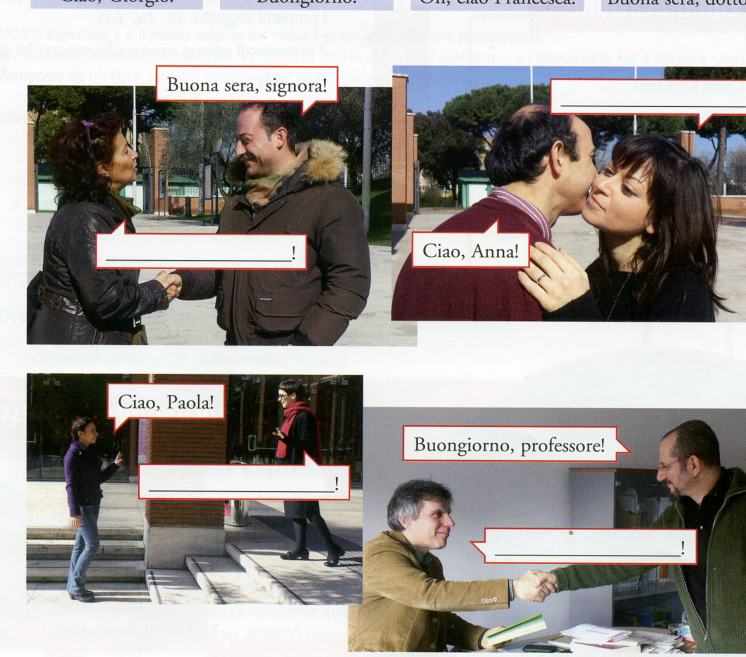
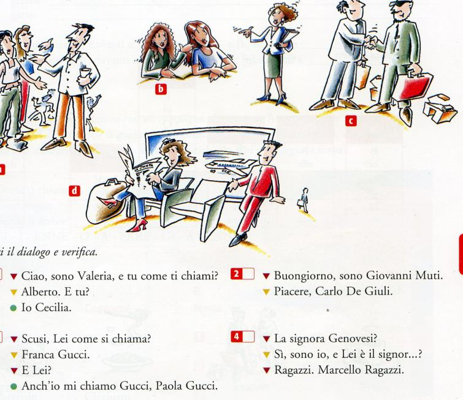
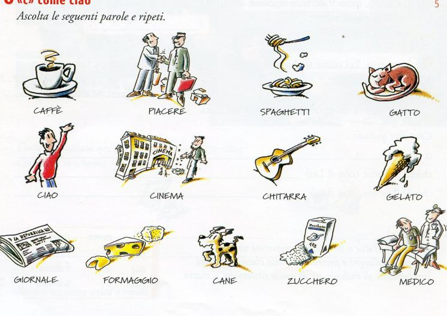
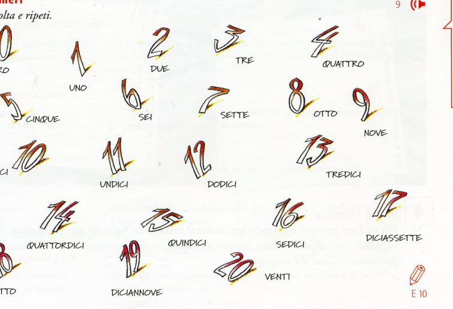

# Lezione 1 — Exercise workbook

[← Overview](lesson.md) · [Grammar](grammar.md) · [Vocabulary](vocabulary.md) · **Exercises**

**Source alignment:** *Nuovo Espresso 1*, Lezione 1, pp. 5–16. These are **original, additional exercises**. Use your lawful copy of the textbook for its own activities. Attempt each item first; expand solutions only after answering.

## Actual textbook picture exercises — embedded crops

Look at each original book image **here**, try the task, then open the model response. These are **new companion exercises** linked to the actual source pictures, not the publisher's answer key.

### Picture A · p. 6 — Greetings: formal or informal?

**Try:** Look at the four photographs. Which conversations would naturally start with *Ciao* and which could use *Buongiorno* or *Buonasera*? Write two greetings.

Reveal model answer

Model: **Ciao, Anna! Come stai?** (informal) and **Buongiorno, professore! Come sta?** (formal). Time and social relationship matter; a photograph alone does not establish the exact relationship.

### Picture B · p. 7 — Introductions in different settings

**Try:** Choose two illustrated encounters. Compose a two-line greeting and introduce yourself.

Reveal model answer

**A:** Buongiorno, sono Carlo. **B:** Piacere, mi chiamo Giulia. For friends: **Ciao! Come ti chiami?**

### Picture C · p. 8 — Actual picture vocabulary

**Try:** Cover the captions and name six depicted things. Then make two full Italian sentences using any objects.

Reveal model answer

Visible labels include **caffè, spaghetti, gatto, cinema, chitarra, gelato, giornale, formaggio, cane, zucchero, medico**. Examples: **Il gatto è qui. Vorrei un caffè.**

### Picture D · p. 11 — Numbers from the illustrated digits

**Try:** Find seven, thirteen and twenty. Say them aloud, then give a fictional telephone number digit by digit.

Reveal model answer

**sette, tredici, venti**. Example digit reading: **tre–due–otto–cinque**.

## Part A — Greetings and social register

**1.** You meet a professor at 10:00. Choose: `Ciao!` / `Buongiorno!`.

Answer
**Buongiorno!** is more suitable in a polite setting.

**2.** You greet a close friend. Choose: `Ciao!` / `Arrivederci!`.

Answer
**Ciao!** (hello, informal).

**3.** Turn informal `Come ti chiami?` into formal Italian.

Answer
**Come si chiama?**

**4.** Turn formal `Di dov'è?` into informal Italian.

Answer
**Di dove sei?**

**5.** Choose a suitable polite farewell: `arrivederci`, `piacere`, or `buongiorno`.

Answer
**Arrivederci.**

## Part B — Grammar transformations

Complete the sentences, then expand the solution.

| # | Prompt |
|---|---|
| 6 | Io ___ Elisabetta. (essere) |
| 7 | Tu ___ di Torino? (essere) |
| 8 | Lei ___ di Verona. (essere) |
| 9 | Io ___ un telefono. (avere) |
| 10 | Tu ___ un indirizzo? (avere) |
| 11 | Lei ___ un nome italiano? (avere) |
| 12 | Io ___ chiamo Sofia. |
| 13 | Come ___ chiami? (informal) |
| 14 | Come ___ chiama? (formal) |
| 15 | Qual ___ il tuo nome? |

Show answers 6–15

6 **sono** · 7 **sei** · 8 **è** · 9 **ho** · 10 **hai** · 11 **ha** · 12 **mi** · 13 **ti** · 14 **si** · 15 **è**.

**16.** Correct: `Lei sei italiano?`

Answer
**Lei è italiano?** The formal pronoun takes third-person singular.

**17.** Correct: `Mi chiamo Luca. Io a una penna.`

Answer
**Mi chiamo Luca. Io ho una penna.**

**18.** Correct: `Maria è italiano.`

Answer
**Maria è italiana.** The nationality adjective agrees with Maria.

**19.** Complete: `___ signora` / `___ signore`.

Answer
**la signora; il signore**.

## Part C — Spelling and numbers

**Sound or number chart:** Follow the printed spelling/number examples below; a photograph would not demonstrate this rule accurately.

**20.** Which word has the soft C sound: `cinema` or `chitarra`?

Answer
**cinema**.

**21.** Which word has the hard G sound: `gelato` or `spaghetti`?

Answer
**spaghetti**.

**22.** Write a fictional name letter by letter in Italian spelling format, e.g. `L-U-C-A`.

Example solution
**M-A-R-T-A**. More than one invented name is valid.

**23.** Write the Italian word for **8**, **12**, **16**, **20**.

Answer
**otto, dodici, sedici, venti**.

**24.** Translate these invented digit strings into Italian *one digit at a time*: `2-0-7`; `1-4-9`.

Answer
**due–zero–sette**; **uno–quattro–nove**.

**25.** Which number is `diciassette`?

Answer
**17**.

## Part D — Situations and dialogues

| Photo 1 | Photo 2 | Photo 3 |
|---|---|---|
||||

*Real photographs; see [credits](../PHOTO_CREDITS.md).*

**26. Visual matching.** Photo 1 shows a greeting; photo 2 shows which object? Name it in Italian.

Answer
**Un telefono** or **il telefono**.

**27.** Photo 3 shows coffee and a pastry. Write an Italian sentence using `caffè`.

Possible model
**Prendo un caffè.** Other grammatically correct answers are welcome.

**28.** Reorder the dialogue turns:

- (A) *Mi chiamo Lucia.*
- (B) *Ciao! Come ti chiami?*
- (C) *Piacere, Lucia!*
- (D) *Piacere!*

Answer
**B → A → C → D** is one natural sequence.

**29.** Complete a formal greeting:

- A: `Buongiorno! Lei come ___?`
- B: `Mi ___ Elena. E Lei?`
- A: `Sono Marco. ___!`

Answer
**si chiama; chiamo; Piacere**.

**30.** You meet a visitor who says `Sono di Madrid.` Ask the question that would produce this answer.

Answer
**Di dove sei?** (informal) or **Di dov'è?** (formal).

**31.** Make a two-line exchange asking for a **fictional** telephone number.

Example

— *Qual è il tuo numero di telefono?*  
— *È zero, due, cinque, uno.* (Clearly invented practice sequence.)

## Part E — Read and understand

The following is an **original short reading**, not copied from the textbook.

> **Un incontro**  
> Buongiorno! Mi chiamo Paola. Sono italiana, di Pisa. Oggi incontro il signor Ricci. Lui è di Perugia. Io dico: «Buongiorno, Lei come si chiama?» Lui risponde: «Mi chiamo Giorgio Ricci. Piacere!» Poi ci salutiamo: «Arrivederci!»

**32.** Where is Paola from?  
**33.** What is the man's surname?  
**34.** Is the exchange formal or informal? Give one clue.

Show reading answers

32. **Pisa**.  
33. **Ricci**.  
34. **Formal**, because Paola uses `Lei` and `buongiorno`.

## Part F — Write and speak

**35.** Write a four-sentence introduction of a **fictional** character: greeting, name, origin, farewell. Use the forms `mi chiamo`, `sono` or `è`.

**36.** Record yourself privately, or speak without recording, giving a 20–30 second informal introduction. Then repeat it in the formal register.

**37.** Recreate the dialogue in [lesson.md](lesson.md) without looking. Change the names and origins. Check whether you correctly changed `tu` to `Lei`.

**38.** Read the p. **16** cultural section of your own book. State one difference between a polite and familiar greeting using original wording.

**39.** If you have lawful access to the associated publisher audio/video, complete an original listening reflection: what greeting did you hear, how formal was it, and which verb ending helped you decide? Without the recording, mark listening **not assessed**.

## Final self-check

- [ ] I used `tu` and `Lei` appropriately.
- [ ] I conjugated singular `essere`, `avere`, and `chiamarsi`.
- [ ] I used `di dove`, `come`, `qual è` naturally.
- [ ] I recalled at least five vocabulary items without looking.
- [ ] I could spell a fictional name and recognize C/G sounds.
- [ ] I could say numbers 0–20 without reading.
- [ ] I could complete a short spoken introduction.
- [ ] I checked the original textbook lesson and noted anything to revisit.

### Review schedule (suggestion)

Review missed items after **1 day**, **3 days**, **7 days**, then adapt the interval according to successful recall. A checked box does not prove mastery, and this repository does not store individual scores or private answers.

**Next:** [Vocabulary for review](vocabulary.md) · [Grammar explanations](grammar.md) · [Lesson overview](lesson.md)
