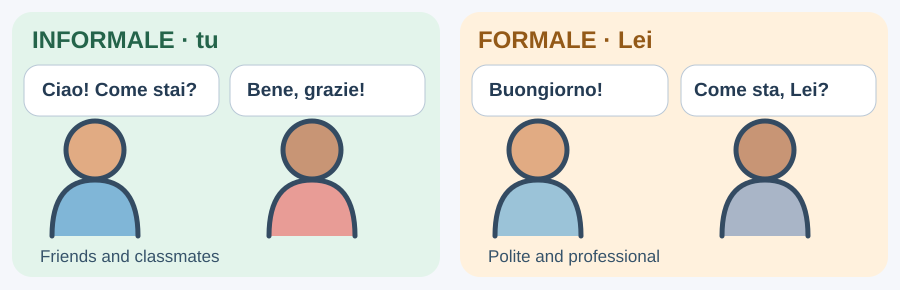
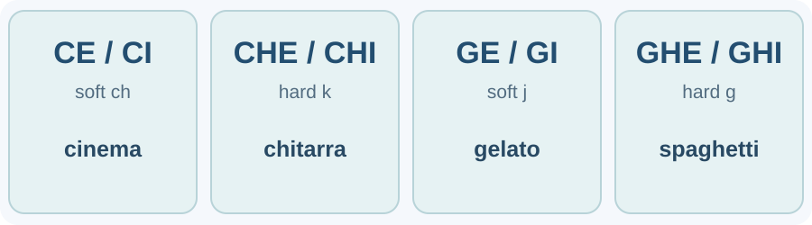

# Lezione 1 — Grammar

[← Overview](lesson.md) · **Grammar** · [Vocabulary →](vocabulary.md) · [Exercises](exercise.md)

*Source alignment:* *Nuovo Espresso 1* pp. 5–13 and 16. The explanations and examples are original.

## 1. Formal and informal Italian: `tu` and `Lei`

| Setting | Greeting | Name question | Origin question |
|---|---|---|---|
| Friends / familiar people | **Ciao!** | **Come ti chiami?** | **Di dove sei?** |
| Polite / professional setting | **Buongiorno!** | **Come si chiama?** | **Di dov'è?** |

- **`tu`** takes second-person singular verbs, e.g. `sei`, `ti chiami`.
- Formal **`Lei`** takes third-person singular verbs, e.g. `è`, `si chiama`.
- `Lei` also means *she* in ordinary Italian. Context tells you the meaning.

**Examples:** *Ciao, Paolo! Come ti chiami?* · *Buongiorno, signora. Di dov'è?* · *Scusi, Lei è italiana?*

**Typical mistake:** ❌ `Lei sei italiana?` → ✅ `Lei è italiana?`

Try: how do you ask a professor's name?

**Come si chiama?** (polite form)

## 2. `Essere`, `avere` and `chiamarsi`

| Person | **essere** (to be) | **avere** (to have) | **chiamarsi** (to be called) |
|---|---|---|---|
| **io** | sono | ho | mi chiamo |
| **tu** | sei | hai | ti chiami |
| **lui / lei / Lei** | è | ha | si chiama |

**Essere:**
- *Sono Laura.* — I'm Laura.
- *Sei di Genova?* — Are you from Genoa?
- *Rosa è italiana.* — Rosa is Italian.

**Avere:**
- *Ho un numero di telefono.* — I have a phone number.
- *Hai una penna?* — Do you have a pen?
- *Lei ha un indirizzo?* — Do you have an address? (formal)

**Chiamarsi:**
- *Mi chiamo Giulia.* — My name is Giulia.
- *Ti chiami Andrea?* — Is your name Andrea?
- *Si chiama Matteo.* — His name is Matteo / your name is Matteo (formal).

**Why the pronouns matter:** `mi`, `ti`, and `si` are essential with `chiamarsi`. “Io chiamo Anna” means “I call Anna”, not “my name is Anna”. Italian often drops `io` or `tu`: `Sono Luca` is natural.

Try: Complete “Io ___ Laura; tu ___ Marco; Lei ___ Rosa.”

**sono**, **sei**, **è**.

## 3. Questions, articles and nationality

| Question / phrase | Meaning | Original example |
|---|---|---|
| **come?** | how? / what? in set phrases | *Come ti chiami?* |
| **di dove?** | where from? | *Di dove sei?* |
| **qual è...?** | which / what is...? | *Qual è il tuo nome?* |
| **il** | the (masculine singular) | *il signore, il numero* |
| **la** | the (feminine singular) | *la signora* |

**Remember:** `qual è` has **no apostrophe**.

| Masculine | Feminine | English |
|---|---|---|
| italiano | italiana | Italian |
| tedesco | tedesca | German |
| spagnolo | spagnola | Spanish |
| francese | francese | French |
| inglese | inglese | English |

- *Marco è italiano, e Lucia è italiana.* — Nationality adjectives usually agree in gender.
- *Sono di Torino.* — I'm from Turin.
- *Di dov'è il professore?* — Where is the professor from?

**Typical mistake:** ❌ `Maria è italiano` → ✅ `Maria è italiana`.

## 4. Communication patterns

- `Buongiorno!` → `Buongiorno!`
- `Come ti chiami?` → `Mi chiamo ...`
- `Di dove sei?` → `Sono di ...`
- `Qual è il tuo numero di telefono?` → `Il mio numero è ...` (use invented numbers).
- `Come si scrive?` → `Si scrive ...`
- `Piacere!` → `Piacere!`
- `Arrivederci!` → `Arrivederci!`

The greeting *buongiorno* is common during the day; *buona sera* in the evening. *Ciao* is informal. *Arrivederci* works as a polite goodbye, and *a presto* means “see you soon”. These are situational defaults, not strict time limits.

## 5. Spelling and pronunciation

The alphabet appears on textbook p. 8; pronunciation and spelling activities appear on pp. 8–9.

| Written pattern | Sound (approximate) | Example |
|---|---|---|
| **c + e/i** | English *ch* | cinema, cena |
| **ch + e/i** | English *k* | chitarra, che |
| **c + a/o/u** | English *k* | cane, cosa |
| **g + e/i** | English *j* | gelato, giornale |
| **gh + e/i** | hard *g* | spaghetti, ghiaccio |
| **g + a/o/u** | hard *g* | gatto, gusto |

**More notes:** the `h` in `ho` is silent, and double consonants are pronounced longer than single consonants. English sound approximations are only guides; native audio is needed for accurate pronunciation practice.

**Useful phrases:** *Come si scrive?* (How do you spell it?) · *Si scrive M-A-R-C-O.* (It's spelled M-A-R-C-O.)

## 6. Numbers 0–20

| Number | Italian | Number | Italian | Number | Italian |
|---:|---|---:|---|---:|---|
| 0 | zero | 7 | sette | 14 | quattordici |
| 1 | uno | 8 | otto | 15 | quindici |
| 2 | due | 9 | nove | 16 | sedici |
| 3 | tre | 10 | dieci | 17 | diciassette |
| 4 | quattro | 11 | undici | 18 | diciotto |
| 5 | cinque | 12 | dodici | 19 | diciannove |
| 6 | sei | 13 | tredici | 20 | venti |

Count forward, backward, and in a random order. For phone practice use **invented digit sequences**, not real contact information.

## 7. Additional insight: first meetings

Textbook p. **16**, the *Caffè culturale* page, presents greetings and farewells as social choices that vary by relationship and context. Practise both formal and informal versions; *buona notte* is usually used at the end of the evening, often before sleep.

## Quick mastery check

Can you make three **independent** sentences using `sono`, `ho`, and `mi chiamo`, then ask the same information formally? Do [the exercise set](exercise.md) to verify rather than just reading.

[← Overview](lesson.md) · [Vocabulary →](vocabulary.md) · [Exercises](exercise.md)
