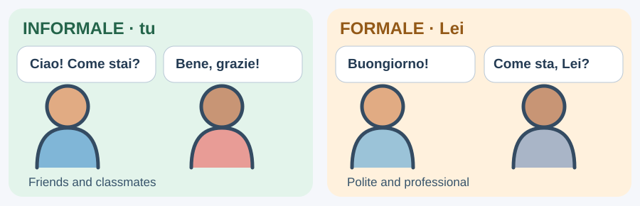

# Lezione 1 — Primi contatti

[← A1 menu](../README.md) · **Overview** · [Grammar](grammar.md) · [Vocabulary](vocabulary.md) · [Exercises](exercise.md)

> **Learning goal:** introduce yourself, greet people, ask names and origins, spell words and exchange simple contact information. This lesson follows the book's communication and grammar sequence with **original** teaching material.

## Your learning journey

| Step | Open | You will learn |
|---|---|---|
| 1 | [**Grammar →**](grammar.md) | `tu / Lei`, `essere`, `avere`, `chiamarsi`, articles, nationality, alphabet and numbers |
| 2 | [**Vocabulary →**](vocabulary.md) | Vocabulary in Italian, English and Persian, pictures, contextual expressions and self-testing |
| 3 | [**Exercises →**](exercise.md) | 30+ varied questions, image-based practice, dialogues, writing and a practical challenge |

## After completing this lesson, you should be able to

- [ ] Select a suitable greeting and say goodbye.
- [ ] Introduce yourself and another fictional person.
- [ ] Ask a name with both informal `tu` and formal `Lei`.
- [ ] Ask and answer `Di dove sei?` or `Di dov'è?`.
- [ ] Recognize the basic masculine/feminine nationality forms and `il`/`la`.
- [ ] Spell a name and distinguish soft/hard C and G combinations.
- [ ] Read and say numbers **0–20**.
- [ ] Ask politely about a phone number or address (without sharing real contact details).

## Detailed textbook map (verified)

| *Nuovo Espresso 1* printed/PDF page | Book activity | Related study |
|---|---|---|
| **5** | *Primi contatti* opening overview | Review the goals above |
| **6** | 1. *Ciao o buongiorno?* | [Formal and informal greetings](grammar.md#1-formal-and-informal-italian-tu-and-lei) |
| **7** | 2. *Scusi, Lei come si chiama?*; 3. *Piacere!* | [Verbs and introductions](grammar.md#2-essere-avere-and-chiamarsi) |
| **8** | 4. *Fare conoscenza*; 5. *L'alfabeto*; 6. *C come ciao* | [Alphabet and sounds](grammar.md#5-spelling-and-pronunciation) |
| **9** | 7. *Come si scrive?* | [Spelling mini-quiz](exercise.md#part-c-spelling-and-numbers) |
| **10** | 8. *E Lei di dov'è?*; 9. *Ricostruisci i dialoghi* | [Question words](grammar.md#3-questions-articles-and-nationality) |
| **11** | 10. *Tu o Lei?*; 11. *Lei è francese?*; 0–20 | [Numbers](grammar.md#6-numbers-0-20) |
| **12** | Contact details and number games | [Contact scenario](exercise.md#part-d-situations-and-dialogues) |
| **13** | *Comunicazione e grammatica* | Recap in [Grammar](grammar.md) |
| **14–15** | *Videocorso 1* | Use the publisher's authorized video, if available |
| **16** | *Caffè culturale*: greetings | Cultural notes in [Grammar](grammar.md) |

**Glossary source:** *Nuovo Espresso 1 Glossario* PDF pp. **1–7**; the heading for Lezione 2 appears toward the end of p. 7.

## Two model conversations (original)

### Meeting a friend

> **Sara:** Ciao! Io mi chiamo Sara. E tu?  
> **Luca:** Mi chiamo Luca. Piacere!  
> **Sara:** Piacere! Di dove sei?  
> **Luca:** Sono di Firenze. E tu?  
> **Sara:** Sono di Pisa. A presto!

### Meeting someone formally

> **Ospite:** Buongiorno, Lei come si chiama?  
> **Signora:** Mi chiamo Rosa Conti. E Lei?  
> **Ospite:** Sono Paolo. Di dov'è?  
> **Signora:** Sono di Bologna. Arrivederci!

**Notice:** `ti chiami` changes to `si chiama`, while `sei` changes to `è`. Formal `Lei` takes third-person singular verbs.

## Practice routine

Read the original book's pages **5–12** with your own copy, study the related files above, and review the summary on page **13**. The book's page **16** adds cultural context. You need authorized publisher media to complete the listening/video tasks as originally intended.

The full uploaded textbook PDF contains **239 pages**. Its main course and revision section run through p. **144**; additional exercises begin at p. **145**. Exercises are a *separate practice component*, not a reason to skip the initial chapter.

**Limits:** these pages cover the book's lesson topics, but do not reproduce the publisher's exercises, illustrations, glossary in full, or recordings. This public repository contains original lessons and visuals only.

**Next → [Grammar](grammar.md)** · [Vocabulary](vocabulary.md) · [Exercises](exercise.md)
