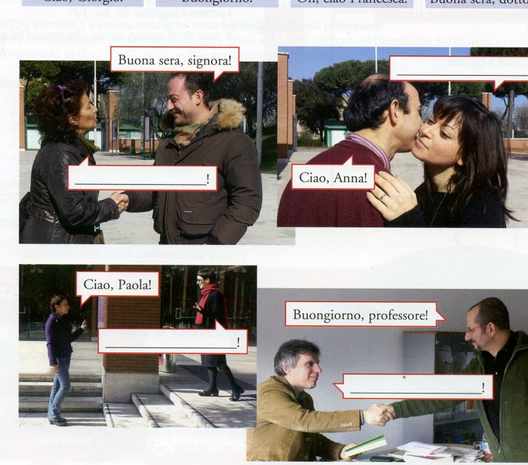
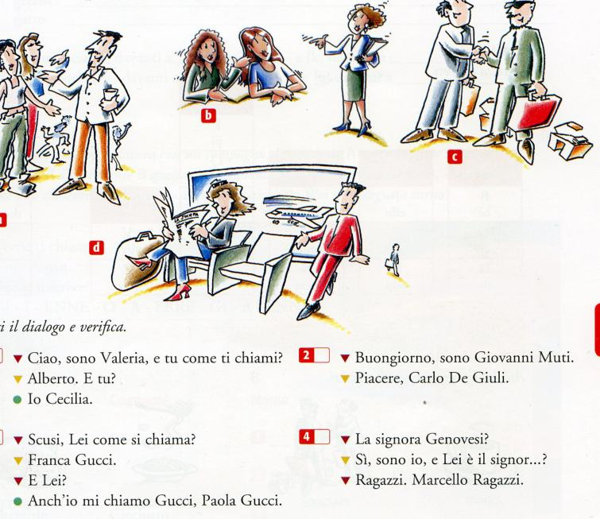

# Lezione 1 — Primi contatti

[← A1 menu](../README.md) · **Conversations & lesson** · [Grammar](grammar.md) · [Vocabulary](vocabulary.md) · [Exercises](exercise.md)

> This is a **conversation-led companion** to *Nuovo Espresso 1* PDF pp. **3–16** (contents p. 3, introduction p. 4, lesson activities pp. 5–16). It follows **every lesson-one conversation activity in order**, with **new original examples**, source page links and explanation. To study the exact publisher dialogues and illustrations, use the uploaded textbook itself; they are not copied into this public repository.

*Real photograph. [Credits](../PHOTO_CREDITS.md).*

## Actual textbook image gallery

These are **focused original crops from the supplied textbook**, not stock-photo substitutions. Use the image together with its original companion exercise in [Exercises](exercise.md). Original publisher rights apply; [image credits](../PHOTO_CREDITS.md).

| Page 6 · Greetings: formal or informal? | Page 7 · Introductions in different settings |
|---|---|
|  |  |

| Page 8 · Actual picture vocabulary | Page 11 · Numbers from the illustrated digits |
|---|---|
|  |  |

## Before Lesson 1 — PDF pages 3–4

- **Page 3 — Indice:** gives the course map, including the first lesson's communication and grammar topics and where other lessons begin.
- **Page 4 — Introduzione:** explains how *Nuovo Espresso 1* is structured and how it combines class activities, extra exercises, culture, video and supplementary materials.

These are **orientation pages**, not additional dialogue exercises. The chapter *Primi contatti* itself starts on **page 5**.

## Learning goals

Greet people, introduce yourself, ask for names and places of origin, distinguish formal **Lei** and informal **tu**, spell names, use nationality adjectives, understand numbers **0–20**, and exchange basic fictional contact information. See [Grammar](grammar.md) and [Vocabulary](vocabulary.md) for detailed learning notes.

## Complete conversation and activity sequence

### 1. Ciao o buongiorno? — book p. 6

**Situation:** Choosing greetings for different people.

**New model conversation** (not the publisher's script):

> A: Ciao, Silvia!  
> B: Ciao, Marco! A domani!  
> A: Buongiorno, professore.  
> B: Buongiorno. Arrivederci!

**What to notice:** Compare informal ciao with polite buongiorno and arrivederci.

**Practice:** Read the book's activity on p. 6; then change the fictional details and recreate the exchange without looking.

### 2. Scusi, Lei come si chiama? — book p. 7

**Situation:** Names and polite introductions.

**New model conversation** (not the publisher's script):

> A: Scusi, Lei come si chiama?  
> B: Mi chiamo Anna Bellini. E Lei?  
> A: Sono Carlo, piacere!  
> B: Piacere!

**What to notice:** Formal Lei uses si chiama, not ti chiami.

**Practice:** Read the book's activity on p. 7; then change the fictional details and recreate the exchange without looking.

### 3. Piacere! — book p. 7

**Situation:** Introducing yourself to a classmate.

**New model conversation** (not the publisher's script):

> A: Ciao! Mi chiamo Eva. E tu?  
> B: Io sono Davide.  
> A: Piacere, Davide!  
> B: Piacere!

**What to notice:** Use mi chiamo and sono to give your name.

**Practice:** Read the book's activity on p. 7; then change the fictional details and recreate the exchange without looking.

### 4. Fare conoscenza — book p. 8

**Situation:** Meeting and choosing informal or formal language.

**New model conversation** (not the publisher's script):

> A: Buongiorno, sono Elena.  
> B: Piacere, mi chiamo Nadia.  
> A: Possiamo darci del tu?  
> B: Certamente, ciao Elena!

**What to notice:** Darsi del tu is an additional useful expression; the book asks learners to act out meetings.

**Practice:** Read the book's activity on p. 8; then change the fictional details and recreate the exchange without looking.

### 5. L'alfabeto / C come ciao — book p. 8

**Situation:** The alphabet and C/G pronunciation.

**New model conversation** (not the publisher's script):

> A: Come si dice questa lettera?  
> B: È la lettera C.  
> A: Come in cinema?  
> B: Sì, ma in chitarra il suono è diverso.

**What to notice:** The illustrations on p. 8 associate pictures with sounds. Use the original book images for its task and our pronunciation chart for extra review.

**Practice:** Read the book's activity on p. 8; then change the fictional details and recreate the exchange without looking.

### 6. Come si scrive? — book p. 9

**Situation:** Spelling first names and surnames.

**New model conversation** (not the publisher's script):

> A: Come ti chiami?  
> B: Mi chiamo Leo.  
> A: Come si scrive?  
> B: L-E-O.  
> A: E il cognome?  
> B: Neri: N-E-R-I.

**What to notice:** The textbook has a pair-work spelling task. Practise with fictional names.

**Practice:** Read the book's activity on p. 9; then change the fictional details and recreate the exchange without looking.

### 7. E Lei di dov'è? — book p. 10

**Situation:** Asking origins and countries.

**New model conversation** (not the publisher's script):

> A: Scusi, Lei è italiana?  
> B: No, sono spagnola.  
> A: Ah, e di dov'è?  
> B: Sono di Valencia.

**What to notice:** Change sei / è according to tu / Lei.

**Practice:** Read the book's activity on p. 10; then change the fictional details and recreate the exchange without looking.

### 8. Ricostruisci i dialoghi — book p. 10

**Situation:** Rebuilding short nationality conversations.

**New model conversation** (not the publisher's script):

> A: Sei tedesca?  
> B: No, sono svizzera.  
> A: Di dov'è il tuo amico?  
> B: È di Berna.

**What to notice:** Put the book's three exchanges in order using p. 10; these are separate new examples.

**Practice:** Read the book's activity on p. 10; then change the fictional details and recreate the exchange without looking.

### 9. Tu o Lei? / Lei è francese? — book p. 11

**Situation:** Recognizing register and nationality.

**New model conversation** (not the publisher's script):

> A: Sei francese?  
> B: No, sono inglese.  
> A: E Lei, signora, di dov'è?  
> C: Sono di Lisbona, sono portoghese.

**What to notice:** The six register questions require publisher audio; do not claim audio answers without hearing it.

**Practice:** Read the book's activity on p. 11; then change the fictional details and recreate the exchange without looking.

### 10. Numeri da zero a venti — book p. 11

**Situation:** Saying and recognizing numbers 0–20.

**New model conversation** (not the publisher's script):

> A: Che numero è questo?  
> B: Diciassette.  
> A: E quello?  
> B: Venti.

**What to notice:** Practise numbers in random order, not just memorized sequence.

**Practice:** Read the book's activity on p. 11; then change the fictional details and recreate the exchange without looking.

### 11. Qual è il Suo numero di telefono? — book p. 12

**Situation:** Address and number exchanges.

**New model conversation** (not the publisher's script):

> A: Qual è il Suo indirizzo?  
> B: Via dei Fiori, numero tre.  
> A: E il cellulare?  
> B: Zero, quattro, uno, due.

**What to notice:** These addresses and digit groups are fictional. Also practise Che numero è? and Primo incontro on p. 12.

**Practice:** Read the book's activity on p. 12; then change the fictional details and recreate the exchange without looking.

### 12. Comunicazione e grammatica — book p. 13

**Situation:** Review of essential grammar and communication.

**New model conversation** (not the publisher's script):

> A: Buongiorno, mi chiamo Tania.  
> B: Piacere, io sono Mauro.  
> A: Di dov'è?  
> B: Sono di Torino. Arrivederci!

**What to notice:** Review essere / avere / chiamarsi, articles il/la, nationality and questions in the book summary.

**Practice:** Read the book's activity on p. 13; then change the fictional details and recreate the exchange without looking.

### 13. Videocorso 1 — book p. 14–15

**Situation:** Video greetings, origins, order of dialogue and phone number.

**New model conversation** (not the publisher's script):

> A: Ciao, sono Irene.  
> B: Piacere! Io mi chiamo Oscar.  
> A: Sei italiano?  
> B: Sì, sono di Napoli.

**What to notice:** This is extra original practice, NOT the video's original dialogue; publisher audio/video is required to answer its specific listening questions.

**Practice:** Read the book's activity on p. 14–15; then change the fictional details and recreate the exchange without looking.

### 14. Caffè culturale — book p. 16

**Situation:** Greetings, farewells, time of day and social gestures.

**New model conversation** (not the publisher's script):

> A: Buona sera, signora.  
> B: Buona sera, a domani!  
> A: Arrivederci!  
> B: Buona notte!

**What to notice:** The book's timeline and pictures show variation by time of day and familiarity. Compare with your own culture.

**Practice:** Read the book's activity on p. 16; then change the fictional details and recreate the exchange without looking.

## Extra practice: change the relationship

**Informal conversation**

> A: Ciao! Come ti chiami?  
> B: Mi chiamo Luca. Di dove sei?  
> A: Sono di Perugia. Piacere!

**Formal version**

> A: Buongiorno! Lei come si chiama?  
> B: Mi chiamo il signor Galli. Di dov'è?  
> A: Sono di Perugia. Piacere!

**Task:** Replace names and origins; identify every verb change between `tu` and `Lei`.

## Book and glossary cross-reference

| Source | What it covers | Pages |
|---|---|---|
| *Nuovo Espresso 1* | Contents and introduction followed by first-contact activities, grammar recap, video and culture | **3–16** (orientation **3–4**; lesson **5–16**) |
| *Nuovo Espresso 1* | Additional exercise section begins | **145**; the supplied PDF contains **150 pages total** |
| *Nuovo Espresso 1 Glossario* | Lezione 1 word list, classroom instructions, cultural expressions | **1–7** (Lezione 2 begins on p. 7) |

**Copyright and completeness:** This file lists and explains all main activity situations from the pages, but does **not** reproduce the original copyrighted dialogues, exercises or screenshots. Original listening/video exercises depend on audio not supplied in this GitHub repo.

**Continue:** [Grammar →](grammar.md) · [Vocabulary and examples →](vocabulary.md) · [Exercises →](exercise.md)
