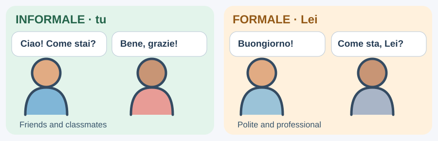
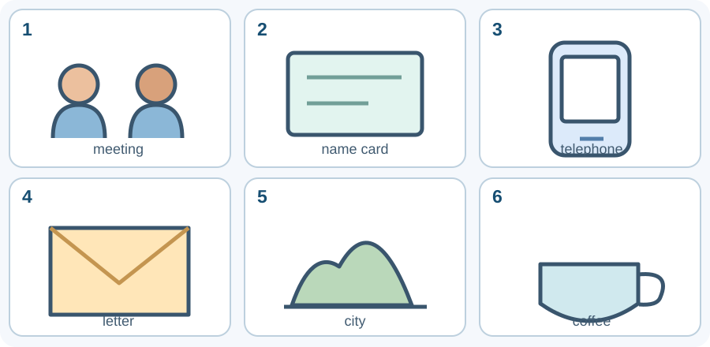
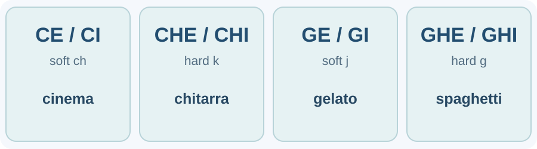
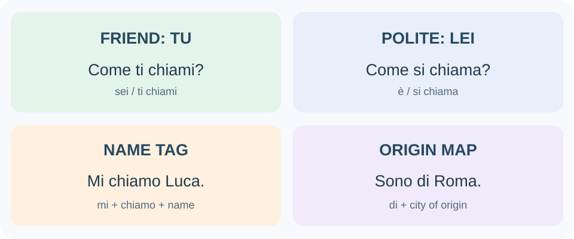

# Lezione 1 — Vocabulary with examples and visual practice

[← Lesson & conversations](lesson.md) · [Grammar](grammar.md) · **Vocabulary** · [Exercises](exercise.md)

> This page draws from the **Lezione 1 section** of *Nuovo Espresso 1 Glossario* (65-page Italian–Persian PDF), pp. **1–7**, checked against the uploaded source. It offers an expanded **selection**, not a reproduction of the complete glossary. English translations, original examples, and new practice tasks are added for self-study. Some sample sentences deliberately preview later grammar.

**How to learn:** Read one group at a time, cover the translation columns, reconstruct five expressions aloud, then use them in original sentences. The [lesson page](lesson.md) contains the full conversation/activity sequence from the main book.

## Contents

1. [1. Greetings, parting and polite expressions](#1-greetings-parting-and-polite-expressions)
2. [2. People, introductions and social language](#2-people-introductions-and-social-language)
3. [3. Pronouns, verbs and questions](#3-pronouns-verbs-and-questions)
4. [4. Countries, languages and nationalities](#4-countries-languages-and-nationalities)
5. [5. Alphabet, reading and classroom actions](#5-alphabet-reading-and-classroom-actions)
6. [6. Contact details and useful everyday words](#6-contact-details-and-useful-everyday-words)
7. [7. Pronunciation-picture words from book p. 8](#7-pronunciationpicture-words-from-book-p-8)

## 1. Greetings, parting and polite expressions

*Glossary pp. 1, 6–7 · book pp. 5–6 and 16*

| Italiano | English | فارسی | Example (original) |
|---|---|---|---|
| ciao | hi / bye (informal) | سلام / خداحافظ | Ciao, Rosa! A domani. |
| buongiorno | good morning / hello | روز بخیر | Buongiorno, professore. |
| buona sera | good evening | عصر بخیر | Buona sera, signora. |
| buona notte | good night | شب بخیر | Buona notte, a domani. |
| salve | hello (neutral) | سلام | Salve, come sta? |
| arrivederci | goodbye (polite) | به امید دیدار | Arrivederci, signora. |
| a presto | see you soon | به زودی می‌بینمت | Ciao, a presto! |
| a domani | see you tomorrow | تا فردا | Arrivederci, a domani! |
| buona giornata | have a good day | روز خوبی داشته باشید | Buona giornata, professore. |
| alla prossima volta | until next time | تا دفعه بعد | A presto, alla prossima volta! |
| piacere | nice to meet you | خوشبختم | Piacere, sono Luca. |
| scusi | excuse me (formal) | ببخشید | Scusi, Lei è di Roma? |

## 2. People, introductions and social language

*Glossary pp. 1–2, 6–7 · book pp. 7–8*

| Italiano | English | فارسی | Example (original) |
|---|---|---|---|
| signore | gentleman / sir | آقا | Il signore si chiama Pietro. |
| signora | lady / madam | خانم | La signora è italiana. |
| professore | professor / teacher | استاد | Buongiorno, professore! |
| persona | person | شخص | Questa persona è di Napoli. |
| gruppo | group | گروه | Il gruppo è qui. |
| nome | first name / name | نام | Qual è il tuo nome? |
| cognome | surname | نام خانوادگی | Il mio cognome è Verdi. |
| chiamarsi | to be called / named | نامیده شدن | Mi chiamo Anna. |
| presentarsi | to introduce oneself | خود را معرفی کردن | È il momento di presentarsi. |
| presentare | to present / introduce | معرفی کردن | Presento una persona. |
| fare conoscenza | to get acquainted | آشنا شدن | Facciamo conoscenza. |
| darsi del tu | to use informal you | تو خطاب کردن | Possiamo darci del tu? |
| darsi del Lei | to use formal you | شما خطاب کردن | In ufficio ci diamo del Lei. |
| amici | friends | دوستان | I miei amici sono qui. |
| parente | relative | فامیل | Un mio parente vive in Italia. |
| abbraccio | hug | بغل | Un abbraccio, a presto! |
| bacio | kiss | بوسه | Un bacio alla mamma. |
| salutare | to greet / say goodbye | سلام / خداحافظی کردن | Saluto il professore. |

## 3. Pronouns, verbs and questions

*Glossary pp. 1–5 · book pp. 5, 7, 10 and 13*

| Italiano | English | فارسی | Example (original) |
|---|---|---|---|
| io | I | من | Io sono Laura. |
| tu | you (informal) | تو | Tu sei di Roma? |
| Lei | you (formal) | شما | Lei come si chiama? |
| essere | to be | بودن | Sono di Milano. |
| sono | I am / they are | هستم | Sono di Firenze. |
| sei | you are (informal) | هستی | Sei inglese? |
| è | he/she/you-formal is | هست | Lei è italiana. |
| avere | to have | داشتن | Ho un indirizzo. |
| chiedere | to ask | پرسیدن | Chiedo un nome. |
| dire | to say | گفتن | Come si dice? |
| come | how | چطور | Come ti chiami? |
| quale | which | کدام | Quale parola? |
| qual è | which/what is | کدام است | Qual è il numero? |
| paese | country | کشور | Di quale paese sei? |
| nazionalità | nationality | ملیت | Qual è la nazionalità? |
| provenienza | origin | زادگاه / اصل | Chiedo la provenienza. |
| quando | when | وقتی که | Quando arriva Marco? |
| numero | number | عدد | Il numero è sette. |

## 4. Countries, languages and nationalities

*Glossary pp. 4–5 · book pp. 10–11*

| Italiano | English | فارسی | Example (original) |
|---|---|---|---|
| italiano / italiana | Italian | ایتالیایی | Marco è italiano; Sara è italiana. |
| inglese | English | انگلیسی | Luca è inglese. |
| irlandese | Irish | ایرلندی | Emma è irlandese. |
| tedesco / tedesca | German | آلمانی | Lena è tedesca. |
| austriaco / austriaca | Austrian | اتریشی | Franz è austriaco. |
| svizzero / svizzera | Swiss | سوئیسی | Nina è svizzera. |
| francese | French | فرانسوی | Marie è francese. |
| spagnolo / spagnola | Spanish | اسپانیایی | Rosa è spagnola. |
| portoghese | Portuguese | پرتغالی | Lui è portoghese. |
| Germania | Germany | آلمان | Berlino è in Germania. |
| Austria | Austria | اتریش | Vienna è in Austria. |
| Svizzera | Switzerland | سوئیس | Berna è in Svizzera. |
| Spagna | Spain | اسپانیا | Madrid è in Spagna. |
| Francia | France | فرانسه | Parigi è in Francia. |
| Inghilterra | England | انگلستان | Londra è in Inghilterra. |
| Irlanda | Ireland | ایرلند | Dublino è in Irlanda. |
| Portogallo | Portugal | پرتغال | Lisbona è in Portogallo. |
| città | city | شهر | Roma è una città. |

## 5. Alphabet, reading and classroom actions

*Glossary pp. 1–6 · book pp. 8–9*

| Italiano | English | فارسی | Example (original) |
|---|---|---|---|
| alfabeto | alphabet | الفبا | L'alfabeto italiano. |
| lettera | letter | حرف | La lettera C. |
| scrivere | to write | نوشتن | Scrivo il nome. |
| leggere | to read | خواندن | Leggo il dialogo. |
| ascoltare | to listen | گوش دادن | Ascolto e ripeto. |
| ripetere | to repeat | تکرار کردن | Ripeto la parola. |
| completare | to complete | کامل کردن | Completo la frase. |
| dialogo | dialogue | گفتگو | Leggiamo un dialogo. |
| abbinare | to match | جور کردن | Abbino le parole. |
| disegno | drawing | نقاشی | Il disegno è semplice. |
| verificare | to check / verify | بررسی کردن | Verifico la risposta. |
| ordinare | to order / arrange | مرتب کردن | Ordino le parole. |
| pronunciare | to pronounce | تلفظ کردن | Pronuncio il nome. |
| suono | sound | صدا | Il suono è diverso. |
| ricostruire | to reconstruct | دوباره ساختن | Ricostruisco il dialogo. |
| frase | sentence | جمله | Scrivo una frase. |
| studente | student | دانشجو / دانش‌آموز | Lo studente ascolta. |
| compagno | classmate | هم‌کلاسی | Il compagno ripete. |
| modello | model | نمونه | Seguo il modello. |
| esercizio | exercise | تمرین | Faccio un esercizio. |

## 6. Contact details and useful everyday words

*Glossary pp. 4–6 · book pp. 11–12*

| Italiano | English | فارسی | Example (original) |
|---|---|---|---|
| indirizzo | address | آدرس | L'indirizzo è inventato. |
| cellulare | mobile phone | موبایل | Ho un cellulare. |
| numero di telefono | phone number | شماره تلفن | Qual è il numero di telefono? |
| foglio | sheet of paper | برگه | Scrivo su un foglio. |
| domanda | question | سؤال | Faccio una domanda. |
| risultato | result | نتیجه | Confronto il risultato. |
| confrontare | to compare | مقایسه کردن | Confronto due risposte. |
| conoscere | to know / meet | شناختن | Conosco Anna. |
| immaginario | imaginary / fictional | خیالی | Uso un nome immaginario. |
| a sinistra | on the left | سمت چپ | Il numero è a sinistra. |
| a destra | on the right | سمت راست | Il nome è a destra. |
| a turno | in turns | به نوبت | Parliamo a turno. |

## 7. Pronunciation-picture words from book p. 8

*Book p. 8; corresponding glossary entries p. 3*

| Italiano | English | فارسی | Example (original) |
|---|---|---|---|
| caffè | coffee | قهوه | Il caffè è buono. |
| gatto | cat | گربه | Il gatto è qui. |
| cinema | cinema | سینما | Il cinema è vicino. |
| chitarra | guitar | گیتار | Ho una chitarra. |
| gelato | ice cream | بستنی | Il gelato è buono. |
| giornale | newspaper | روزنامه | Leggo il giornale. |
| formaggio | cheese | پنیر | Mi piace il formaggio. |
| cane | dog | سگ | Il cane è qui. |
| zucchero | sugar | شکر | Lo zucchero è bianco. |
| medico | doctor | پزشک | Il medico è italiano. |

## Illustrated vocabulary: picture-to-word

Match pictures **1–6** to this unordered word list:

- `il telefono` — telephone
- `la lettera` — letter
- `fare conoscenza` — getting acquainted
- `la città` — city
- `il caffè` — coffee
- `il nome` — name

Reveal picture key

**1** fare conoscenza; **2** il nome; **3** il telefono; **4** la lettera; **5** la città; **6** il caffè.

**Next:** Make an original sentence about each image. For example, for picture 1: *Due persone si salutano.* For picture 3: *Ho un telefono.*

## Pronunciation picture drill

Read these aloud: **cinema**, **chitarra**, **gelato**, **spaghetti**. Explain why C and G sound different. Check the [grammar explanation](grammar.md#5-spelling-and-pronunciation).

Reveal sound clues

C before E/I is typically soft; CH before E/I is hard. G before E/I is typically soft; GH before E/I is hard.

## Vocabulary exercise 1 — Which phrase fits?

1. You greet a professor in the morning: `ciao` or `buongiorno`?
2. You politely interrupt someone: `scusi` or `piacere`?
3. You see a friend tomorrow: `a domani` or `buona notte`?
4. You ask a name formally: `Come ti chiami?` or `Come si chiama?`?
5. You ask someone's country of origin: `Di dove sei?` or `Come ti chiami?`?

Reveal exercise 1 answers

1 **buongiorno**; 2 **scusi**; 3 **a domani**; 4 **Come si chiama?**; 5 **Di dove sei?**

## Vocabulary exercise 2 — Recover Italian from English

Translate each into Italian without looking above:

1. surname
2. to pronounce
3. address
4. to match
5. nationality
6. to repeat
7. goodbye (polite)
8. Switzerland
9. a sheet of paper
10. to get acquainted

Reveal exercise 2 answers

1 **cognome**; 2 **pronunciare**; 3 **indirizzo**; 4 **abbinare**; 5 **nazionalità**; 6 **ripetere**; 7 **arrivederci**; 8 **Svizzera**; 9 **foglio**; 10 **fare conoscenza**.

## Vocabulary exercise 3 — Make chunks

Reorder the words.

1. `chiami / ti / come`
2. `di / sei / dove`
3. `si / Lei / come / chiama`
4. `telefono / numero / il / di`
5. `sono / Firenze / di`

Reveal exercise 3 answers

1 **Come ti chiami?**; 2 **Di dove sei?**; 3 **Lei come si chiama?**; 4 **il numero di telefono**; 5 **Sono di Firenze.**

## Vocabulary exercise 4 — Nationality pairs

Give the feminine form:

1. `italiano`
2. `tedesco`
3. `spagnolo`
4. `svizzero`
5. `francese`

Reveal exercise 4 answers

1 **italiana**; 2 **tedesca**; 3 **spagnola**; 4 **svizzera**; 5 **francese** (unchanged).

## Vocabulary exercise 5 — Read and respond

**Original mini-reading:**

> Buongiorno! Sono Sara, sono di Napoli. Questa è una mia amica, Claire. Claire è francese, di Lione. Io parlo italiano; Claire parla italiano e francese. Oggi facciamo conoscenza con due studenti.

Questions:

1. Who comes from Naples?
2. Who is French?
3. What does `facciamo conoscenza` mean?
4. Which word means “students”?

Reveal reading answers

1 **Sara**. 2 **Claire**. 3 **We get acquainted / meet people**. 4 **studenti** (plural of `studente`).

## Remember the vocabulary: picture → phrase → sentence → conversation

**Rule of thumb:** A word becomes usable when you can recognize it, **retrieve it without looking**, and put it into a meaningful Italian sentence. Read the glossary for meaning, but do not stop at translation.

### Visual memory hooks

| Picture in your mind | Word or chunk | Make the connection | Your own Italian sentence |
|---|---|---|---|
| 🤝 Two people meeting | `piacere` | A first meeting | `Piacere, sono Eva.` |
| 🏷️ A name label | `mi chiamo` | A name attached to a person | `Mi chiamo Luca.` |
| 🪪 An ID card | `nome / cognome` | First-name field / surname field | `Il mio cognome è Rossi.` |
| 📱 A phone | `cellulare / numero` | Ask for a made-up number | `Qual è il numero?` |
| ✉️ An address card | `indirizzo` | Where a letter goes | `Questo è un indirizzo inventato.` |
| 🌍 A map | `di dove` | Origin, not current location | `Di dove sei? Sono di Pisa.` |

**Be careful:** pictures help you remember the *meaning*, but **they don't teach article gender automatically**. Say `il nome`, `il cognome`, `il numero`, but `la lettera` and `la signora` aloud as full chunks.

### Bridge to English, with a warning

| Italian | Helpful English connection | Don't confuse it with... |
|---|---|---|
| `presentarsi` | *present / introduce oneself* | English *to present* often needs an object; Italian `presentarsi` can mean introduce yourself |
| `informale / formale` | *informal / formal* | English has only one common `you`, unlike `tu / Lei` |
| `nazionalità` | *nationality* | Nationality adjectives may change ending with gender |
| `numero` | *number* (similar meaning, different spelling) | Don't pronounce it as English *number* |
| `come` | *how* in `Come ti chiami?` | English *come* means “arrive”; **Italian `come` is a false friend** |

English is a **meaning bridge**, not a word-for-word sentence-building formula. Notice Italian chunks first.

### Shadowing ladder — greetings (original lines)

**Without an Italian recording**, this is **repeat-aloud / rhythm practice**, *not* strict audio shadowing. For true shadowing, use an authorized recording with natural Italian speech: listen, then speak almost simultaneously, imitating rhythm and stress.

| Round | Say aloud | Change one detail |
|---|---|---|
| 1 · Chunk | `Buongiorno!` | `Ciao!` |
| 2 · Question | `Come ti chiami?` | `Come si chiama?` |
| 3 · Answer | `Mi chiamo Rosa.` | `Mi chiamo Pietro.` |
| 4 · Exchange | `Buongiorno! Come si chiama? — Mi chiamo Anna. Piacere!` | Make it informal |
| 5 · No text | Close this page | Introduce two fictional people |

**Technique:** Listen (if audio is available) → repeat slowly → repeat at natural speed → say from memory → make a new sentence. Focus on *clear rhythm and intelligibility*, not speed.

### Picture recall: three passes

Use the [six original illustrated pictures](#illustrated-vocabulary-picture-to-word). On the first pass, **name** the picture. On the second, say **one sentence**. On the third, ask **one question** involving it.

Example, phone picture: `telefono` → `Ho un telefono.` → `Hai un telefono?`

Reveal two other model chains

**Name card:** `nome` → `Il mio nome è Sofia.` → `Qual è il tuo nome?`  
**Coffee:** `caffè` → `Questo è un caffè.` → `È un caffè?`

### Recall test — remove the English

Say the Italian expression for these concepts **without reading the tables**: *nice to meet you*, *formal excuse me*, *your surname*, *where from*, *say goodbye politely*, *spell a name*.

Reveal possible answers

`Piacere!`; `Scusi`; `il cognome`; `Di dove?`; `Arrivederci!`; `Come si scrive?`.

### Spaced retrieval — not just re-reading

Practise immediately, then try again **tomorrow**, after **three days**, and after **a week**. Each time begin with picture-to-Italian recall and an **original sentence**, and only then reveal the word list. Revisit errors sooner; adjust the timing as necessary.

## Practice with the main book

- For greetings and introductions, review book **pp. 6–7**.
- For alphabet/sounds and spelled names, book **pp. 8–9**.
- For country/nationality expressions, book **pp. 10–11**.
- For numbers and contact details, book **pp. 11–12**.
- For culture and leave-taking, book **p. 16**.

**Review strategy:** Revisit difficult words after 1, 3 and 7 days; adjust based on actual recall. Personal answers and progress belong in private notes, not this public repository.

[← Lesson page](lesson.md) · [Grammar](grammar.md) · [Exercises →](exercise.md)
