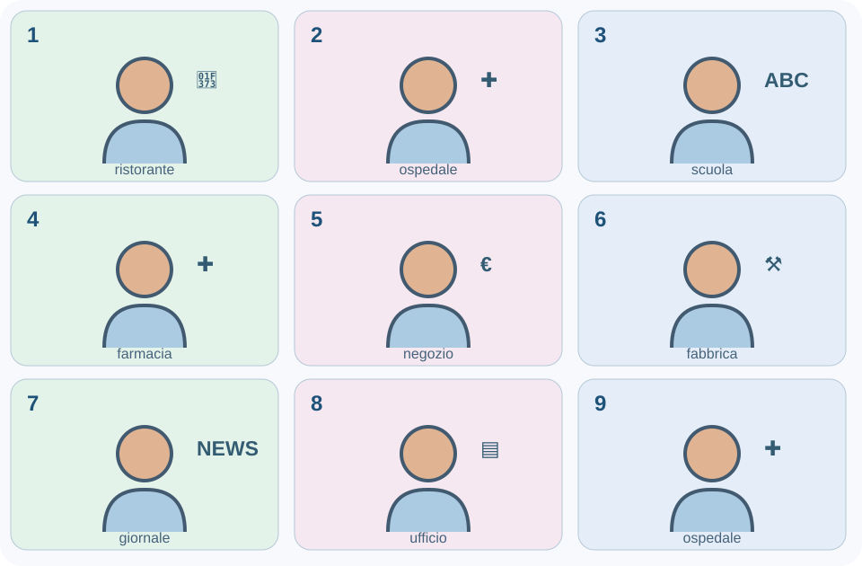
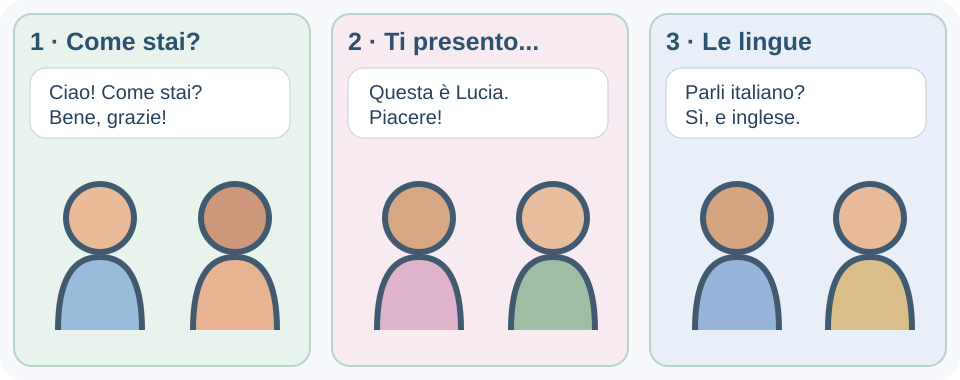
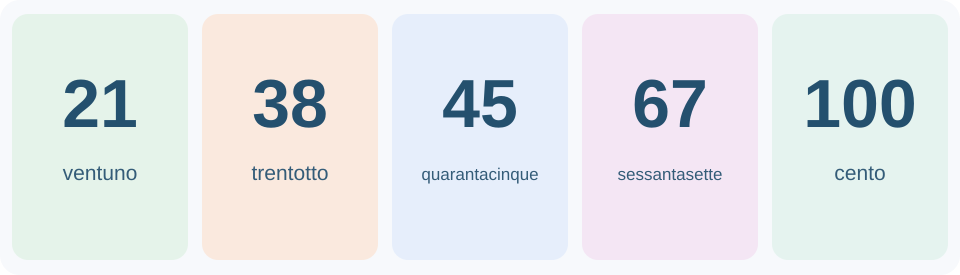

# Lezione 2 — Exercise workbook and review game

[← Lesson & conversations](lesson.md) · [Grammar](grammar.md) · [Vocabulary](vocabulary.md) · **Exercises**

> **Source alignment:** `Nuovo_Espresso_1.pdf`, pp. **17–32**; activities on pp. 18–26, summary p. 27, video/culture pp. 28–29, and **Facciamo il punto 1** pp. 30–32. The tasks here are new originals, not reproductions of publisher exercises or the answer keys. Expand answers only after trying.

## Suggested study routine

1. Solve Part A without looking back.
2. Work through Parts B–E using [grammar](grammar.md) and [vocabulary](vocabulary.md) only after a first independent attempt.
3. Complete visual matching and the reading task.
4. Try the interactive-style revision board with a classmate.
5. Finish the written/speaking challenge and self-evaluation.

## Part A — Greetings and introductions

**1.** Your friend says “Come stai?” Reply that you're very well.

Reveal answer

**Benissimo, grazie!**

**2.** Address a professor politely: “How are you?”

Reveal answer

**Come sta?**

**3.** Which phrase responds sympathetically to “Oggi sto male”?

Reveal answer

**Mi dispiace!**

**4.** Make “Questo è Marco” feminine with the name Rosa.

Reveal answer

**Questa è Rosa.**

**5.** Choose the feminine form: molto lieto / molto lieta (female speaker).

Reveal answer

**molto lieta**

**6.** Change the phrase to formal: “Come stai?”

Reveal answer

**Come sta?**

**7.** Introduce an imaginary male friend using `questo`.

Reveal answer

**Questo è Pietro, un mio amico. (example)**

## Part B — Regular verbs and irregular verbs

**8.** Io ___ inglese. (parlare)

Reveal answer

**parlo**

**9.** Noi ___ a Firenze. (abitare)

Reveal answer

**abitiamo**

**10.** Voi ___ in una scuola. (lavorare)

Reveal answer

**lavorate**

**11.** Tu ___ bene oggi? (stare)

Reveal answer

**stai**

**12.** Loro ___ italiani. (essere)

Reveal answer

**sono**

**13.** Io ___ il medico. (fare)

Reveal answer

**faccio**

**14.** Lei ___ vent'anni? (avere)

Reveal answer

**ha**

**15.** Noi ___ insegnanti. (essere)

Reveal answer

**siamo**

**16.** Loro ___ un lavoro. (avere)

Reveal answer

**hanno**

**17.** Rewrite as negative: “Parlo russo”.

Reveal answer

**Non parlo russo.**

**18.** Correct the error: “Io parlare francese”.

Reveal answer

**Io parlo francese.**

## Part C — Articles, gender and origin

**19.** Choose: ___ studente (un / uno)

Reveal answer

**uno studente**

**20.** Choose: ___ amica (un / un')

Reveal answer

**un'amica**

**21.** Choose: ___ avvocato (un / un')

Reveal answer

**un avvocato**

**22.** Choose: ___ giornalista (una / uno) for a woman

Reveal answer

**una giornalista**

**23.** Add definite article: ___ farmacista (male)

Reveal answer

**il farmacista**

**24.** Complete: Abito ___ Milano.

Reveal answer

**a**

**25.** Complete: Sono ___ Genova.

Reveal answer

**di**

**26.** Complete: Lavoro ___ una farmacia.

Reveal answer

**in**

**27.** Complete: ___ anni hai?

Reveal answer

**Quanti**

**28.** Correct the error: “un'amico”.

Reveal answer

**un amico**

## Part D — Work and languages

**29.** You work as a cook: “I am a cook” in Italian.

Reveal answer

**Sono cuoco / Sono cuoca.**

**30.** Ask informally: “What work do you do?”

Reveal answer

**Che lavoro fai?**

**31.** Ask informally: “Where do you work?”

Reveal answer

**Dove lavori?**

**32.** Say: “She works in a shop.”

Reveal answer

**Lei lavora in un negozio.**

**33.** Say: “I speak Italian but not German.”

Reveal answer

**Parlo italiano ma non parlo tedesco.**

**34.** Where does `un farmacista` work?

Reveal answer

**In una farmacia.**

**35.** Where does `un infermiere` work?

Reveal answer

**In un ospedale.**

**36.** Say: “My female friend is Spanish.”

Reveal answer

**La mia amica è spagnola.**

**37.** Ask: “Which languages do you speak?”

Reveal answer

**Che lingue parli?**

## Part E — Ages and numbers

**38.** Write 21 in words.

Reveal answer

**ventuno**

**39.** Write 28 in words.

Reveal answer

**ventotto**

**40.** Write 38 in words.

Reveal answer

**trentotto**

**41.** Write 45 in words.

Reveal answer

**quarantacinque**

**42.** Write 67 in words.

Reveal answer

**sessantasette**

**43.** Write 93 in words.

Reveal answer

**novantatré**

**44.** Write 100 in words.

Reveal answer

**cento**

**45.** Complete: Io ___ venticinque anni.

Reveal answer

**ho**

**46.** Correct the error: “Sono trenta anni”.

Reveal answer

**Ho trent'anni. / Ho trenta anni.**

**47.** What is `quarantadue` as a numeral?

Reveal answer

**42**

**48.** Translate: “She works in a pharmacy, but I work in a school.”

Reveal answer

**Lei lavora in una farmacia, ma io lavoro in una scuola.**

**49.** You meet someone politely. Ask their name and where they live, using formal `Lei`.

One possible answer

**Come si chiama? Dove abita?**

## Part F — Visual profession matching

**50.** Match cards 1–9 with this unordered list: `operaio, cuoco, impiegato, farmacista, insegnante, infermiere, giornalista, commesso, medico`.

Reveal card key

1 **cuoco** · 2 **medico** · 3 **insegnante** · 4 **farmacista** · 5 **commesso** · 6 **operaio** · 7 **giornalista** · 8 **impiegato** · 9 **infermiere**.

**51.** Choose any four cards. For each, write a sentence using either `Lavora in …` or `Fa il/la …`.

Sample answers

`Il cuoco lavora in un ristorante.` · `Il farmacista lavora in una farmacia.` · `L'impiegata lavora in un ufficio.` · `L'insegnante lavora in una scuola.`

## Part G — Reading practice: fictional online posts

These short readings are **original** and follow the source's social-post theme (p. 24).

### Post 1

> Ciao! Sono Martina, ho ventinove anni e sono di Genova. Abito a Parma, dove lavoro in una libreria. Parlo italiano e inglese. Cerco qualcuno per parlare francese.

**52.** How old is Martina?  
**53.** Where is she from, and where does she live?  
**54.** Which language is she looking to practise?

Reveal answers 52–54

**29; Genova / Parma; French.**

### Post 2

> Buongiorno. Mi chiamo Eric, sono francese e studio italiano. Cerco una stanza a Bologna. Parlo francese, tedesco e un po' di italiano. Preferisco una stanza vicino alla scuola.

**55.** Which city does Eric mention?  
**56.** Which languages does he speak?  
**57.** What is he looking for?

Reveal answers 55–57

**Bologna; French, German and some Italian; a room near his school.**

**58.** Write your own 35–50-word **fictional social post**, using `sono`, `abito`, `parlo`, `cerco`. Don't publish real names, addresses, school/work details or phone numbers.

## Part H — Speaking and conversation missions

**59.** Picture 1: have two friends greet each other, ask how they feel and respond differently.

**60.** Picture 2: introduce a fictional male friend and female friend. Use `questo` and `questa`.

**61.** Picture 3: ask a partner which languages they speak. Reply with one positive and one negative sentence.

**62.** Play `Indovina il lavoro`: one person describes a workplace without naming the job; the other guesses.

**63.** Conduct a five-question interview: `Come ti chiami?`, `Di dove sei?`, `Dove abiti?`, `Che lavoro fai?`, `Dove lavori?`.

**64.** Say your age in Italian using `ho`, or use a fictional age if you prefer. Ask about another person's age.

## Part I — Number and age game

**65.** Hide the word labels and read the five printed numerals aloud. Then say these original extra numbers: 22, 31, 48, 56, 99.

Reveal answers for 65

**ventuno; trentotto; quarantacinque; sessantasette; cento**. Extra: **ventidue; trentuno; quarantotto; cinquantasei; novantanove**.

## Part J — Mixed checkpoint: `Facciamo il punto 1` (pp. 30–32)

The original source contains a large **illustrated board game** on pp. 30–31 that covers **Lessons 1 and 2 together**. Use the board in your own copy of the book. Below is an additional original, printable/chat-friendly revision round.

| Card | Mission |
|---|---|
| 🎯 1 | Introduce a fictional visitor politely. |
| 🎯 2 | Say 3 greetings and 3 farewells. |
| 🎯 3 | Conjugate `essere` for `io / tu / Lei / noi`. |
| 🎯 4 | Say 3 jobs and their workplaces. |
| 🎯 5 | Ask a person about their languages and make a negative sentence. |
| 🎯 6 | Write 47, 61, 83 and 100 in Italian. |
| 🎯 7 | Ask where a person lives and where they work. |
| 🎯 8 | Introduce a male friend and female friend using the correct articles. |
| 🎯 9 | Ask someone's age and respond with an invented age. |
| 🎯 10 | Write a three-line fictional profile of an imaginary student. |

**Scoring idea:** award one point for each independently correct card. This is an **optional self-study game**, not the book's official marking scheme or a certification score.

Sample answer key for structured cards

Card 3: **sono, sei, è, siamo**.  
Card 6: **quarantasette, sessantuno, ottantatré, cento**.  
For other cards, many original answers are possible. Use the grammar reference to check them.

### `Bilancio` — self-assessment (p. 32)

Reflect privately on your ability to:

- [ ] Say your name, origin and profession.
- [ ] Greet someone and ask how they are.
- [ ] Introduce someone else.
- [ ] Have a short conversation.
- [ ] Describe your language abilities.
- [ ] Thank someone and choose polite language.
- [ ] Use the lesson's core grammar and vocabulary independently.

### `Progetto` — imaginary class group (p. 32)

Create an **original, fictional** class introduction in Italian: write 5–7 lines about imaginary classmates, the languages they speak and what they study. The source proposes a social-network class project, but do **not** upload real classmates' names, photos, contact information or individual learning information to this public repository.

## Listening and video boundary

The published book contains listening exercises (including the conversation on p. 25 and number recognition on p. 26) and video questions on pp. 28–29. This repository does **not** include publisher audio or video. Do not invent comprehension scores or original-book answer keys without the authorized media.

[← Lesson](lesson.md) · [Grammar](grammar.md) · [Vocabulary](vocabulary.md)
