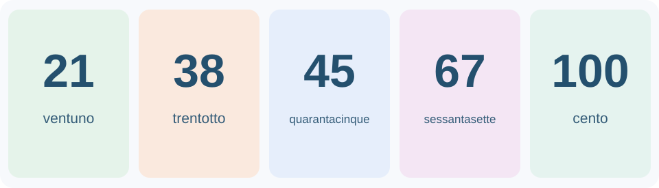
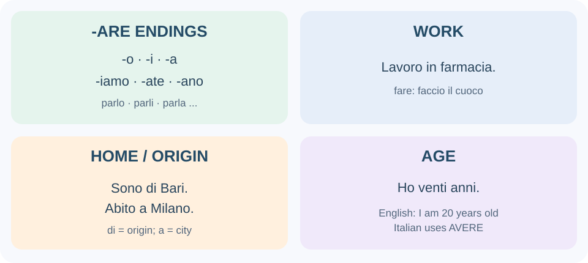

# Lezione 2 — Grammar, structures and examples

[← Lesson & conversations](lesson.md) · **Grammar** · [Vocabulary](vocabulary.md) · [Exercises](exercise.md)

> Grammar follows the **source overview on p. 17 and the consolidated reference on p. 27 of `Nuovo_Espresso_1.pdf`**. Rules, charts, error explanations and examples below are newly written teaching material.

## 1. `Come stai?` and `Come sta?`

| Informal | Formal | Reply |
|---|---|---|
| Come **stai**? | Come **sta**? | Bene, grazie. / Benissimo! |
| Come **va**? | Come **va**? | Non c'è male. / Così così. |
| Come **stai oggi**? | Come **sta oggi**? | Oggi sto male. |

`Mi dispiace` is a sympathetic response to bad news. Choose the form depending on the **person you address**, not the speaker's gender.

**Examples:** `Come stai, Sara?` · `Come sta, signore?` · `Oh, mi dispiace!`

Mini-check: ask a professor how they are

**Come sta?**

## 2. Regular present tense: `-are`

Remove `-are` and add the appropriate endings.

| Subject | parlare | lavorare | abitare |
|---|---|---|---|
| io | parlo | lavoro | abito |
| tu | parli | lavori | abiti |
| lui / lei / Lei | parla | lavora | abita |
| noi | parliamo | lavoriamo | abitiamo |
| voi | parlate | lavorate | abitate |
| loro | parlano | lavorano | abitano |

**Examples**

- `Parlo italiano e portoghese.` — I speak Italian and Portuguese.
- `Dove lavori?` — Where do you work?
- `Abitiamo a Pisa.` — We live in Pisa.
- `Il mio amico parla russo.` — My friend speaks Russian.
- `I miei amici lavorano a scuola.` — My friends work at a school.

**Common mistake:** ❌ `Io parlare italiano` → ✅ `Io parlo italiano`.

Mini-check: Noi ___ spagnolo. (parlare)

**parliamo**

## 3. Common verbs: `essere`, `avere`, `fare`, `stare`

| Subject | essere | avere | fare | stare |
|---|---|---|---|---|
| io | sono | ho | faccio | sto |
| tu | sei | hai | fai | stai |
| lui / lei / Lei | è | ha | fa | sta |
| noi | siamo | abbiamo | facciamo | stiamo |
| voi | siete | avete | fate | state |
| loro | sono | hanno | fanno | stanno |

**Use each in a real situation:**

- **essere:** `Sono portoghese.` / `La dottoressa è italiana.`
- **avere:** `Ho ventisei anni.` / `Abbiamo due libri.`
- **fare:** `Faccio la giornalista.` / `Che lavoro fate?`
- **stare:** `Sto bene, grazie.` / `Come stanno i tuoi amici?`

**Common mistake:** ❌ `Sono ventidue anni` → ✅ `Ho ventidue anni`.

Mini-check: She is a teacher; how do you say “She is fine”?

**Lei sta bene.**

## 4. Negative sentences with `non`

Put **non immediately before the conjugated verb**.

| Affirmative | Negative |
|---|---|
| `Parlo tedesco.` | `Non parlo tedesco.` |
| `Sono medico.` | `Non sono medico.` |
| `Abitiamo a Roma.` | `Non abitiamo a Roma.` |
| `Hai una macchina.` | `Non hai una macchina.` |

Answers to yes/no questions often start with `sì` or `no`: `Parli russo?` — `No, non parlo russo.`

**Common mistake:** ❌ `Parlo non francese` → ✅ `Non parlo francese`.

## 5. `Questo / questa` and introducing other people

`Questo` refers to a masculine singular noun/person, `questa` to a feminine singular noun/person.

- `Questo è Marco, un mio amico.`
- `Questa è Silvia, una mia amica.`
- `Questo è un avvocato.`
- `Questa è una farmacista.`

The `mio/mia` forms are useful here but are treated fully later; the goal now is to introduce people without confusing `questo` and `questa`.

## 6. Articles and singular noun gender

### Definite articles (the)

| Context | Masculine | Feminine |
|---|---|---|
| Before most consonants | **il** medico | **la** giornalista |
| Before s + consonant, z | **lo** studente | **la** studentessa |
| Before vowels | **l'** avvocato | **l'** amica |

### Indefinite articles (a/an)

| Context | Masculine | Feminine |
|---|---|---|
| Before most consonants | **un** medico | **una** giornalista |
| Before s + consonant, z | **uno** studente | **una** studentessa |
| Before vowels | **un** avvocato | **un'** amica |

**Important:** masculine **un** has **no apostrophe**, but feminine **un'** does before a vowel.

**Examples:** `un insegnante`, `un'amica`, `uno studente`, `una scuola`, `un negozio`.

**Common mistake:** ❌ `un'amico` → ✅ `un amico`.

The source p. 27 also introduces the idea that singular nouns have a grammatical gender. Often `-o` is masculine and `-a` feminine, but there are exceptions; don't guess gender from the last letter alone (e.g., `il ristorante`, `la farmacia`).

Mini-check: add an article to studente, amica, insegnante

**uno studente; un'amica; un insegnante.**

## 7. Place prepositions and question words

| Question | Example answer | Rule |
|---|---|---|
| **Di dove sei?** | `Sono di Napoli.` | di + city of origin |
| **Dove abiti?** | `Abito a Milano.` | a + city |
| **Dove lavori?** | `Lavoro in un ufficio.` | in + workplace |
| **Che lavoro fai?** | `Faccio la segretaria.` | che + noun |
| **Chi è?** | `È un mio amico.` | who |
| **Che lingue parli?** | `Parlo italiano e inglese.` | what languages |
| **Quanti anni hai?** | `Ho ventiquattro anni.` | how many |

The book also contrasts **in + country** (`abito in Italia`) with **a + city** (`abito a Roma`), and **in** with occupational locations (`lavoro in farmacia`, `in un ufficio`). These are **useful defaults**, not every rule about Italian prepositions.

## 8. Numbers from 20 to 100 and ages

| Number | Italian | Number | Italian |
|---:|---|---:|---|
| 20 | venti | 60 | sessanta |
| 21 | ventuno | 67 | sessantasette |
| 22 | ventidue | 70 | settanta |
| 23 | ventitré | 77 | settantasette |
| 28 | ventotto | 80 | ottanta |
| 29 | ventinove | 81 | ottantuno |
| 30 | trenta | 90 | novanta |
| 31 | trentuno | 93 | novantatré |
| 38 | trentotto | 99 | novantanove |
| 40 | quaranta | 100 | cento |
| 45 | quarantacinque | 50 | cinquanta |

Build most numbers by joining the tens with the ones. Before **uno** and **otto**, the final vowel of the tens usually drops: `venti+uno → ventuno`; `trenta+otto → trentotto`. Numbers ending in `tré` take an acute accent, e.g., `ventitré`.

### Age

- `Quanti anni hai?` — How old are you?
- `Ho ventotto anni.` — I am 28 years old.
- `Quanti anni ha Sua figlia?` — How old is your daughter? (polite)
- `Ha tre anni.` — She is three years old.

**Not** `Sono ventotto anni` in Italian. Use `avere`.

## 9. The communication framework on book p. 27

For a typical first conversation, this sequence covers most communicative tasks:

1. `Buongiorno! Come sta?`
2. `Bene, grazie. E Lei?`
3. `Questo è il mio amico.`
4. `Che lingue parlate?`
5. `Che lavoro fate?`
6. `Dove abitate e dove lavorate?`
7. `Quanti anni avete?`

Answer with **complete original sentences**, not isolated vocabulary.

## Remember it: visual patterns and English comparisons

These techniques are **extra learning aids**. The grammar rules themselves are in the preceding sections and in the source book's summary on p. 27.

### 1. Remember `-are` as an ending staircase

Picture the endings in order: **-o, -i, -a, -iamo, -ate, -ano**.

| Who? | parlare | Memory cue |
|---|---|---|
| io | parl**o** | one speaker |
| tu | parl**i** | one friend |
| lui / lei / Lei | parl**a** | third-person / polite Lei |
| noi | parl**iamo** | our group |
| voi | parl**ate** | your group |
| loro | parl**ano** | their group |

**English bridge:** English usually changes only the third-person singular verb (*I speak / she speaks*). Italian changes the present-tense ending much more, and you can often omit the subject pronoun.

**Recall:** Turn `Io parlo italiano` into `noi`, then `loro`, without referring to the table.

Reveal answers

`Noi parliamo italiano.` · `Loro parlano italiano.`

### 2. Four mental pictures for four irregular verbs

- 🪪 **essere = identity:** `Sono un medico.` (*I am a doctor.*)
- 🎒 **avere = have:** `Ho una penna.` (*I have a pen.*)
- 🛠️ **fare = do / make:** `Faccio il cuoco.` (*I work as a cook.*)
- 🙂 **stare = state / feeling:** `Sto bene.` (*I'm well.*)

**Important:** `stare` does **not** universally replace English “to be”; `essere` and `stare` have different uses. The picture is just a starting association.

### 3. An age badge fixes a common English-to-Italian error

English says **“I am 24 years old.”** Italian says **`Ho ventiquattro anni.`** — literally *I have 24 years*.

Imagine an ID badge carrying a number **inside your bag** (the `avere` picture). Say `Ho ... anni` as one memorized pattern.

**Do not translate word by word:** ❌ `Sono ventiquattro anni.` ✅ `Ho ventiquattro anni.`

### 4. Articles: picture the word's opening sound

Imagine each noun has a doorway. For masculine nouns: `un medico`, but `uno studente`; for feminine vowel-initial nouns, `un'amica`. The apostrophe belongs to **un' (feminine)**, not masculine `un`.

Look at the noun's **initial sound**, not just the job or person in the picture.

Hide the table: complete `___ studente`, `___ amica`, `___ avvocato`.

`uno studente`; `un'amica`; `un avvocato`.

### 5. Compare English questions without importing English word order

| English | Italian | Notice |
|---|---|---|
| Where **do** you live? | `Dove abiti?` | No separate auxiliary **do** |
| What languages **do** you speak? | `Che lingue parli?` | Conjugated Italian verb |
| How old **are** you? | `Quanti anni hai?` | Literally “How many years do you have?” |
| What **do** you do? | `Che lavoro fai?` | `fare` conjugates to `fai` |

**Do not create mixed-language sentences** such as `Dove do you abiti?`. Use English only to understand the *meaning* and compare the *structure*; practise the entire final sentence in Italian.

### 6. Remember origin, residence and workplace as three map pins

- 📍 `Sono **di** Palermo.` — origin
- 🏠 `Abito **a** Verona.` — city where you live
- 💼 `Lavoro **in** una scuola.` — workplace

These are **common patterns** taught here, not every possible rule for `di`, `a`, and `in`.

**Recall:** Say a fictional origin, residence and workplace using those three patterns.

### 7. A number-memory trick

Build `trentotto` with **trenta + otto**; the last vowel drops before `otto`. Likewise, `ventuno` from **venti + uno**. Remember the accent in `ventitré`.

**Use it:** Cover the printed word and spell 21, 28, 33 and 38.

Reveal numbers

`ventuno`; `ventotto`; `trentatré`; `trentotto`.

## Learning check before moving on

Can you independently conjugate `parlare` and `essere`, introduce a friend, distinguish `un` from `un'`, make a negative sentence and write your age in Italian? Check with [exercises](exercise.md) rather than assuming mastery from reading.

[← Lesson](lesson.md) · [Vocabulary →](vocabulary.md) · [Exercises](exercise.md)
