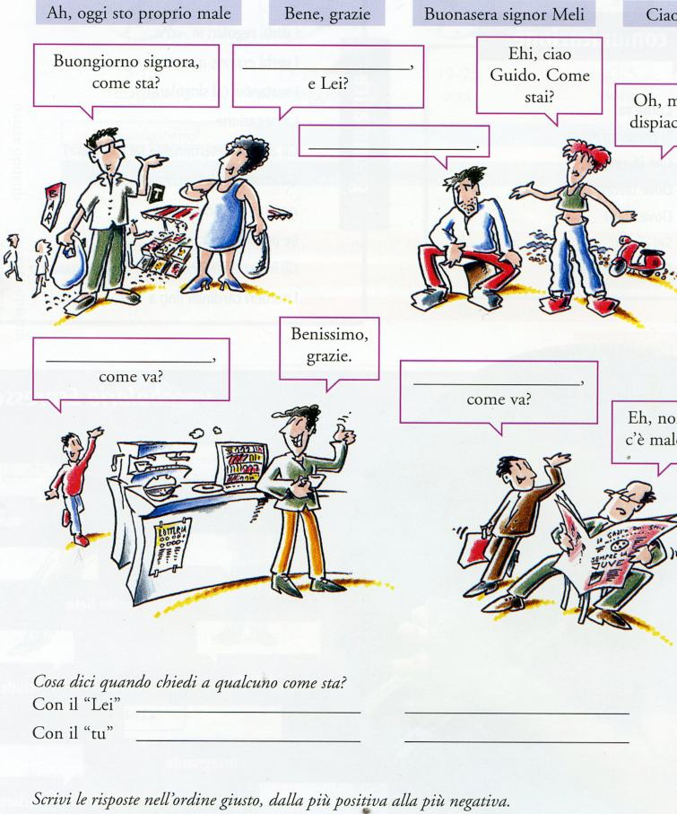
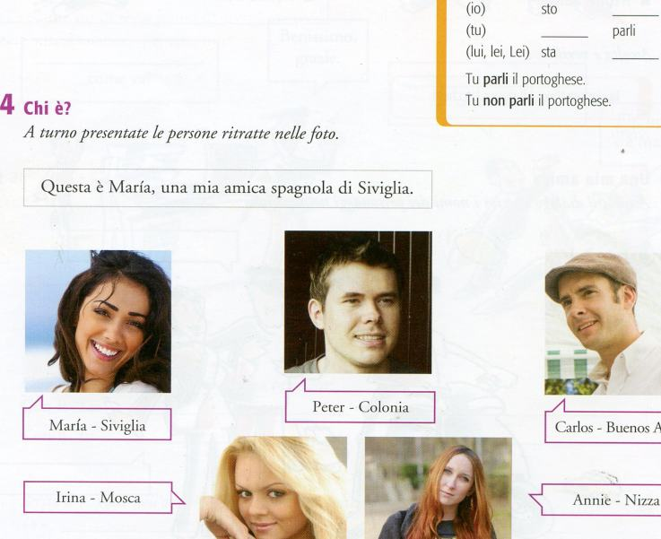
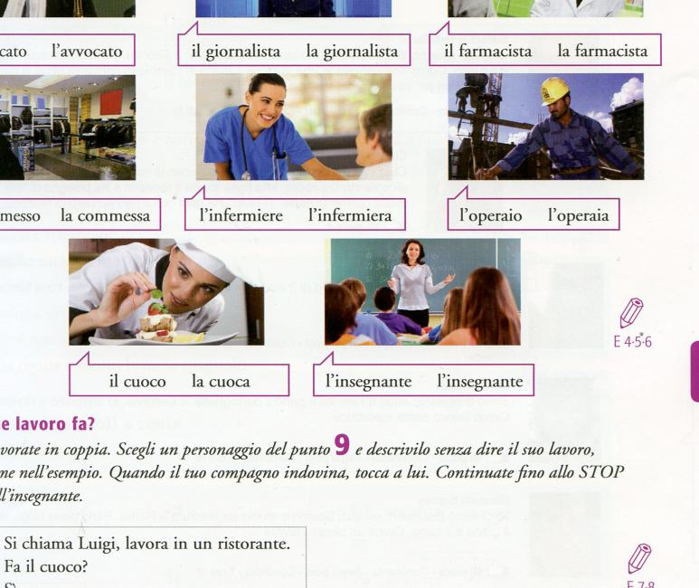
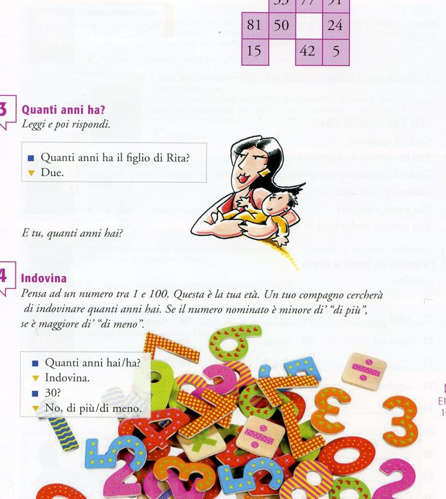

# A1 · Lezione 2 — Io e gli altri

[← A1 course](../README.md) · **Lesson** · [Grammar](grammar.md) · [Vocabulary](vocabulary.md) · [Exercises](exercise.md)

> **Source: `Nuovo_Espresso_1.pdf`, pages 17–32.** Lezione 2 occupies pp. 17–29; pp. 30–32 are **Facciamo il punto 1**, a combined revision of Lessons 1–2. The matching *Glossario* chapter occupies parts of PDF pp. 7–17. All dialogues below are **original exercises**, not the publisher's scripts.

| Photo 1 | Photo 2 | Photo 3 |
|---|---|---|
||.jpg?width=500)||

*Real photographs; see [credits](../PHOTO_CREDITS.md).*

## Actual textbook image gallery

These are **focused original crops from the supplied textbook**, not stock-photo substitutions. Use the image together with its original companion exercise in [Exercises](exercise.md). Original publisher rights apply; [image credits](../PHOTO_CREDITS.md).

| Page 18 · How is each person? | Page 20 · Introduce the six people |
|---|---|
|  |  |

| Page 23 · Jobs and workplaces | Page 26 · Number-reading game |
|---|---|
|  |  |

## Learning goals

Ask **come stai/sta** and respond naturally; introduce a friend; describe nationalities, languages, jobs and workplaces; read a short social post; ask for someone's age; count 20–100; use regular **-are** verbs, **essere/avere/fare/stare**, articles, negation and question words; complete the book's first combined review.

## Visual memory and shadowing track

Start with **[vocabulary pictures, sentence ladders and the shadowing lab](vocabulary.md#active-vocabulary-lab-learn-through-scenes-not-isolated-definitions)**. Study the **[memory checkpoints in grammar](grammar.md#memory-checkpoints-beside-the-rules)**, then test yourself with **[exercises 66–72](exercise.md#part-k-memory-transfer-no-translations-visible)**. The goal is to go from seeing a word to making a complete Italian sentence without translating word by word. English notes are explicitly comparisons, not Italian grammar rules.

## How to study this lesson

1. Read each communication situation below and the corresponding **original book page**.
2. Learn the connected structures in [Grammar](grammar.md).
3. Study the themed words and real photographs in [Vocabulary](vocabulary.md).
4. Do [Exercises](exercise.md), then the book's review game on pp. 30–32.

## Page-by-page conversation and reading guide

| Book page | What you will find | Skill |
|---|---|---|
| **18** | Come va? | Greet friends and strangers; ask how they feel. |
| **19** | Piacere | Transform an informal introduction into a polite one. |
| **19–20** | Una mia amica | Introduce a friend, mention where they come from and which language they speak. |
| **20** | Chi è? | Describe people in the source photographs by name and place. |
| **21** | Che lingue parla? | Say which languages you speak, and ask classmates. |
| **21** | Presentazioni | Prepare conversations for a party (festa) and bookstore (libreria). |
| **21** | Che lavoro fa? | Read professional-profile images and infer jobs. |
| **22** | Faccio la segretaria / Posti di lavoro | Ask where someone lives, works and what they do. |
| **23** | Le professioni / Che lavoro fa? | Identify nine professions and play a job guessing game. |
| **23** | Per conoscerci meglio | Interview others about their identity, city and work. |
| **24** | Cerco… | Read and write short online posts about languages, housing and help. |
| **25** | Piacere, molto lieto | Listen for languages and check true/false statements. |
| **25** | I numeri da venti a cento | Understand numbers 20–100. |
| **26** | Che numero è? / Quanti anni hai? / Indovina | Recognize spoken numbers, ask age and play a number guessing game. |
| **27** | Comunicazione e grammatica | Consolidate all chapter communication structures and grammar. |
| **28–29** | Videocorso 2 / Caffè culturale | Follow a video story and read the cultural geography quiz. |
| **30–31** | Facciamo il punto 1 — Gioco | Review lessons 1–2 with an illustrated board game. |
| **32** | Facciamo il punto 1 — Bilancio e Progetto | Self-assess and prepare a fictional class profile. |

### 1. Come va? — p. 18

**Book skill:** Greet friends and strangers; ask how they feel.

**Original model exchange / reading:**

> **A:** Ciao, Nina! Come stai?  
> **B:** Bene, grazie. E tu?  
> **A:** Oggi così così, sono stanca.  
> **B:** Oh, mi dispiace!

**What to notice:** Use come stai? (tu), come sta? (Lei). Answers range from benissimo to male.

**Practice:** Work through the source page 18 using your own PDF; then change the names, countries, jobs or numbers in the original model above.

### 2. Piacere — p. 19

**Book skill:** Transform an informal introduction into a polite one.

**Original model exchange / reading:**

> **A:** Buona sera, signora Bianchi. Come sta?  
> **B:** Bene, grazie. Le presento il signor Serra.  
> **A:** Molto lieto.  
> **B:** Piacere!

**What to notice:** The activity switches tu/Lei, greetings, and titles; molto lieto/a is a formal introduction.

**Practice:** Work through the source page 19 using your own PDF; then change the names, countries, jobs or numbers in the original model above.

### 3. Una mia amica — p. 19–20

**Book skill:** Introduce a friend, mention where they come from and which language they speak.

**Original model exchange / reading:**

> **A:** Ciao, Omar! Questa è Giulia, una mia amica.  
> **B:** Piacere! Di dove sei?  
> **A:** Sono di Porto; parlo portoghese e italiano.  
> **B:** Che bello!

**What to notice:** Questo è (masculine), questa è (feminine); notice un amico vs un'amica.

**Practice:** Work through the source page 19–20 using your own PDF; then change the names, countries, jobs or numbers in the original model above.

### 4. Chi è? — p. 20

**Book skill:** Describe people in the source photographs by name and place.

**Original model exchange / reading:**

> **A:** Questa è Marta, una mia amica spagnola di Valencia.  
> **B:** Questo è Pietro. È tedesco e vive a Colonia.

**What to notice:** Read the photographed city labels in the book and create fictional introductions.

**Practice:** Work through the source page 20 using your own PDF; then change the names, countries, jobs or numbers in the original model above.

### 5. Che lingue parla? — p. 21

**Book skill:** Say which languages you speak, and ask classmates.

**Original model exchange / reading:**

> **A:** Parli italiano?  
> **B:** Sì, parlo italiano e inglese.  
> **A:** Parli russo?  
> **B:** No, non parlo russo.

**What to notice:** Use parlare regular -are; non goes before the verb.

**Practice:** Work through the source page 21 using your own PDF; then change the names, countries, jobs or numbers in the original model above.

### 6. Presentazioni — p. 21

**Book skill:** Prepare conversations for a party (festa) and bookstore (libreria).

**Original model exchange / reading:**

> **A:** Ciao, ti presento Alberto.  
> **B:** Piacere! Di dove sei?  
> **A:** Sono di Napoli.  
> **B:** Anche io!

**What to notice:** Book p. 21 describes two role-play settings; add greetings that fit the setting.

**Practice:** Work through the source page 21 using your own PDF; then change the names, countries, jobs or numbers in the original model above.

### 7. Che lavoro fa? — p. 21

**Book skill:** Read professional-profile images and infer jobs.

**Original model exchange / reading:**

> **A:** Abito a Parma e lavoro in una clinica.  
> **B:** Sei medico?  
> **A:** Sì, sono medico. E tu che lavoro fai?

**What to notice:** Compare profession descriptions with images in the source PDF.

**Practice:** Work through the source page 21 using your own PDF; then change the names, countries, jobs or numbers in the original model above.

### 8. Faccio la segretaria / Posti di lavoro — p. 22

**Book skill:** Ask where someone lives, works and what they do.

**Original model exchange / reading:**

> **A:** Di dove sei?  
> **B:** Sono di Genova, ma abito a Bologna.  
> **A:** Che lavoro fai?  
> **B:** Faccio la segretaria in un ufficio.

**What to notice:** Distinguish sono di (origin), abito a (city), lavoro in (location).

**Practice:** Work through the source page 22 using your own PDF; then change the names, countries, jobs or numbers in the original model above.

### 9. Le professioni / Che lavoro fa? — p. 23

**Book skill:** Identify nine professions and play a job guessing game.

**Original model exchange / reading:**

> **A:** Lavora in una farmacia.  
> **B:** Fa il farmacista?  
> **A:** Esatto!  
> **B:** E questa persona? Lavora in un ristorante.

**What to notice:** Source pictures show lawyer, journalist, pharmacist, shop assistant, nurse, factory worker, cook and teacher; the original illustration remains in the book.

**Practice:** Work through the source page 23 using your own PDF; then change the names, countries, jobs or numbers in the original model above.

### 10. Per conoscerci meglio — p. 23

**Book skill:** Interview others about their identity, city and work.

**Original model exchange / reading:**

> **A:** Come ti chiami?  
> **B:** Mi chiamo Teresa.  
> **A:** Dove abiti?  
> **B:** Abito a Bologna. Lavoro in una scuola.

**What to notice:** Make an invented 3-sentence profile from the answers.

**Practice:** Work through the source page 23 using your own PDF; then change the names, countries, jobs or numbers in the original model above.

### 11. Cerco… — p. 24

**Book skill:** Read and write short online posts about languages, housing and help.

**Original model exchange / reading:**

> Ciao! Sono Lena e studio a Milano. Cerco una stanza vicino all'università. Parlo inglese e un po' di italiano.

**What to notice:** Source has social-network-style posts; identify who, where and what each poster seeks.

**Practice:** Work through the source page 24 using your own PDF; then change the names, countries, jobs or numbers in the original model above.

### 12. Piacere, molto lieto — p. 25

**Book skill:** Listen for languages and check true/false statements.

**Original model exchange / reading:**

> **A:** Piacere, sono Giorgio.  
> **B:** Molto lieta! Mi chiamo Sofia.  
> **A:** Parli italiano?  
> **B:** Sì, lo parlo bene.

**What to notice:** Original book comprehension requires its publisher audio; don't invent those answers.

**Practice:** Work through the source page 25 using your own PDF; then change the names, countries, jobs or numbers in the original model above.

### 13. I numeri da venti a cento — p. 25

**Book skill:** Understand numbers 20–100.

**Original model exchange / reading:**

> **A:** Che numero è?  
> **B:** È trentotto.  
> **A:** E questo?  
> **B:** Sessantasette.

**What to notice:** Read the original number table; practise writing and saying new combinations.

**Practice:** Work through the source page 25 using your own PDF; then change the names, countries, jobs or numbers in the original model above.

### 14. Che numero è? / Quanti anni hai? / Indovina — p. 26

**Book skill:** Recognize spoken numbers, ask age and play a number guessing game.

**Original model exchange / reading:**

> **A:** Quanti anni hai?  
> **B:** Ho ventiquattro anni.  
> **A:** Tuo fratello ne ha trenta?  
> **B:** No, di meno!

**What to notice:** Say Ho ... anni (not Sono ... anni); ne ha is a natural optional extension.

**Practice:** Work through the source page 26 using your own PDF; then change the names, countries, jobs or numbers in the original model above.

### 15. Comunicazione e grammatica — p. 27

**Book skill:** Consolidate all chapter communication structures and grammar.

**Original model exchange / reading:**

> **A:** Come sta?  
> **B:** Bene, grazie. E Lei?  
> **A:** Che lavoro fa?  
> **B:** Faccio l'infermiera, lavoro in ospedale.

**What to notice:** The grammar summary explicitly covers articles, noun gender, negation, questo/questa, a/in and questions.

**Practice:** Work through the source page 27 using your own PDF; then change the names, countries, jobs or numbers in the original model above.

### 16. Videocorso 2 / Caffè culturale — p. 28–29

**Book skill:** Follow a video story and read the cultural geography quiz.

**Original model exchange / reading:**

> **A:** Scusi, Lei è di Torino?  
> **B:** No, di Roma.  
> **A:** Dove lavora?  
> **B:** In un ufficio.

**What to notice:** The video requires publisher media. Book p. 29 contains an illustrated map of Italy; don't assume its population statistics are current.

**Practice:** Work through the source page 28–29 using your own PDF; then change the names, countries, jobs or numbers in the original model above.

### 17. Facciamo il punto 1 — Gioco — p. 30–31

**Book skill:** Review lessons 1–2 with an illustrated board game.

**Original model exchange / reading:**

> **A:** Dimmi tre saluti.  
> **B:** Ciao, buongiorno, arrivederci!  
> **A:** Che lavoro fai?  
> **B:** Faccio il cuoco.

**What to notice:** Board game consolidates greetings, numbers, language, professions, places and verbs.

**Practice:** Work through the source page 30–31 using your own PDF; then change the names, countries, jobs or numbers in the original model above.

### 18. Facciamo il punto 1 — Bilancio e Progetto — p. 32

**Book skill:** Self-assess and prepare a fictional class profile.

**Original model exchange / reading:**

> **A:** Ciao, siamo un gruppo di studenti. Studiamo italiano e parliamo altre lingue.  
> **B:** Cerchiamo amici per fare conversazione.

**What to notice:** The source has a skills inventory and group project involving profiles, photos and a social-network-style class page.

**Practice:** Work through the source page 32 using your own PDF; then change the names, countries, jobs or numbers in the original model above.

## Reading extension — a fictional social message

> **Cerco uno scambio linguistico!** Sono Rita, abito a Firenze e studio tedesco. Parlo italiano e inglese. Cerco una persona per fare conversazione il sabato. In cambio posso aiutarti con l'italiano.

1. Dove abita Rita? 2. Che lingue parla? 3. Che cosa cerca? 4. Quale verbo è al presente: `studio` o `studiato`?

Reveal reading answers

1. Firenze. 2. Italiano e inglese. 3. Una persona con cui fare conversazione. 4. **studio**.

## Pages 30–32 are included, not skipped

**Facciamo il punto 1** is the end-of-unit checkpoint spanning Lessons **1 and 2**: the board game (pp. 30–31), personal skills checklist and class social-profile project (p. 32). The original board and other source illustrations remain in the PDF; [exercise.md](exercise.md) includes new mixed revision and a safe fictional profile task.

## Source and media notes

- Main source checked visually: **`Nuovo_Espresso_1.pdf` pp. 17–32**, including photographed professions, illustrated dialogues, social posts, numbers, review board, map and video stills.
- Vocabulary source: **`Nuovo Espresso 1 Glossario.pdf`**, Italian–Persian, chapter `Lezione 2` spanning PDF pp. **7–17** (boundary pages also contain adjacent chapters).
- **Publisher audio/video are not republished; selected book illustration crops are embedded for picture practice with source and rights disclosed in PHOTO_CREDITS.md**. Listening- and video-dependent questions in the original book cannot be graded from these pages alone.
- New illustrations here are original, designed for teaching and visual recognition.

[← A1 menu](../README.md) · **Next: [Grammar →](grammar.md)** · [Vocabulary](vocabulary.md) · [Exercises](exercise.md)
