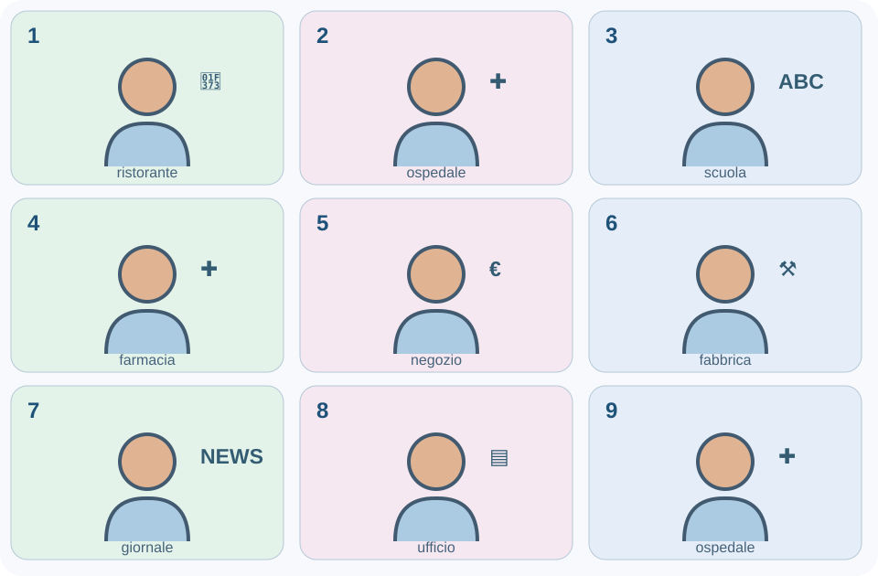
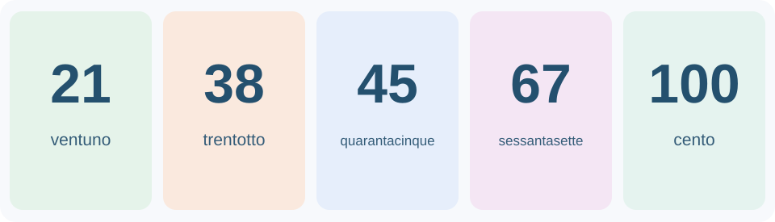

# Lezione 2 — Illustrated vocabulary and practice

[← Lesson & conversations](lesson.md) · [Grammar](grammar.md) · **Vocabulary** · [Exercises →](exercise.md)

> **Source:** `Nuovo Espresso 1 Glossario.pdf`, **Lezione 2**, PDF pp. **7–17** (page boundaries overlap with neighboring chapters). The Italian terms below are a **selected expanded learning set** rather than a transcription of every glossary line. The English glosses and practice sentences are original; Persian glosses are brief study aids. Main-book references: **pp. 17–32**.

## How to study

Learn **one themed group** at a time. Read the model sentences, cover the meanings, speak the Italian expression, and use it in a different sentence. If an example uses a verb not yet taught, focus first on the target vocabulary.

## 1. Social greetings & feelings

| Italian | English | فارسی | Original example |
|---|---|---|---|
| come va? | how's it going? | اوضاع چطوره؟ | Ciao, come va oggi? |
| come stai? | how are you? (informal) | حالت چطوره؟ | Come stai, Paola? |
| come sta? | how are you? (formal) | حالتون چطوره؟ | Buongiorno, come sta? |
| bene | well | خوب | Sto bene, grazie. |
| benissimo | very well | خیلی خوب | Benissimo, grazie! |
| male | badly | بد | Oggi sto male. |
| non c'è male | not bad | بد نیست | Non c'è male, grazie. |
| oggi | today | امروز | Oggi lavoro. |
| mi dispiace | I'm sorry | متأسفم | Oh, mi dispiace! |
| molto lieto / lieta | very pleased (to meet you) | از آشنایی خوشحالم | Molto lieta, signora. |
| grazie | thanks | مرسی | Bene, grazie. |
| purtroppo | unfortunately | متأسفانه | Purtroppo oggi lavoro. |

## 2. Introducing people

| Italian | English | فارسی | Original example |
|---|---|---|---|
| questo | this (masculine) | این (مذکر) | Questo è Marco. |
| questa | this (feminine) | این (مؤنث) | Questa è Sara. |
| un amico | a male friend | یک دوست (مذکر) | È un mio amico. |
| un'amica | a female friend | یک دوست (مؤنث) | È una mia amica. |
| presentazione | introduction | معرفی | Faccio una presentazione. |
| personaggio | character | شخصیت | Il personaggio si chiama Leo. |
| invece | instead / whereas | در عوض | Io parlo inglese; lei invece parla francese. |
| sapere | to know | دانستن | Sai parlare italiano? |
| sì / no | yes / no | بله / نه | Sì, grazie. No, grazie. |
| festa | party | مهمانی | Vado a una festa. |
| libreria | bookshop | کتابفروشی | Lavoro in una libreria. |
| conoscente | acquaintance | آشنا | È un mio conoscente. |

## 3. Languages & communication

| Italian | English | فارسی | Original example |
|---|---|---|---|
| parlare | to speak | حرف زدن | Parlo italiano. |
| lingua | language | زبان | Che lingue parli? |
| l'italiano | Italian language | ایتالیایی | Parlo l'italiano. |
| l'inglese | English language | انگلیسی | Parlo inglese. |
| il francese | French language | فرانسوی | Parla francese. |
| lo spagnolo | Spanish language | اسپانیایی | Parlo lo spagnolo. |
| il tedesco | German language | آلمانی | Parla tedesco. |
| il portoghese | Portuguese language | پرتغالی | Parla portoghese. |
| il russo | Russian language | روسی | Non parlo russo. |
| il greco | Greek language | یونانی | Parli greco? |
| l'olandese | Dutch language | هلندی | Studio olandese. |
| un po' | a little | یه کم | Parlo un po' di italiano. |
| molto bene | very well | خیلی خوب | Parla molto bene. |
| conoscere | to know / to be familiar with | شناختن / بلد بودن | Conosco questa lingua. |

## 4. Work, professions & workplaces

| Italian | English | فارسی | Original example |
|---|---|---|---|
| lavoro | work / job | کار | Che lavoro fai? |
| fare | to do / make | انجام دادن | Faccio il cuoco. |
| lavorare | to work | کار کردن | Lavoro in un ufficio. |
| avvocato / avvocata | lawyer | وکیل | È avvocata. |
| giornalista | journalist | خبرنگار | Fa la giornalista. |
| farmacista | pharmacist | داروساز | Lavora in farmacia. |
| commesso / commessa | shop assistant | فروشنده | La commessa lavora in negozio. |
| infermiere / infermiera | nurse | پرستار | Fa l'infermiera. |
| operaio / operaia | factory worker | کارگر | Lavora in fabbrica. |
| cuoco / cuoca | cook / chef | آشپز | Sono cuoca. |
| insegnante | teacher | معلم | Lavora in una scuola. |
| segretaria | secretary | منشی | Faccio la segretaria. |
| impiegato / impiegata | office employee | کارمند | Sono impiegata. |
| architetto / architetta | architect | معمار | È architetto. |
| medico / medica | doctor | پزشک | Faccio il medico. |
| fabbrica | factory | کارخانه | Lavora in una fabbrica. |
| farmacia | pharmacy | داروخانه | Lavoro in farmacia. |
| negozio | shop | مغازه | Lavora in un negozio. |
| ristorante | restaurant | رستوران | Lavorano in un ristorante. |
| ospedale | hospital | بیمارستان | Lavora in ospedale. |
| ufficio | office | دفتر | Sono in ufficio. |
| scuola | school | مدرسه | Lavora a scuola. |
| posto di lavoro | workplace | محل کار | Qual è il tuo posto di lavoro? |

## 5. Cities, living and social posts

| Italian | English | فارسی | Original example |
|---|---|---|---|
| abitare | to live (reside) | زندگی کردن | Abito a Milano. |
| studiare | to study | درس خواندن | Studio italiano. |
| qui | here | اینجا | Abito qui. |
| cercare | to look for | جستجو کردن | Cerco una stanza. |
| offrire | to offer | پیشنهاد کردن | Offro una stanza. |
| bacheca | noticeboard / social feed | تابلو اعلانات | Leggo una bacheca online. |
| stanza | room | اتاق | Cerco una stanza. |
| libero / libera | free / available | آزاد / خالی | La stanza è libera. |
| in cambio di | in exchange for | در ازای | In cambio offro conversazione. |
| vicino | near | نزدیک | Abito vicino al centro. |
| famiglia | family | خانواده | La famiglia vive a Roma. |
| bisogno | need | نیاز | Ho bisogno di aiuto. |
| condividere | to share | به اشتراک گذاشتن | Condivido una notizia. |
| commentare | to comment | نظر دادن | Commento il post. |
| seguire | to follow | دنبال کردن | Seguo la pagina. |
| zona | area / district | منطقه | Cerco una stanza in questa zona. |

## 6. Numbers, age and study terms

| Italian | English | فارسی | Original example |
|---|---|---|---|
| quanti anni hai? | how old are you? | چند سالته؟ | Quanti anni hai? |
| anno / anni | year / years | سال | Ho ventitré anni. |
| età | age | سن | Qual è la sua età? |
| di più | more / higher | بیشتر | No, di più! |
| di meno | less / lower | کمتر | No, di meno! |
| indovinare | to guess | حدس زدن | Prova a indovinare. |
| numero | number | عدد | Che numero è? |
| intervistare | to interview | مصاحبه کردن | Intervisto un compagno. |
| vero / falso | true / false | درست / غلط | La risposta è vera o falsa? |
| maschile | masculine | مذکر | Questo è maschile. |
| femminile | feminine | مؤنث | Questa è femminile. |
| singolare | singular | مفرد | La parola è singolare. |
| negazione | negation | منفی سازی | Non è la negazione. |
| interrogativo | question word | پرسشی | Chi è un interrogativo. |

## Picture-based profession quiz

Match picture **1–9** to each profession, in this mixed order: **infermiere, giornalista, commesso, insegnante, operaio, medico, cuoco, farmacista, impiegato**.

Reveal the matching key

1 **cuoco**, 2 **medico**, 3 **insegnante**, 4 **farmacista**, 5 **commesso**, 6 **operaio**, 7 **giornalista**, 8 **impiegato**, 9 **infermiere**.

Next, pick five pictures and write a complete sentence of the form `Lavora in ...` or `Fa il/la ...`.

## Visual numbers game

Cover the written words and **say 21, 38, 45, 67 and 100** aloud. Then write 22, 31, 48, 56 and 99 in Italian. The related grammar is in [Grammar §8](grammar.md#8-numbers-from-20-to-100-and-ages).

Reveal new number answers

**ventidue, trentuno, quarantotto, cinquantasei, novantanove**.

## High-value chunks (learn whole phrases)

| Situation | Italian |
|---|---|
| Ask informally | **Come stai?** |
| Ask politely | **Come sta?** |
| Reply | **Benissimo, grazie. E tu?** |
| React with sympathy | **Oh, mi dispiace!** |
| Introduce a friend | **Questo è Marco, un mio amico.** |
| Introduce a female friend | **Questa è Sara, una mia amica.** |
| Ask languages | **Che lingue parli?** |
| Deny | **Non parlo russo.** |
| Ask profession | **Che lavoro fai?** |
| Ask workplace | **Dove lavori?** |
| State origin | **Sono di Verona.** |
| State residence | **Abito a Bologna.** |
| Ask age | **Quanti anni hai?** |
| Say age | **Ho ventotto anni.** |
| Write a post | **Cerco qualcuno per fare conversazione.** |

## Vocabulary drills

### A. Choose the correct expression

1. Someone feels unwell: `benissimo` or `sto male`?
2. A friend introduces a woman: `questo è` or `questa è`?
3. You ask about work: `Che lavoro fai?` or `Di dove sei?`?
4. A person is in a pharmacy: `farmacista` or `cuoco`?
5. Someone is looking for a room: `cerco una stanza` or `faccio la stanza`?

Reveal answers A

**1 sto male · 2 questa è · 3 Che lavoro fai? · 4 farmacista · 5 cerco una stanza**

### B. Recall from English

Translate without checking the word lists:

1. pharmacy
2. journalist
3. nurse
4. to live
5. shop assistant
6. unfortunately
7. I am sorry
8. to guess
9. age
10. a female friend

Reveal answers B

**farmacia; giornalista; infermiere/infermiera; abitare; commesso/commessa; purtroppo; mi dispiace; indovinare; età; un'amica**.

### C. Build a sentence

Rearrange the words:

1. `italiano / parlo / non`
2. `fai / lavoro / che`
3. `abito / Bologna / a`
4. `amica / mia / questa / è / una`
5. `anni / ho / trentadue`

Reveal answers C

1. **Non parlo italiano.**
2. **Che lavoro fai?**
3. **Abito a Bologna.**
4. **Questa è una mia amica.**
5. **Ho trentadue anni.**

### D. Read a short original classified-style post

> Ciao! Sono Michela, abito a Torino e lavoro in un negozio. Parlo italiano e un po' di tedesco. Cerco una persona per parlare tedesco una volta alla settimana.

Questions: Where does Michela live? Where does she work? Which language does she want to practice?

Reveal reading answers

**Torino; un negozio; tedesco.**

## Book connection

- **pp. 18–20:** social language, greetings, introductions.
- **p. 21:** languages and professional profiles.
- **pp. 22–23:** professions, workplaces and illustrated matching.
- **p. 24:** social-network-style written posts.
- **pp. 25–26:** numbers, ages and guessing.
- **pp. 30–32:** review vocabulary in the combined Lessons 1–2 game.

Vocabulary entries are **not a claim that a particular learner has memorized these words**. Keep actual learning results private.

[← Lesson & conversations](lesson.md) · [Grammar](grammar.md) · **[Exercises →](exercise.md)**
