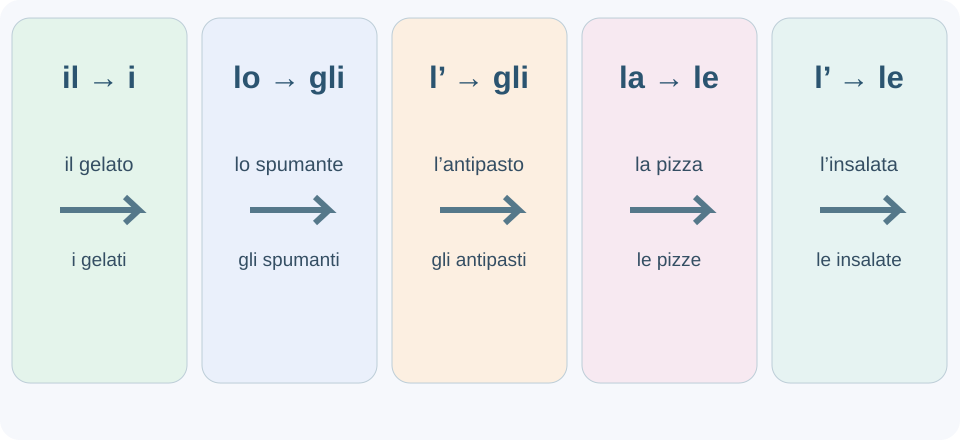
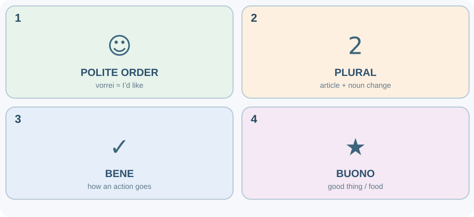

# Lezione 3 — Grammar, structure, examples and memory

[← Lesson & conversations](lesson.md) · **Grammar** · [Vocabulary](vocabulary.md) · [Exercises](exercise.md)

> **Source:** *Nuovo Espresso 1*, Lezione 3, pp. 33–46; main grammar summary on **p. 43**. The present-tense verbs occur in the source dialogues on **pp. 35 and 37**, and the grammar summary covers articles, plurals, `bene/buono` and questions. These examples and recall exercises are original.

## 1. Ordering politely: `prendo` and `vorrei`

| Italian | English | When to use |
|---|---|---|
| `Prendo un tè.` | I'll have a tea. | Common direct order |
| `Vorrei un tè.` | I'd like a tea. | Polite request |
| `Per me un tè.` | A tea for me. | Ordering among several people |
| `Un tè, per favore.` | A tea, please. | Short polite order |
| `Che cosa desidera?` | What would you like? | Polite service question |
| `Da bere?` | Something to drink? | Restaurant/café question |

**English bridge:** English *I want a coffee* can be correct but direct; `vorrei` is the useful Italian counterpart of **I'd like**, not merely a translation of **want**.

**Avoid this mistake:** ❌ `Io prendo un tè per me` is wordy for a normal order; more idiomatic: `Prendo un tè` or `Per me un tè`.

### `Prendere`: regular -ere

| Person | Present |
|---|---|
| io | **prendo** |
| tu | **prendi** |
| lui / lei / Lei | **prende** |
| noi | **prendiamo** |
| voi | **prendete** |
| loro | **prendono** |

- `Prendiamo due panini.`
- `Lei prende un caffè?`
- `I miei amici prendono un aperitivo.`

Recall: Complete “Noi ___ due caffè; voi ___ una spremuta.”

**prendiamo; prendete.**

## 2. Preferences: `volere` and `preferire`

The source dialogues on p. 37 practise these verbs, which are not identical to their English equivalents in every sentence.

| Person | volere | preferire |
|---|---|---|
| io | **voglio** | **preferisco** |
| tu | **vuoi** | **preferisci** |
| lui / lei / Lei | **vuole** | **preferisce** |
| noi | **vogliamo** | **preferiamo** |
| voi | **volete** | **preferite** |
| loro | **vogliono** | **preferiscono** |

**Examples:** `Preferisco il pesce.` · `Volete un dolce?` · `No, preferiamo il gelato.`

**Rule:** `preferire` belongs to the -ire group, but it adds **-isc-** to some present forms. Don't assume all -ire verbs work identically; this is the pattern you need here.

**Memory image:** Think of two trays: **voglio** (I want), **preferisco** (I choose this over that), **vorrei** (I would like, politely).

**English bridge:** The expression *I would like* is `vorrei`, not `voglio`. `Vorrei` is a conditional form and is learned here as a practical chunk; the complete conditional system is not an A1 prerequisite.

Choose: “I prefer water” — `Voglio l'acqua` or `Preferisco l'acqua`?

**Preferisco l'acqua.** `Voglio l'acqua` means **I want water**.

## 3. Definite articles: singular and plural (source p. 43)

| Noun begins with | Masculine singular → plural | Feminine singular → plural |
|---|---|---|
| Most consonants | **il gelato → i gelati** | **la pizza → le pizze** |
| Vowels | **l'antipasto → gli antipasti** | **l'insalata → le insalate** |
| s + consonant; z | **lo spumante → gli spumanti** | usually **la → le** |

**Remember:** articles depend on **gender, number and initial sound**. The difference between `il/i`, `lo/gli` and `l'/gli` is not a pronunciation whim.

**English bridge:** English *the* stays unchanged before singular and plural nouns; Italian changes the article. Learn `il gelato`, not just `gelato`.

**Common mistake:** ❌ `i antipasti` → ✅ `gli antipasti`.

Convert: `la pizza`, `l'insalata`, `il bicchiere` to plurals

**le pizze; le insalate; i bicchieri.**

## 4. Plural noun patterns and important exceptions

The book's summary on **p. 43** groups plural changes by final letter.

| Singular noun | Plural | Why |
|---|---|---|
| `il bicchiere` | `i bicchieri` | common masculine **-e → -i** |
| `l'aperitivo` | `gli aperitivi` | masculine **-o → -i** |
| `la bevanda` | `le bevande` | feminine **-a → -e** |
| `la carne` | `le carni` | feminine **-e → -i** |
| `il tè` | `i tè` | accented word unchanged |
| `la specialità` | `le specialità` | accented ending unchanged |
| `il toast` | `i toast` | consonant-ending loanword unchanged |

**Picture memory:** Imagine **two pizzas**: `una pizza` becomes `due pizze`. Imagine **two glasses**: `un bicchiere` becomes `due bicchieri`.

**Warning:** You can't determine a noun's gender solely from its last letter. Learn **the article + noun together**.

Pluralize: `la bevanda`, `il toast`, `l'antipasto`

**le bevande; i toast; gli antipasti.**

## 5. `Bene` vs `buono`: well versus good

The book makes this contrast explicitly on **p. 43**.

| Italian | English | Grammar role |
|---|---|---|
| `Qui si mangia **bene**.` | People eat **well** here. | **Adverb**: modifies a verb |
| `Il risotto è **buono**.` | The risotto is **good**. | **Adjective**: describes the noun |
| `La pizza è **buona**.` | The pizza is good. | Adjective agrees with feminine noun |
| `I panini sono **buoni**.` | The sandwiches are good. | Masculine plural adjective |

**English bridge:** *good* ≈ `buono`; *well* ≈ `bene` **in these examples**, but there are nuances and exceptions in both languages.

**Memory trick:** **Verb → bene**; **thing → buono/buona**. Picture a chef cooking **well**, then a **good** pizza.

**Common error:** ❌ `La pizza è bene.` → ✅ `La pizza è buona.`

Choose: “Lavori bene” or “Lavori buono”?

**Lavori bene.** `bene` describes how someone works.

## 6. Question words and polite requests (source p. 43)

| Italian question | Meaning | Example answer |
|---|---|---|
| `(Che) cosa desidera?` | What would you like? | `Vorrei un tè.` |
| `Quale piatto preferisce?` | Which dish do you prefer? | `Preferisco la pasta.` |
| `Quanti tavoli ci sono?` | How many tables are there? | `Ci sono quattro tavoli.` |
| `Per quante persone?` | For how many people? | `Per tre persone.` |
| `Quanto costa?` | How much does it cost? | `Costa dieci euro.` |

Common polite expressions: **`per favore`**, **`per cortesia`**, **`mi porta…?`**, **`grazie`**, **`prego`**, **`si figuri`**.

**English comparison:** English often introduces a question with *do/does*; Italian generally uses the conjugated verb directly. `Che cosa prendi?` — not ❌ `Che cosa do prendi?`.

## 7. Complete restaurant communication

| Situation | Natural Italian |
|---|---|
| Request a menu | `Posso avere il menù, per favore?` |
| Order | `Vorrei un piatto di pasta.` |
| Ask about drinks | `Che cosa prendete da bere?` |
| Say a preference | `Preferisco l'acqua naturale.` |
| Ask for missing cutlery | `Mi porta una forchetta, per favore?` |
| Ask for the bill | `Il conto, per cortesia.` |
| Book a table | `È possibile prenotare un tavolo per quattro?` |
| Specify a time | `Per le otto, grazie.` |

These are **original extension examples** based on the book's communication goals; they are not transcripts.

## Visual memory and retrieval practice

### Four picture rules

1. **Tray + polite smile → `vorrei`**: *I'd like*, not literal *I want*.
2. **Two plates → a plural**: change **article and noun**, `il piatto → i piatti`.
3. **Chef action vs delicious pizza**: `cucina bene` versus `pizza buona`.
4. **Question-mark sign → `che cosa / quale / quanto / quante`**: use them before a noun or verb as appropriate.

### A four-stage sentence ladder

**Look at a plate** → `piatto` → `il piatto` → `Vorrei un piatto di pasta.` → `Quale piatto preferisce?`

Do the same for **bicchiere**, **antipasto**, **gelato** and **forchetta**. Say the entire sentence without switching halfway into English.

### Recall after hiding the table

- Make `il gelato` plural.
- Translate *The pizza is good* and *We eat well here*.
- Say *I'd like a cappuccino* politely.
- Ask *For how many people?*.
- Conjugate `preferire` for `io`, `noi`, `Lei`.

Show a possible answer key

`i gelati`; `La pizza è buona`; `Qui mangiamo bene`; `Vorrei un cappuccino, per favore`; `Per quante persone?`; `preferisco / preferiamo / preferisce`.

## Suggested recall routine

Use new pictures first, then retrieve a **word**, a **complete phrase**, a **question**, and a **mini-dialogue** without reading. Revisit after one day, three days and one week; repeat missed forms sooner. English is only a bridge for understanding, never a substitute for a correctly formed Italian sentence.

[← Lesson](lesson.md) · [Vocabulary →](vocabulary.md) · [Exercises →](exercise.md)
