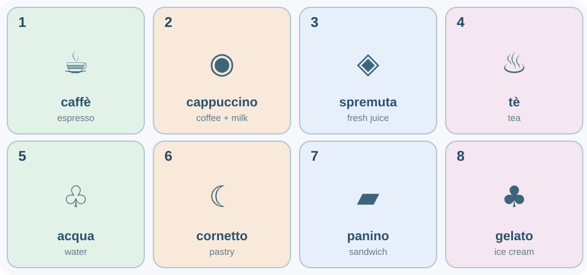
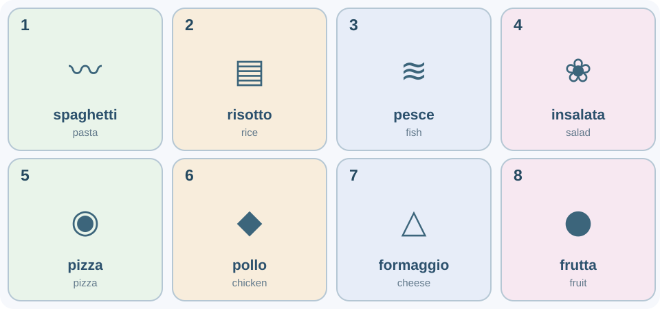
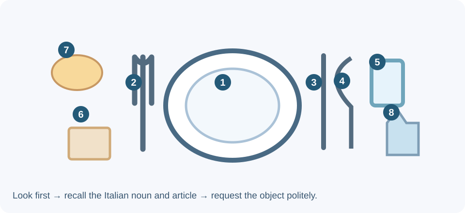
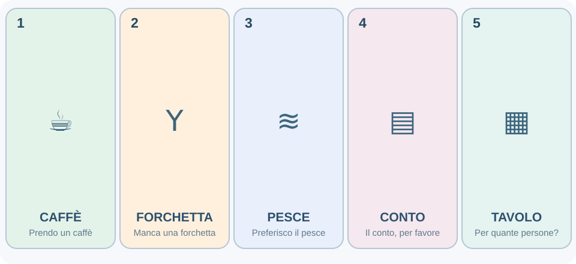

# Lezione 3 — Vocabulary, pictures, sentences and shadowing

[← Lesson & conversations](lesson.md) · [Grammar](grammar.md) · **Vocabulary** · [Exercises](exercise.md)

> **Source:** *Nuovo Espresso 1 Glossario*, Lesson 3 entries on **PDF pp. 17–25**, compared with *Nuovo Espresso 1* pp. **33–46**. This is an **expanded selected study list**, not the full third-party glossary. The English glosses, illustrative sentences and exercises are new additions. Some examples introduce natural extra grammar as an optional preview.

**Method:** See the picture → recall the **Italian word and article** → make a **sentence** → ask a **question** → say a **two-line exchange** without looking.

## Visual entry points

**First attempt:** before reading the lists below, say what you recognize. Use the Italian article with every noun; then check your guesses.

## 1. Drinks and café orders

| Italiano | English | فارسی | Original sentence |
|---|---|---|---|
| bevanda | drink / beverage | نوشیدنی | Vorrei una bevanda fresca. |
| caffè | coffee | قهوه | Prendo un caffè, grazie. |
| cappuccino | cappuccino | کاپوچینو | Un cappuccino, per favore. |
| tè al limone | lemon tea | چای لیمویی | Vorrei un tè al limone. |
| tè al latte | tea with milk | چای با شیر | Preferisco il tè al latte. |
| latte | milk | شیر | Un bicchiere di latte, grazie. |
| acqua minerale | mineral water | آب معدنی | Prendo un'acqua minerale. |
| acqua naturale | still water | آب بدون گاز | Preferisco l'acqua naturale. |
| spremuta | freshly squeezed juice | آب‌میوه تازه | Vorrei una spremuta d'arancia. |
| aranciata | orange soft drink | نوشابه پرتقالی | Prendiamo un'aranciata. |
| pompelmo | grapefruit | گریپ‌فروت | Mi piace il pompelmo. |
| aperitivo | aperitif / pre-dinner drink | نوشیدنی پیش از غذا | Prendiamo un aperitivo. |
| bicchiere | glass | لیوان | Un bicchiere d'acqua, grazie. |
| bottiglia | bottle | بطری | C'è una bottiglia sul tavolo. |
| ghiaccio | ice | یخ | Un'acqua senza ghiaccio, per favore. |

## 2. Snacks and ordering language

| Italiano | English | فارسی | Original sentence |
|---|---|---|---|
| cornetto | Italian breakfast pastry | کروسان ایتالیایی | Vorrei un cornetto. |
| crema | custard / cream | کرم | Un cornetto con la crema. |
| marmellata | jam | مربا | Preferisco la marmellata. |
| panino | sandwich / bread roll | ساندویچ | Prendo un panino. |
| tramezzino | triangular sandwich | ساندویچ مثلثی | Vorrei un tramezzino. |
| toast | toasted sandwich | تُست | Prendiamo due toast. |
| menù | menu | منو | Posso vedere il menù? |
| prendere | to take / order | گرفتن / سفارش دادن | Prendo un tè. |
| desiderare | to wish / want | خواستن | Che cosa desidera? |
| vorrei | I would like | مایلم / می‌خواهم | Vorrei un panino. |
| per me | for me | برای من | Per me un caffè. |
| per favore | please | لطفاً | Un tè, per favore. |
| per cortesia | please (polite) | لطفاً | Il conto, per cortesia. |
| ordinazione | order (food/drink) | سفارش | Il cameriere prende l'ordinazione. |

## 3. Menu courses, foods and preferences

| Italiano | English | فارسی | Original sentence |
|---|---|---|---|
| antipasto | starter / appetizer | پیش‌غذا | Prendiamo un antipasto. |
| primo piatto | first course | غذای اول | Vorrei un primo piatto. |
| secondo piatto | main course | غذای دوم | Preferisco un secondo. |
| contorno | side dish | مخلفات | Prendo un contorno di verdure. |
| dessert | dessert | دسر | Per dessert prendo un gelato. |
| pasta | pasta | پاستا | Preferisco la pasta. |
| spaghetti | spaghetti | اسپاگتی | Prendo gli spaghetti. |
| tortellini | stuffed pasta | تورتلینی | Vorrei i tortellini. |
| lasagne | lasagne | لازانیا | Le lasagne sono buone. |
| risotto | risotto / rice dish | ریزوتو | Prendiamo un risotto. |
| carne | meat | گوشت | Non mangio carne. |
| pesce | fish | ماهی | Preferisco il pesce. |
| pollo | chicken | مرغ | Prendo il pollo. |
| insalata | salad | سالاد | L'insalata è fresca. |
| patatine fritte | French fries | سیب‌زمینی سرخ‌کرده | Vorrei le patatine fritte. |
| formaggio | cheese | پنیر | Il formaggio è buono. |
| frutta fresca | fresh fruit | میوه تازه | Prendo la frutta fresca. |
| gelato | ice cream | بستنی | Il gelato è buonissimo. |
| preferire | to prefer | ترجیح دادن | Preferisco il pesce. |
| volere | to want | خواستن | Vuoi un dolce? |

## 4. Tableware, extras and the bill

| Italiano | English | فارسی | Original sentence |
|---|---|---|---|
| tavolo | table | میز | Il tavolo è pronto. |
| piatto | plate / dish | بشقاب / غذا | Mi porta un piatto? |
| forchetta | fork | چنگال | Manca una forchetta. |
| coltello | knife | چاقو | C'è un coltello sul tavolo. |
| cucchiaio | spoon | قاشق | Vorrei un cucchiaio. |
| cucchiaino | teaspoon | قاشق چای‌خوری | Mi porta un cucchiaino? |
| tovagliolo | napkin | دستمال سفره | Un tovagliolo, per favore. |
| pane | bread | نان | Mi porta un po' di pane? |
| sale | salt | نمک | Il sale è sul tavolo. |
| pepe | pepper | فلفل | Vorrei un po' di pepe. |
| olio | oil | روغن | L'olio è vicino al pane. |
| aceto | vinegar | سرکه | C'è l'aceto sul tavolo? |
| conto | bill / check | صورت‌حساب | Il conto, per favore. |
| cameriere / cameriera | waiter / waitress | پیشخدمت | Il cameriere arriva. |
| cliente | customer | مشتری | Il cliente vuole il menù. |
| buono / buona | good (adjective) | خوب | La pizza è buona. |
| bene | well (adverb) | به‌خوبی | Qui si mangia bene. |
| mancare | to be missing / lacking | کم بودن / نبودن | Manca un bicchiere. |

## 5. Restaurants, reading ads and reservations

| Italiano | English | فارسی | Original sentence |
|---|---|---|---|
| ristorante | restaurant | رستوران | Il ristorante è aperto. |
| trattoria | traditional casual restaurant | تراتوریا / غذاخوری سنتی | Ceniamo in trattoria. |
| pizzeria | pizzeria | پیتزافروشی | La pizzeria è vicina. |
| bar | café / bar | کافه / بار | Prendo un caffè al bar. |
| gelateria | ice-cream shop | بستنی‌فروشی | Andiamo in gelateria. |
| chiosco | kiosk / snack stand | کیوسک | Il chiosco è aperto. |
| rosticceria | prepared-food shop | فروشگاه غذای آماده | Compro qualcosa in rosticceria. |
| annuncio | advertisement / notice | آگهی | Leggo l'annuncio. |
| vegetariano / vegetariana | vegetarian | گیاهخوار | Cerco un ristorante vegetariano. |
| aperto / aperta | open | باز | È aperto stasera? |
| chiuso / chiusa | closed | بسته / تعطیل | Il locale è chiuso lunedì. |
| prenotare | to reserve / book | رزرو کردن | Vorrei prenotare un tavolo. |
| prenotazione | reservation | رزرو | Ho una prenotazione. |
| invito | invitation | دعوت | Grazie per l'invito. |
| ospite | guest | مهمان | Invitiamo quattro ospiti. |
| stasera | this evening | امشب | Stasera andiamo al ristorante. |
| a più tardi | see you later | بعداً می‌بینمت | Grazie, a più tardi! |
| per quante persone? | for how many people? | برای چند نفر؟ | Un tavolo per quante persone? |

## 6. Useful classroom and reading words

| Italiano | English | فارسی | Original sentence |
|---|---|---|---|
| scegliere | to choose | انتخاب کردن | Scegli il piatto. |
| abbinare | to match | وصل کردن | Abbina le bevande alle immagini. |
| ascoltare | to listen | گوش دادن | Ascolta il dialogo. |
| leggere | to read | خواندن | Leggi il menù. |
| completare | to complete | کامل کردن | Completa la frase. |
| dialogo | dialogue | گفتگو | Leggo un dialogo. |
| interrogativo | question word | واژه پرسشی | Quale è un interrogativo. |
| plurale | plural | جمع | Qual è il plurale? |
| singolare | singular | مفرد | La parola è al singolare. |
| piacere | to like / pleasure | دوست داشتن / لذت | Mi piace il gelato. |

## Picture memory lab — three rounds

### Round 1: drink and snack pictures

Look at [the first picture sheet](assets/drink-cards.svg). Try to name items **1–8** before revealing answers.

Show suggested drink-card answers

1 **un caffè**, 2 **un cappuccino**, 3 **una spremuta**, 4 **un tè**, 5 **un'acqua minerale**, 6 **un cornetto**, 7 **un panino**, 8 **un gelato**.

### Round 2: choose a dish from a picture

Look at the eight foods and use `Vorrei...` or `Preferisco...` for **four different cards**.

Four model sentences

`Vorrei gli spaghetti.` · `Preferisco il pesce.` · `Prendo un'insalata.` · `Vorrei il risotto.`

### Round 3: set the table

Match visual numbers to **piatto, forchetta, coltello, cucchiaio, bicchiere, tovagliolo, pane, bottiglia**.

Answer key

1 **piatto** · 2 **forchetta** · 3 **coltello** · 4 **cucchiaio** · 5 **bicchiere** · 6 **tovagliolo** · 7 **pane** · 8 **bottiglia**.

**Then produce:** `Sul tavolo c'è ...`, `Manca ...`, `Mi porta ...?` for three different objects.

## Learn a word in four active steps

| Target | Recognize | Sentence | Ask / answer |
|---|---|---|---|
| **caffè** | ☕ coffee | `Prendo un caffè.` | `Prendi un caffè? — Sì, grazie.` |
| **forchetta** | 🍴 fork | `Manca una forchetta.` | `Mi porta una forchetta? — Certo.` |
| **pesce** | 🐟 fish | `Preferisco il pesce.` | `Preferisci il pesce? — Sì.` |
| **conto** | 🧾 bill | `Vorrei il conto.` | `Mi porta il conto, per favore?` |
| **prenotare** | 📅 reserve | `Vorrei prenotare un tavolo.` | `Per quante persone? — Per tre.` |

Don't simply recite Italian → English. **Produce the new Italian question**, change one detail, and then retrieve the entire exchange from memory.

## Memory connections and English traps

| Italian | Helpful association | Avoid this misunderstanding |
|---|---|---|
| `menù` | English **menu** | Good cognate; remember the accent and Italian pronunciation. |
| `ristorante` | English **restaurant** | Similar meaning, but `al ristorante` / `in un ristorante` are useful Italian chunks. |
| `prenotare` | English **pre-book** (memory cue only) | The sound association is **not** a historical derivation. It means *reserve/book*. |
| `conto` | Think **count** the bill (memory cue only) | A `conto` is the bill/check; “count” is **contare**. |
| `pasta` | English **pasta** | In Italian, `pasta` can refer to food and sometimes pastry depending on context. |
| `buono` vs `bene` | English **good** vs **well** | `La pizza è buona`; `Si mangia bene`. |
| `vorrei` | English **I'd like** | Do not mistake `voglio` (*I want*) for an equally polite request. |
| `un / una / un'` | English **a/an** | Italian depends on noun gender; **un'amica** but **un amico**. |

**Remember:** Mnemonics are artificial recall aids. **Only full Italian phrases show how the language works.** Do not create hybrid sentences such as ❌ `I vorrei un coffee`.

## Shadowing and speaking ladder

**True shadowing** requires **Italian native-speaker audio**: listen closely and repeat *with a tiny delay*, matching stress, rhythm and connected speech. The uploaded book contains marked listening activities; the associated recordings are **not in this GitHub repo**. With text alone, the following is **read-aloud, echo repetition and recall practice**, not verified audio shadowing.

### Level 1 — isolated chunks

Slowly read each Italian phrase, then repeat it **three times** and finally without looking:

- `Vorrei un cappuccino.`
- `Con la crema o con la marmellata?`
- `Preferisco l'acqua naturale.`
- `Mi porta una forchetta, per favore?`
- `Il conto, per cortesia.`
- `È possibile prenotare un tavolo?`

### Level 2 — connected original café conversation

> **Barista:** Buongiorno, che cosa desidera?  
> **Cliente:** Un cornetto e un cappuccino, per favore.  
> **Barista:** Con la crema o con la marmellata?  
> **Cliente:** Con la crema, grazie.  
> **Barista:** Ecco a Lei.  
> **Cliente:** Grazie mille!

Read slowly for meaning, imitate natural phrasing with a lawful native recording if available, then **hide the script** and say both roles.

### Level 3 — restaurant conversation

> **Cameriera:** Buona sera. Avete prenotato?  
> **Cliente:** Sì, per due persone, alle otto.  
> **Cameriera:** Benissimo. Che cosa prendete?  
> **Cliente:** Vorremmo un risotto e un'insalata.  
> **Cameriera:** Da bere?  
> **Cliente:** Due acque naturali, grazie.

**Note:** `vorremmo` is the plural conditional *we would like*, a useful extra beyond the chapter's core `vorrei`.

### Level 4 — transformation

Without looking, change the **food**, **drink**, **party size**, and **requested table item**. Keep the grammatical forms consistent. End by requesting the bill and thanking the server.

## A sentence-memory chain from one picture

Picture a **fork**. Follow these four steps:

1. **Name:** `la forchetta`.
2. **Observe:** `Sul tavolo c'è una forchetta.`
3. **Problem:** `Manca una forchetta.`
4. **Ask:** `Mi porta una forchetta, per favore?`

Now repeat the same process with **bicchiere**, **cucchiaio**, **tovagliolo** and **bottiglia**. Write your own sentence before reading a model.

## Active retrieval quiz

1. Ask politely for a cappuccino.
2. Say that the pizza is good.
3. Say that people eat well here.
4. Ask for the bill.
5. Ask how many people a table is for.
6. Give the plural of `il gelato` and `la bevanda`.
7. Name three things missing from a table.
8. Say you prefer fish, not meat.

Sample answer key

1. `Vorrei un cappuccino, per favore.`
2. `La pizza è buona.`
3. `Qui si mangia bene.`
4. `Il conto, per cortesia.`
5. `Per quante persone?`
6. `i gelati; le bevande`.
7. Example: `Mancano una forchetta, un bicchiere e un tovagliolo.` (a natural alternative is `Manca una forchetta, manca un bicchiere e manca un tovagliolo.`)
8. `Preferisco il pesce, non la carne.`

## Suggested spaced recall

| When | Before looking | After recalling |
|---|---|---|
| Immediately | Name 8 picture cards and order one drink | Check articles and word choice |
| Next day | Shadow or repeat one model exchange | Correct endings and politeness |
| After 3 days | Mix drinks, table items, foods and question words | Relearn difficult phrases |
| After 7 days | Plan a fictional meal and reserve a table aloud | Check grammar against [grammar.md](grammar.md) |

Adapt intervals to your recall. Actual progress and scores should stay private, outside the public GitHub repository.

## Source cross-reference

- **pp. 34–36:** illustrated drinks and snack foods, café ordering and menu.
- **pp. 37–38:** preferences and the trattoria dialogue.
- **pp. 39–40:** illustrated tableware, requests and bill.
- **pp. 41–42:** restaurant ads, menu planning and reservations.
- **pp. 43–46:** grammar summary, video and types of Italian eating establishments.

**Next:** [Exercises →](exercise.md) · [Grammar](grammar.md) · [Lesson & conversations](lesson.md)
