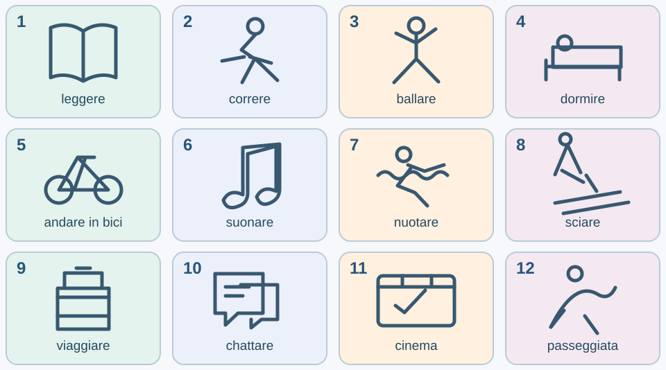

# Lezione 4 — Exercises, visual recall and shadowing practice

[← Lesson](lesson.md) · [Grammar](grammar.md) · [Vocabulary](vocabulary.md) · **Exercises**

> **Original practice** aligned with *Nuovo Espresso 1*, chapter 4, and the requested coverage **pp. 47–59**. Listening/video-dependent publisher tasks require authorized audio/video; the exercises here do not purport to supply the publisher's answer key.

## Part A — 30 sentence and grammar recall prompts

Read each prompt, answer **in Italian**, then expand only after an attempt.

**1.** Complete: Io ___ (dormire) otto ore.

Show answer

**dormo**

**2.** Complete: Noi ___ (uscire) sabato.

Show answer

**usciamo**

**3.** Complete: Tu ___ (uscire) stasera?

Show answer

**esci**

**4.** Say 'I never go skiing'.

Show answer

**Non scio mai.**

**5.** Say 'I usually read'.

Show answer

**Di solito leggo.**

**6.** Complete: Mi ___ la musica.

Show answer

**piace**

**7.** Complete: Mi ___ i film.

Show answer

**piacciono**

**8.** Ask 'Do you like jazz?' (informal)

Show answer

**Ti piace il jazz?**

**9.** Reply 'Me too' to a positive preference.

Show answer

**Anche a me!**

**10.** Ask 'At what time?'

Show answer

**A che ora?**

**11.** Say 01:00.

Show answer

**È l'una.**

**12.** Say 05:15.

Show answer

**Sono le cinque e un quarto.**

**13.** Say 07:30.

Show answer

**Sono le sette e mezza.**

**14.** Say 08:45.

Show answer

**Sono le nove meno un quarto.**

**15.** Ask someone what they do in their free time.

Show answer

**Che cosa fai nel tempo libero?**

**16.** Invite a friend to the cinema.

Show answer

**Andiamo al cinema?**

**17.** Accept the invitation politely.

Show answer

**Volentieri!**

**18.** Decline an invitation politely.

Show answer

**Mi dispiace, non posso.**

**19.** Make a new sentence with 'spesso'.

Show answer

**Esco spesso. (sample)**

**20.** Correct 'Mi piace i libri'.

Show answer

**Mi piacciono i libri.**

**21.** Correct 'Io uscire sabato'.

Show answer

**Io esco sabato.**

**22.** Say 'I don't like opera'.

Show answer

**Non mi piace l'opera.**

**23.** Ask 'Do you like reading?'

Show answer

**Ti piace leggere?**

**24.** Name three outdoor activities.

Show answer

**Correre, sciare, andare in bicicletta. (sample)**

**25.** Say 'I sometimes go to museums'.

Show answer

**Qualche volta visito musei.**

**26.** Say 'We go out at eight'.

Show answer

**Usciamo alle otto.**

**27.** Ask where a friend would like to go.

Show answer

**Dove vuoi andare?**

**28.** Describe your fictional Sunday in two sentences.

Show answer

**La domenica dormo e faccio una passeggiata. (sample)**

**29.** Say 'I like classic music but not detective films'.

Show answer

**Mi piace la musica classica, ma non mi piacciono i film gialli.**

**30.** Give a time in words: 21:15.

Show answer

**Sono le nove e un quarto di sera.**

## Part B — Picture recognition

**31.** Identify picture cards 1–8. Say an Italian phrase with the correct verb/article for each.

Sample card labels

1. leggere; 2. correre; 3. ballare; 4. dormire; 5. andare in bici; 6. suonare; 7. nuotare; 8. sciare. Now create original sentences, checking conjugation and articles.

**32.** Choose four pictured items and make **four full sentences** and **two questions**. Try to say the sentences without looking at any translation.

**33.** Use the visual cues as a speaking exercise with a partner: show a card without its label, ask a question, and let the other person answer.

## Part C — Reading comprehension

> Mi chiamo Valeria. Il sabato faccio ginnastica e il pomeriggio leggo. Mi piace il cinema ma non mi piace ballare. Qualche volta esco con Anna alle nove. Domenica di solito dormo.

**34.** What does Valeria do on Saturday?  
**35.** Does she like dancing?  
**36.** How often does she go out with Anna?

Answers 34–36

34. Fa ginnastica e legge. 35. No. 36. Qualche volta.

## Part D — Active production

**37.** Make five new sentences from different vocabulary groups. Avoid reusing the example sentences from the tables.

**38.** Write a three-turn question-and-answer dialogue, using an invitation, a preference and a clock time.

**39.** Explain in English **one word-order or grammar difference** between English and Italian, then demonstrate it with a valid Italian example.

**40.** Practise the [shadowing script](vocabulary.md#shadowing-ladder-only-with-authorized-italian-audio) with **authorized audio** if available. Otherwise practise echo repetition/read-aloud and then speak without the written model.

## Part E — Mixed review and unit project

**41.** Combine Lessons 1–4: greet a fictional new friend, introduce yourself, say which languages you speak, order a drink, and propose an evening activity.

**42.** Review page **55** and the cultural tasks on p. **58**; if you have publisher video, attempt pp. **56–57** as well.

**43.** Write a fictional seven-day leisure diary using at least three adverbs of frequency and two preferences.

## Personal review checklist

- [ ] I can identify at least eight pictured words **without a translation**.
- [ ] I can convert single words into sentences and questions.
- [ ] I can recall two forms or expressions that differ structurally from English.
- [ ] I can reproduce the mini-dialogue after hiding the text.
- [ ] I have not marked publisher listening/video tasks completed without the actual recording.

**Spaced recall suggestion:** attempt again tomorrow, in three days, and in a week; check the answer keys **after** retrieval and revisit misses sooner.

[← Lesson](lesson.md) · [Grammar](grammar.md) · [Vocabulary](vocabulary.md)