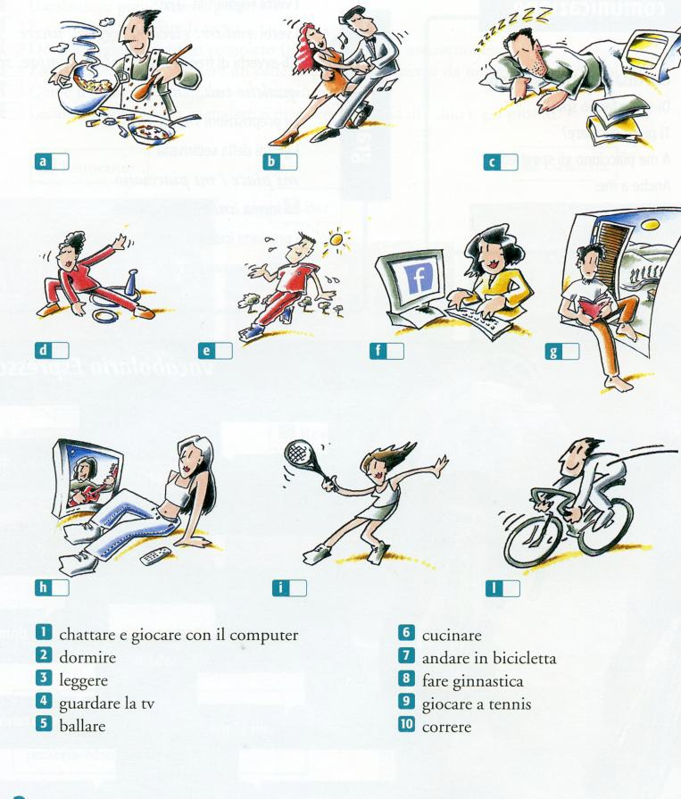
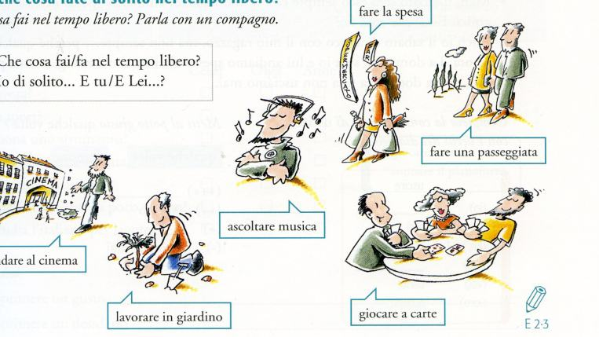
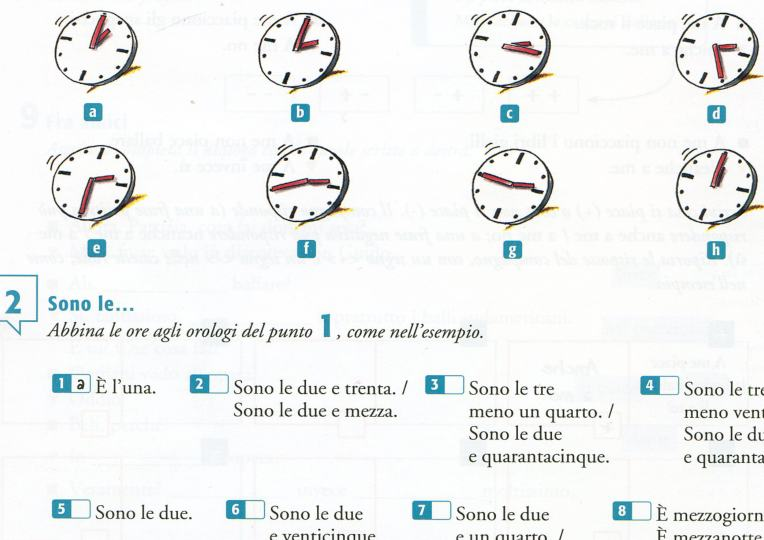
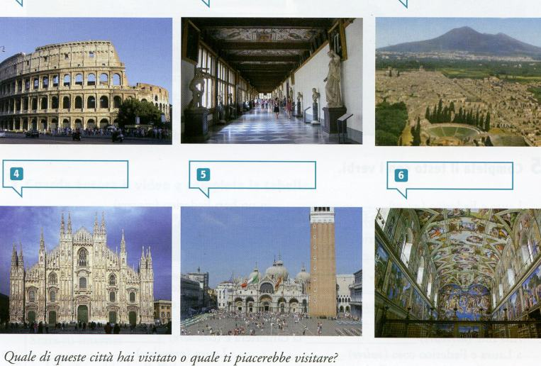

# Lezione 4 — Tempo libero

[← A1 course](../README.md) · **Lesson** · [Grammar](grammar.md) · [Vocabulary](vocabulary.md) · [Exercises](exercise.md)

> **Requested coverage:** *Nuovo_Espresso_1.pdf* pp. **47–59**. Actual chapter pp. **47–58**. Page 59 opens Lesson 5. The matching Italian–Persian glossary occupies approximately PDF pp. **25–30**. This course uses **original companion dialogues and practice**, along with **focused crops of the original textbook's pictures**. It does not reproduce complete publisher pages; see [image rights](../PHOTO_CREDITS.md).

|Photo 1|Photo 2|
|---|---|
|||

*Real photographs. [Credits](../PHOTO_CREDITS.md).*

## Book images — real crops from the supplied PDF

These are **the actual publisher illustrations**, cropped to the relevant visual areas. They are not substitute web photos. Answer the picture-specific questions in [Exercises](exercise.md#actual-book-picture-practice--with-images). [Provenance and rights](../PHOTO_CREDITS.md).

### Page 48 — Hobbies and leisure activities

### Page 49 — What do you do in your free time?

### Page 54 — Real clock-reading grid

### Page 58 — Culture and leisure places

## Learning outcomes

Discuss hobbies, sports, routines and weekends; express frequency and likes/dislikes; accept or decline invitations; talk about music, films and reading; ask and tell the time; and read short leisure profiles.

- [ ] I can reproduce an **original conversation** without reading it.
- [ ] I can use vocabulary in a **complete new Italian sentence**, not only translate it.
- [ ] I can explain at least two **Italian–English structure differences**.
- [ ] I can label picture cards, ask questions and respond.
- [ ] I can complete the book's original tasks **where media is available**.

## Page-by-page map

| PDF page | Book activity/topic | Learning task |
|---|---|---|
| **47** | Opening: Tempo libero | Preview free-time conversation, preferences and time. |
| **48** | Che cosa fanno?; Di solito faccio sport | Identify pictured leisure activities and talk about sport. |
| **49** | Che cosa fate di solito nel tempo libero? | Ask classmates what they normally do and compare routines. |
| **50** | C'era una persona che…; Che cosa fai il fine settimana? | Identify habits and talk about weekends using weekday names. |
| **51** | Sempre, spesso o mai?; Studio l'italiano | Express frequency and read short personal study profiles. |
| **52** | Il mio profilo; Fra amici; Le piace…? | Read/write a mini profile and exchange invitations or preferences. |
| **53** | Anche a me!; Che genere è questo? | Say you share or do not share a preference and identify genres. |
| **54** | Che ora è? Che ore sono? | Read illustrated clocks, ask and say time. |
| **55** | Comunicazione e grammatica | Review -ire verbs, irregular uscire, frequency adverbs, piacere, indirect pronouns and time. |
| **56–57** | Videocorso 4: I gusti psicologici | Understand a scene about tastes and preferences. |
| **58** | Caffè culturale: luoghi e turismo | Read a cultural text about visitors, landmarks and Italian cultural sites. |
| **59** | Transition: In albergo begins | Recognize the new chapter cover, without importing its grammar into Lesson 4. |

## Conversations and readings in textbook order

### 1. Opening: Tempo libero — p. 47

**What the source teaches:** Preview free-time conversation, preferences and time.

**New model conversation:**

> Quali attività ti piacciono?  
> Mi piace leggere e andare in bicicletta.

**What to notice:** The opening shows illustrated hobbies and vocabulary.

**Your turn:** Change the details, read the matching book activity and speak or write a new exchange without copying the example. Start with the illustration above and recall relevant words before looking at the vocabulary file.

### 2. Che cosa fanno?; Di solito faccio sport — p. 48

**What the source teaches:** Identify pictured leisure activities and talk about sport.

**New model conversation:**

> Che cosa fai nel tempo libero?  
> Di solito faccio sport e vado in bicicletta.

**What to notice:** Book drawings illustrate cycling, skiing, chatting, jogging and other activities.

**Your turn:** Change the details, read the matching book activity and speak or write a new exchange without copying the example. 

### 3. Che cosa fate di solito nel tempo libero? — p. 49

**What the source teaches:** Ask classmates what they normally do and compare routines.

**New model conversation:**

> Di solito ascolto musica. E tu?  
> Io faccio una passeggiata.

**What to notice:** Use io/tu and the frequency phrase di solito.

**Your turn:** Change the details, read the matching book activity and speak or write a new exchange without copying the example. 

### 4. C'era una persona che…; Che cosa fai il fine settimana? — p. 50

**What the source teaches:** Identify habits and talk about weekends using weekday names.

**New model conversation:**

> Che cosa fai il sabato?  
> Spesso esco con gli amici.

**What to notice:** The book has a class interview and a weekday/frequency completion.

**Your turn:** Change the details, read the matching book activity and speak or write a new exchange without copying the example. 

### 5. Sempre, spesso o mai?; Studio l'italiano — p. 51

**What the source teaches:** Express frequency and read short personal study profiles.

**New model conversation:**

> Vai spesso al cinema?  
> Qualche volta, ma non ci vado mai il lunedì.

**What to notice:** Read source profiles and decide which activities are common.

**Your turn:** Change the details, read the matching book activity and speak or write a new exchange without copying the example. 

### 6. Il mio profilo; Fra amici; Le piace…? — p. 52

**What the source teaches:** Read/write a mini profile and exchange invitations or preferences.

**New model conversation:**

> Ti piace il jazz?  
> Sì, molto! A me piace anche il cinema.

**What to notice:** Use the illustrated dialogue activity and practice mi piace/a me piace.

**Your turn:** Change the details, read the matching book activity and speak or write a new exchange without copying the example. 

### 7. Anche a me!; Che genere è questo? — p. 53

**What the source teaches:** Say you share or do not share a preference and identify genres.

**New model conversation:**

> Mi piace la musica classica.  
> Anche a me!  
> A me invece no.

**What to notice:** Notice the difference between agreement and disagreement.

**Your turn:** Change the details, read the matching book activity and speak or write a new exchange without copying the example. 

### 8. Che ora è? Che ore sono? — p. 54

**What the source teaches:** Read illustrated clocks, ask and say time.

**New model conversation:**

> Che ore sono?  
> Sono le quattro e un quarto.

**What to notice:** The pictured clocks show several times. Use e un quarto, e mezza, meno un quarto.

**Your turn:** Change the details, read the matching book activity and speak or write a new exchange without copying the example. 

### 9. Comunicazione e grammatica — p. 55

**What the source teaches:** Review -ire verbs, irregular uscire, frequency adverbs, piacere, indirect pronouns and time.

**New model conversation:**

> Usciamo stasera?  
> Volentieri! A che ora?  
> Alle otto.

**What to notice:** This is the chapter's grammar consolidation page.

**Your turn:** Change the details, read the matching book activity and speak or write a new exchange without copying the example. 

### 10. Videocorso 4: I gusti psicologici — p. 56–57

**What the source teaches:** Understand a scene about tastes and preferences.

**New model conversation:**

> Ti piace correre?  
> Non molto. Preferisco leggere.

**What to notice:** Publisher video required for its real comprehension answers; this example is original.

**Your turn:** Change the details, read the matching book activity and speak or write a new exchange without copying the example. 

### 11. Caffè culturale: luoghi e turismo — p. 58

**What the source teaches:** Read a cultural text about visitors, landmarks and Italian cultural sites.

**New model conversation:**

> Ti piace visitare musei?  
> Sì, mi piacciono molto.

**What to notice:** Book includes cultural images of Italian monuments; do not assume historical statistics are current.

**Your turn:** Change the details, read the matching book activity and speak or write a new exchange without copying the example. 

### 12. Transition: In albergo begins — p. 59

**What the source teaches:** Recognize the new chapter cover, without importing its grammar into Lesson 4.

**New model conversation:**

> Buon fine settimana!  
> Grazie, anche a te!

**What to notice:** Page 59 is the opening of Lesson 5.

**Your turn:** Change the details, read the matching book activity and speak or write a new exchange without copying the example. 

## A complete reading task (original)

> **Il mio sabato** — Sono Elisa e lavoro dal lunedì al venerdì. Il sabato di solito dormo fino alle nove, poi faccio la spesa. Nel pomeriggio leggo o vado in bicicletta. Mi piace il cinema, ma non mi piacciono i film gialli. Domenica qualche volta visito un museo.

**Questions:** 1. Quando lavora Elisa? 2. Che cosa fa il sabato pomeriggio? 3. Quale genere non le piace? 4. Cosa fa qualche volta la domenica?

Show reading answers

1. Dal lunedì al venerdì. 2. Legge o va in bicicletta. 3. I film gialli. 4. Visita un museo.

## Practice sequence and memory method

1. **See:** Cover the captions on the real photographs.
2. **Recall:** Say the Italian item with an article or correct verb form.
3. **Connect:** Read its English meaning but note where word-for-word translation fails.
4. **Build:** Make a statement and then a question using the same item.
5. **Speak:** Repeat a short original dialogue; use native Italian audio for **true shadowing**.
6. **Retrieve:** After one day, three days and seven days, attempt the same task **before** opening answers.

Study [Grammar](grammar.md) and [Vocabulary](vocabulary.md), then test yourself in [Exercises](exercise.md). The texts, illustrations and recordings of the publisher remain in the source, not in this public repository.

[Grammar →](grammar.md) · [Vocabulary →](vocabulary.md) · [Exercises →](exercise.md)