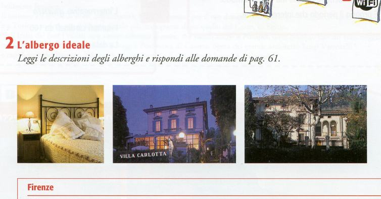
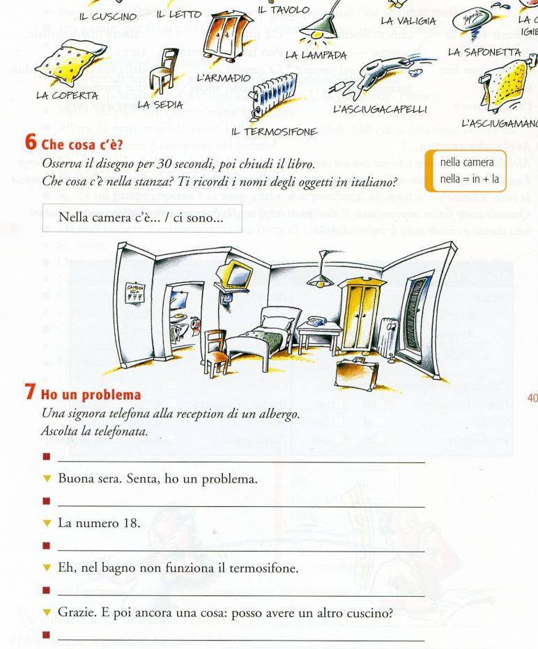
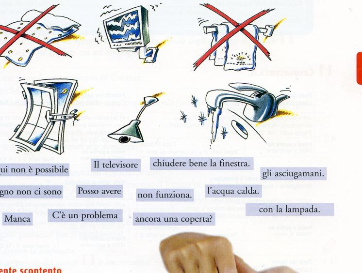
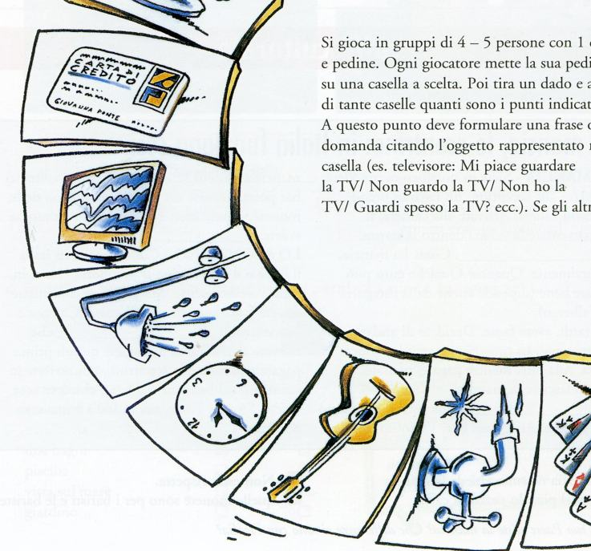

# Lezione 5 — Exercises, visual recall and shadowing practice

[← Lesson](lesson.md) · [Grammar](grammar.md) · [Vocabulary](vocabulary.md) · **Exercises**

> **Original practice** aligned with *Nuovo Espresso 1*, chapter 5, and the requested coverage **pp. 59–75**. Listening/video-dependent publisher tasks require authorized audio/video; the exercises here do not purport to supply the publisher's answer key.

## Original textbook picture practice — with answer checks

**Actual original book crops are below**, not instructions to open another PDF. Read the picture, produce an Italian answer, and expand the companion model. Official listening tasks still need the original audio.

### Picture 1: Compare the three hotels (PDF p. 60)

**Try:** Look at the actual accommodation photographs and describe the rooms and surroundings. Choose one for a fictional booking.

Show model answer

**Vorrei una camera doppia in un albergo tranquillo. C'è una bella vista?** Hotel features should only be claimed if visible in the picture or listed in the source description.

### Picture 2: Hotel facilities and objects (PDF p. 64)

**Try:** Name six illustrated hotel facilities and form two questions using *c'è / ci sono*.

Show model answer

**C'è una piscina? C'è un ascensore? Ci sono due bagni?** Identify the actual objects in the illustrated source grid.

### Picture 3: Room problems and requests (PDF p. 65)

**Try:** Use the source's crossed-out objects and problem pictures to invent three polite complaints at reception.

Show model answer

**Mi scusi, il televisore non funziona. Manca un asciugamano. Può cambiare la lampada, per favore?**

### Picture 4: Picture-based review (Lessons 3–5) (PDF p. 72)

**Try:** Choose four visual board spaces from the original review game. Create a hotel booking, café order, time question and one complaint.

Show model answer

**Vorrei una camera. Prendo un cappuccino. Che ore sono? La doccia non funziona.** These are original tasks, not the publisher's official board solutions.

## Part A — 30 sentence and grammar recall prompts

Read each prompt, answer **in Italian**, then expand only after an attempt.

**1.** Complete: ___ una camera libera?

Show answer

**C'è**

**2.** Complete: ___ due camere disponibili.

Show answer

**Ci sono**

**3.** Say 'There is no parking'.

Show answer

**Non c'è il parcheggio.**

**4.** Ask for a double-bed room.

Show answer

**Avete una camera matrimoniale?**

**5.** Ask the price per night.

Show answer

**Quanto costa a notte?**

**6.** Ask whether breakfast is included.

Show answer

**La colazione è compresa?**

**7.** Ask 'Is there Wi-Fi?'

Show answer

**C'è il Wi-Fi?**

**8.** Say 'The shower doesn't work'.

Show answer

**La doccia non funziona.**

**9.** Say 'A towel is missing'.

Show answer

**Manca un asciugamano.**

**10.** Request a room politely.

Show answer

**Vorrei prenotare una camera.**

**11.** Say 250 in Italian.

Show answer

**duecentocinquanta**

**12.** Say 1,000 in Italian.

Show answer

**mille**

**13.** Say 2,000 in Italian.

Show answer

**duemila**

**14.** Write July 1st in Italian.

Show answer

**il primo luglio**

**15.** Write July 2nd in Italian.

Show answer

**il due luglio**

**16.** Say 'from August 3 to August 7'.

Show answer

**dal tre al sette agosto**

**17.** Translate 'balcony'.

Show answer

**balcone**

**18.** Translate 'lift'.

Show answer

**ascensore**

**19.** Translate 'parking'.

Show answer

**parcheggio**

**20.** Translate 'holiday rental'.

Show answer

**casa vacanze / alloggio per le vacanze**

**21.** Ask 'How much is the room?'

Show answer

**Quanto viene la camera?**

**22.** Say 'the room is dirty'.

Show answer

**La camera è sporca.**

**23.** Say 'the television is broken'.

Show answer

**Il televisore è rotto.**

**24.** Say 'We want to rent an apartment'.

Show answer

**Vogliamo prendere in affitto un appartamento.**

**25.** Translate 'receipt'.

Show answer

**scontrino**

**26.** Translate 'tip'.

Show answer

**mancia**

**27.** Ask for a price total.

Show answer

**Qual è il prezzo totale?**

**28.** Say a fictional arrival date.

Show answer

**Arrivo il cinque agosto. (sample)**

**29.** Make 'c'è una camera' plural.

Show answer

**ci sono due camere**

**30.** Write a polite complaint about heating.

Show answer

**Mi scusi, il riscaldamento non funziona.**

## Part B — Picture recognition

|Photo 1|Photo 2|Photo 3|Photo 4|
|---|---|---|---|
||||.jpg?width=500)|

*Real photographs. [Credits](../PHOTO_CREDITS.md).*

**31.** Identify the four photographs: a hotel room, a reception area, a swimming pool and a shower. Say one or two Italian expressions for each. No photograph shows all eight amenities from the old diagram.

Sample card labels

1. `camera`; 2. `reception`; 3. `piscina`; 4. `doccia`. Practice other facilities using the vocabulary table. Now create original sentences, checking conjugation and articles.

|Photo 1|Photo 2|
|---|---|
|.jpg?width=500)||

*Real photographs. [Credits](../PHOTO_CREDITS.md).*

**32.** Study the two **real hotel photographs**. Invent four hypothetical hotel complaints and two polite questions. **Do not claim the photographed shower or room is broken**; the task is language practice. Try to say the sentences without looking at any translation.

**33.** Use the visual cues as a speaking exercise with a partner: show a card without its label, ask a question, and let the other person answer.

## Part C — Reading comprehension

> Buongiorno, cerco una camera doppia dal sei al nove settembre. Vorrei il bagno privato, la colazione e il parcheggio. Ho bisogno anche del Wi-Fi. Potete confermare il prezzo totale? Grazie.

**34.** Which room is requested?  
**35.** Give the dates in Italian.  
**36.** Which three amenities are mentioned in addition to the private bathroom?

Answers 34–36

34. Camera doppia. 35. Dal sei al nove settembre. 36. Colazione, parcheggio e Wi-Fi.

## Part D — Active production

**37.** Make five new sentences from different vocabulary groups. Avoid reusing the example sentences from the tables.

**38.** Write a three-turn question-and-answer dialogue, using a booking enquiry, a room feature and a price.

**39.** Explain in English **one word-order or grammar difference** between English and Italian, then demonstrate it with a valid Italian example.

**40.** Practise the [shadowing script](vocabulary.md#shadowing-ladder-only-with-authorized-italian-audio) with **authorized audio** if available. Otherwise practise echo repetition/read-aloud and then speak without the written model.

## Part E — Mixed review and unit project

**41.** Use the original *Facciamo il punto 2* board (pp. **72–73**) and answer questions covering food, free time and hotel vocabulary.

**42.** Use p. **74** to self-assess: can you order, express preferences, reserve a room, ask about dates and report problems?

**43.** Plan a **fictional** short holiday in Italy: compare two imaginary accommodations, state dates, ask about price and amenities and write a polite booking message. Do not publish real contact details or plans.

## Personal review checklist

- [ ] I can identify at least eight pictured words **without a translation**.
- [ ] I can convert single words into sentences and questions.
- [ ] I can recall two forms or expressions that differ structurally from English.
- [ ] I can reproduce the mini-dialogue after hiding the text.
- [ ] I have not marked publisher listening/video tasks completed without the actual recording.

**Spaced recall suggestion:** attempt again tomorrow, in three days, and in a week; check the answer keys **after** retrieval and revisit misses sooner.

[← Lesson](lesson.md) · [Grammar](grammar.md) · [Vocabulary](vocabulary.md)