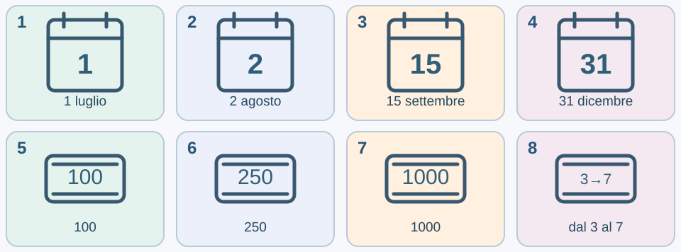

# Lezione 5 — Grammar, examples and memory bridges

[← Lesson](lesson.md) · **Grammar** · [Vocabulary](vocabulary.md) · [Exercises](exercise.md)

> Source alignment: the chapter's **Comunicazione e grammatica** summary on p. **69** and conversations across pp. **59–71**. Memory associations and English comparisons are **original teaching aids**, not grammar rules in themselves.

## 1. C'è and ci sono

| Italian | English |
|---|---|
| C'è una camera. | There is one room. |
| Ci sono due camere. | There are two rooms. |
| Non c'è il Wi-Fi. | There is no Wi-Fi. |
| Ci sono quattro letti? | Are there four beds? |

**How to remember and avoid English interference:** **English bridge:** singular *there is* → `c'è`; plural *there are* → `ci sono`. The negative `non` goes before `c'è/ci sono`.

One-minute practice

Choose a new subject or object and produce **two complete Italian sentences** with this pattern. Then check the table above and correct the verb ending or noun article.

## 2. Rooms, adjectives and agreement

| Italian | English |
|---|---|
| camera singola | single room |
| camera doppia | twin / double-occupancy room (check bed layout) |
| camera matrimoniale | room with a double bed |
| bagno privato | private bathroom |
| colazione compresa | breakfast included |

**How to remember and avoid English interference:** Adjectives can agree with nouns: `camera singola`, `camere singole`. Don't assume English 'double room' always indicates one double bed; `matrimoniale` usually clarifies bed type.

One-minute practice

Choose a new subject or object and produce **two complete Italian sentences** with this pattern. Then check the table above and correct the verb ending or noun article.

## 3. Place expressions and prepositions

| Pattern | Example |
|---|---|
| in + town/country context | `in Italia` |
| a + city | `a Firenze` |
| vicino a | `vicino alla stazione` |
| con / senza | `con bagno` / `senza balcone` |
| dal ... al ... | `dal tre al sette luglio` |

**How to remember and avoid English interference:** The book develops `di/a/da/in` in practical location and date phrases. **Do not translate English *from / to / in* word-by-word** without learning the whole Italian chunk.

One-minute practice

Choose a new subject or object and produce **two complete Italian sentences** with this pattern. Then check the table above and correct the verb ending or noun article.

## 4. Prices and numbers over 100

| Number | Italian |
|---:|---|
| 100 | cento |
| 101 | centouno |
| 200 | duecento |
| 500 | cinquecento |
| 1,000 | mille |
| 2,000 | duemila |
| 1,250 | milleduecentocinquanta |

**How to remember and avoid English interference:** `Quanto viene?` and `Quanto costa?` both ask about price in relevant contexts. `100` is `cento`, but `1,000` is `mille`, not `un cento`.

One-minute practice

Choose a new subject or object and produce **two complete Italian sentences** with this pattern. Then check the table above and correct the verb ending or noun article.

## 5. Dates, months and ordinal numbers

| Italian | Explanation |
|---|---|
| il primo maggio | May 1st |
| il due maggio | May 2nd |
| dal primo al cinque luglio | from July 1st to July 5th |
| il dieci agosto | August 10th |
| 15/06/2026 | 15 June 2026 in day/month/year convention |

**How to remember and avoid English interference:** Italian dates generally use **primo** for the first day and **cardinal** numbers for other days. English typically uses ordinal words for all days (*the second, third*).

One-minute practice

Choose a new subject or object and produce **two complete Italian sentences** with this pattern. Then check the table above and correct the verb ending or noun article.

## 6. Polite requests and reporting problems

| Scenario | Italian |
|---|---|
| Booking | `Vorrei prenotare una camera.` |
| Availability | `Avete una camera libera?` |
| Price | `Quanto costa a notte?` |
| No Wi-Fi | `Non c'è il Wi-Fi.` |
| Broken shower | `La doccia non funziona.` |
| Missing towel | `Manca un asciugamano.` |

**How to remember and avoid English interference:** Use `mi scusi`, `per favore`, `grazie`, `potrebbe...?` politely. `Potrebbe` is an optional advanced polite form; A1 also accepts `Può...?`.

One-minute practice

Choose a new subject or object and produce **two complete Italian sentences** with this pattern. Then check the table above and correct the verb ending or noun article.

## Picture-based grammar recall

- One room → `C'è una camera.` Two rooms → `Ci sono due camere.`
- Broken television → `Il televisore non funziona.`
- Date card 1/7 → `il primo luglio`; 2/7 → `il due luglio`.
- Price 250 → `duecentocinquanta euro`.

## English–Italian sentence-ladder exercise

English *There are two rooms* → Italian `Ci sono due camere.` Italian uses `ci sono` for plural. Build `C'è una camera → Ci sono due camere → Ci sono due camere libere?`.

**Technique:** Read English once for meaning, identify the **Italian structure**, then speak the final sentence *entirely in Italian*. Do not rehearse mixed-language phrases as though they were Italian.

## Quick error-correction quiz

1. ❌ `C'è due camere.` → ?
2. ❌ `Il camera è libera.` → ?
3. ❌ `il due giugno` expressed as `il secondo giugno` in an ordinary date → ?

Reveal answers

1. `Ci sono due camere.` 2. `La camera è libera.` 3. `Il due giugno.`

[← Lesson](lesson.md) · [Vocabulary →](vocabulary.md) · [Exercises →](exercise.md)