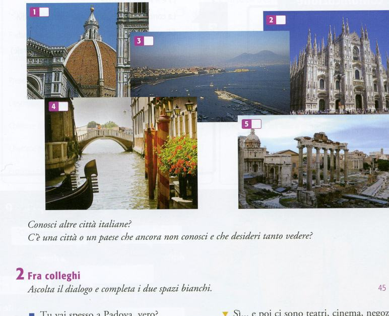
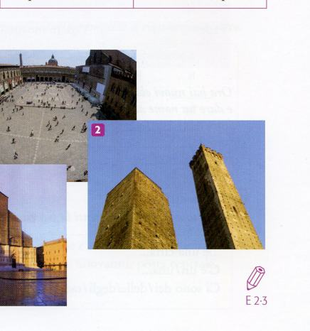
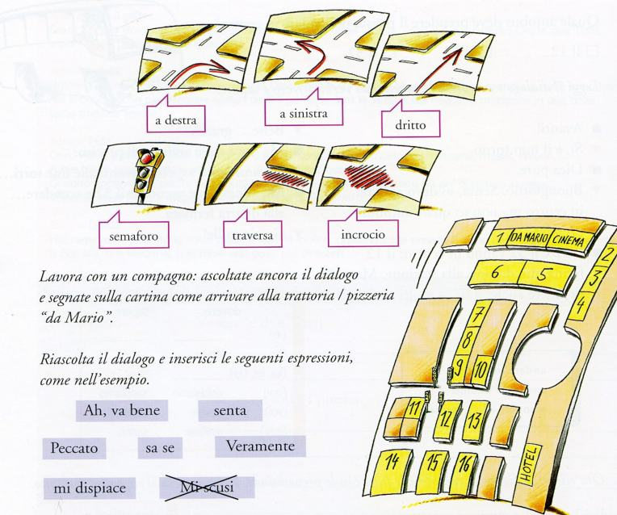
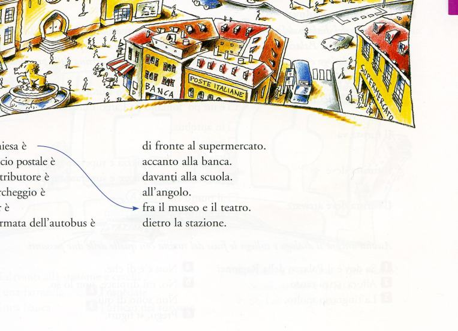
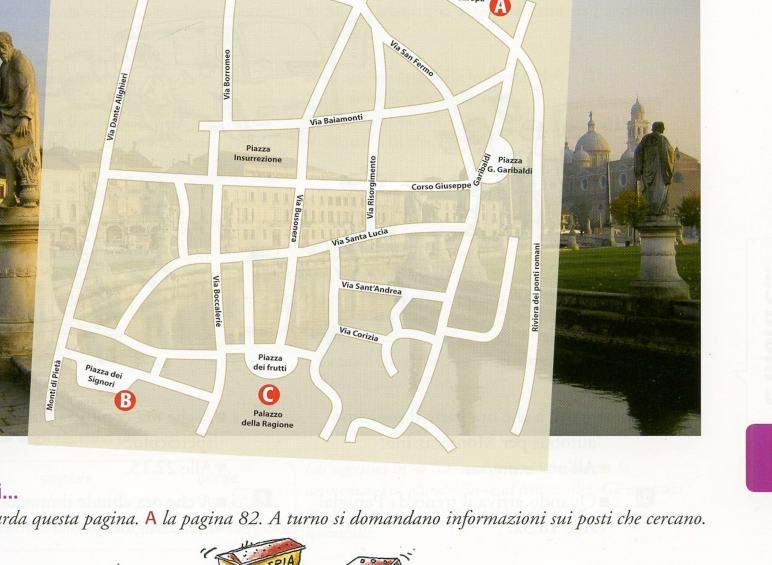

# A1 · Lezione 6 — In giro per l'Italia

[← A1 course](../README.md) · **Lesson** · [Grammar](grammar.md) · [Vocabulary](vocabulary.md) · [Exercises](exercise.md)

> **Requested source range:** *Nuovo_Espresso_1.pdf* pp. **75–89**. Chapter itself: **pp. 75–88**. Page 89 opens Lesson 7. Matching Italian–Persian glossary: PDF pp. **39–44**, including boundary pages.

## Actual cropped book pictures

These are **the original source images from the uploaded Nuovo Espresso 1 textbook**. Use them directly, then answer the [matching picture exercises](exercise.md#original-textbook-picture-practice--with-answer-checks). See [credits and publisher rights](../PHOTO_CREDITS.md).

### Page 76 — Five actual Italian city photographs

### Page 77 — Bologna's piazza, towers and church

### Page 80 — Six direction illustrations

### Page 81 — Actual illustrated town scene

### Page 83 — Route map of Padova

## Goals and learning method

Recognize Italian city landmarks; describe towns using **c'è/ci sono**, partitives and adjectives; ask for places, bus stops and walking directions; say opening and departure times; and understand the civic role of the piazza.

Use **see → say → sentence → dialogue → hidden recall**. Each source activity below gets an original model dialogue and a book-specific picture/reading task. The course includes both credited third-party photographs and **limited cropped original textbook illustrations**; see the rights and source notes in [PHOTO_CREDITS.md](../PHOTO_CREDITS.md).

## Real-photo preview and textbook-picture tasks

| Real-photo prompt | Task from the book |
|---|---|
|  | Open your PDF p. **76** and compare the **publisher's actual picture activity** with this distinct photograph. Say two Italian sentences about what you can see. |
|  | Open your PDF p. **77–78** and compare the **publisher's actual picture activity** with this distinct photograph. Say two Italian sentences about what you can see. |
|  | Open your PDF p. **84** and compare the **publisher's actual picture activity** with this distinct photograph. Say two Italian sentences about what you can see. |

[Photo credits and licenses](../PHOTO_CREDITS.md). Photos are illustrative and not a substitute for the source's original picture matching.

## Complete source map

| PDF page | Source activity | Aim |
|---|---|---|
| 75 | **Apertura — In giro per l'Italia** | The overview introduces describing towns, asking directions, opening times, adjective agreement, ci, dovere and sapere. |
| 76 | **1 · Il Bel Paese** | Photographs show five city landmarks: Firenze, Roma, Venezia, Napoli and Milano. |
| 76–77 | **2 · Fra colleghi** | A dialogue about Padova leads into adjectives and plural forms. |
| 77 | **3 · Cosa c'è in questa città?** | An illustrated word grid supports singular/plural noun and adjective matching. |
| 77 | **4 · Cosa c'è a Bologna?** | Three photos show a square, towers and a church for recognition and inference. |
| 78 | **5 · Cose da vedere e da fare a Bologna** | Read the forum-style posts by Felix il gatto, Lulu82 and Fede and attribute recommendations. |
| 78 | **6 · La mia città** | Produce a short description of a town using c'è/ci sono, adjective agreement and photos. |
| 79 | **7 · All'ufficio informazioni** | The tourist chooses bus 12, 67 or 32 and asks where to get off; learn dovere/sapere. |
| 79 | **8 · Dove devo scendere?** | Substitute destinations: duomo, museo archeologico, teatro comunale, chiesa di San Giovanni, posta centrale, biblioteca, università. |
| 80 | **9 · Alla reception** | Picture cards show a destra, a sinistra, dritto, semaforo, traversa, incrocio; a map shows a route to a restaurant. |
| 81 | **10 · Dov'è …? / 11 · Dov'è l'ufficio postale?** | Follow short written directions using the colourful street scene near the station, post office, bank and theatre. |
| 82–83 | **12 · Scusi…** | Two detailed schematic town maps and A/B information-gap dialogues locate different facilities. |
| 82–83 | **13 · Una visita a Padova** | A tourist asks about Palazzo della Ragione and a route from Largo Europa; choices cover foot/bus and crossing. |
| 84 | **E inoltre… — A che ora? / E da voi?** | Bus departure, train arrival, spectacle and museum opening times, plus illustrated business opening schedules. |
| 85 | **Comunicazione e grammatica** | Summary of adjective plurals, -co/-ca, partitives, molto, ci with andare, dovere, sapere, question words and clock time. |
| 86–87 | **Videocorso 6 · La seconda a destra** | The story uses photographs of tourists and a direction-giving misunderstanding, plus a photo-matching task with monuments. |
| 88 | **Caffè culturale · La piazza** | Images of Italian street types and a cultural reading explain the social role of the piazza. |
| 89 | **Transition to Lesson 7** | The green cover is **Andiamo in vacanza!**, not Lesson 6 content. |

## Original conversations and reading prompts

### 1. Apertura — In giro per l'Italia — book p. 75

**Source activity:** The overview introduces describing towns, asking directions, opening times, adjective agreement, ci, dovere and sapere.

**Original companion dialogue:**

> **A:** Come si arriva al centro?  
> **B:** Dalla stazione, può andare a piedi.

**Use the book's pictures/reading:** Read the purple communication and grammar overview; note the direction vocabulary in the word clouds.

**Speaking transfer:** Replace the places, times, people or events with fictional alternatives, then ask the corresponding question without checking the text.

### 2. 1 · Il Bel Paese — book p. 76

**Source activity:** Photographs show five city landmarks: Firenze, Roma, Venezia, Napoli and Milano.

**Original companion dialogue:**

> **A:** È una città famosa per i monumenti.  
> **B:** È Firenze? / Sì, esatto!

**Use the book's pictures/reading:** Look at **the actual five photos** on p. 76, identify each landmark and justify your city match.

**Speaking transfer:** Replace the places, times, people or events with fictional alternatives, then ask the corresponding question without checking the text.

### 3. 2 · Fra colleghi — book p. 76–77

**Source activity:** A dialogue about Padova leads into adjectives and plural forms.

**Original companion dialogue:**

> **A:** Com'è Padova?  
> **B:** È una città vivace e tranquilla. Ci sono molti musei.

**Use the book's pictures/reading:** Book activity includes listening/completing a dialogue; check original audio separately.

**Speaking transfer:** Replace the places, times, people or events with fictional alternatives, then ask the corresponding question without checking the text.

### 4. 3 · Cosa c'è in questa città? — book p. 77

**Source activity:** An illustrated word grid supports singular/plural noun and adjective matching.

**Original companion dialogue:**

> **A:** Ci sono dei palazzi antichi.  
> **B:** C'è anche una chiesa famosa.

**Use the book's pictures/reading:** Use the grid's **palazzo, castello, torre, museo, chiesa, teatro, ristorante** prompts.

**Speaking transfer:** Replace the places, times, people or events with fictional alternatives, then ask the corresponding question without checking the text.

### 5. 4 · Cosa c'è a Bologna? — book p. 77

**Source activity:** Three photos show a square, towers and a church for recognition and inference.

**Original companion dialogue:**

> **A:** Secondo me ci sono delle torri famose.  
> **B:** Sì, guarda la foto numero due.

**Use the book's pictures/reading:** Do the book's checkbox prediction **before** reading p. 78.

**Speaking transfer:** Replace the places, times, people or events with fictional alternatives, then ask the corresponding question without checking the text.

### 6. 5 · Cose da vedere e da fare a Bologna — book p. 78

**Source activity:** Read the forum-style posts by Felix il gatto, Lulu82 and Fede and attribute recommendations.

**Original companion dialogue:**

> **A:** Che cosa si può fare a Bologna?  
> **B:** Si può passeggiare sotto i portici.

**Use the book's pictures/reading:** The post-matching answers belong to the original book, so do the matching from your copy.

**Speaking transfer:** Replace the places, times, people or events with fictional alternatives, then ask the corresponding question without checking the text.

### 7. 6 · La mia città — book p. 78

**Source activity:** Produce a short description of a town using c'è/ci sono, adjective agreement and photos.

**Original companion dialogue:**

> **A:** La mia città è piccola ma vivace.  
> **B:** Ci sono due musei e una piazza grande.

**Use the book's pictures/reading:** Use a real city you know or an invented location; attach only images you are permitted to reuse.

**Speaking transfer:** Replace the places, times, people or events with fictional alternatives, then ask the corresponding question without checking the text.

### 8. 7 · All'ufficio informazioni — book p. 79

**Source activity:** The tourist chooses bus 12, 67 or 32 and asks where to get off; learn dovere/sapere.

**Original companion dialogue:**

> **A:** Scusi, devo andare in centro. Quale autobus devo prendere?  
> **B:** Il 32. Deve scendere alla quarta fermata.

**Use the book's pictures/reading:** Study the book's bus illustration and listening choices. Do not guess the recorded audio answer.

**Speaking transfer:** Replace the places, times, people or events with fictional alternatives, then ask the corresponding question without checking the text.

### 9. 8 · Dove devo scendere? — book p. 79

**Source activity:** Substitute destinations: duomo, museo archeologico, teatro comunale, chiesa di San Giovanni, posta centrale, biblioteca, università.

**Original companion dialogue:**

> **A:** Per il teatro, quale autobus devo prendere?  
> **B:** Prenda il 5 e scenda alla terza fermata.

**Use the book's pictures/reading:** Numbers and routes here are **original fictional practice**, not factual city transport directions.

**Speaking transfer:** Replace the places, times, people or events with fictional alternatives, then ask the corresponding question without checking the text.

### 10. 9 · Alla reception — book p. 80

**Source activity:** Picture cards show a destra, a sinistra, dritto, semaforo, traversa, incrocio; a map shows a route to a restaurant.

**Original companion dialogue:**

> **A:** C'è una trattoria qui vicino?  
> **B:** Sì. Vada dritto, poi giri a sinistra al semaforo.

**Use the book's pictures/reading:** Point to all six **real book picture cards** and then describe an imaginary route.

**Speaking transfer:** Replace the places, times, people or events with fictional alternatives, then ask the corresponding question without checking the text.

### 11. 10 · Dov'è …? / 11 · Dov'è l'ufficio postale? — book p. 81

**Source activity:** Follow short written directions using the colourful street scene near the station, post office, bank and theatre.

**Original companion dialogue:**

> **A:** Scusi, dov'è la posta?  
> **B:** È di fronte alla banca, vicino al teatro.

**Use the book's pictures/reading:** Check the actual p. 81 street image before answering placement questions.

**Speaking transfer:** Replace the places, times, people or events with fictional alternatives, then ask the corresponding question without checking the text.

### 12. 12 · Scusi… — book p. 82–83

**Source activity:** Two detailed schematic town maps and A/B information-gap dialogues locate different facilities.

**Original companion dialogue:**

> **A:** Scusi, c'è una farmacia qui vicino?  
> **B:** Sì, è accanto alla banca.

**Use the book's pictures/reading:** Book map A (p. 82) and map B (p. 83) are **not identical**; role-play from the correct one.

**Speaking transfer:** Replace the places, times, people or events with fictional alternatives, then ask the corresponding question without checking the text.

### 13. 13 · Una visita a Padova — book p. 82–83

**Source activity:** A tourist asks about Palazzo della Ragione and a route from Largo Europa; choices cover foot/bus and crossing.

**Original companion dialogue:**

> **A:** Il palazzo è lontano da qui?  
> **B:** No, può andare a piedi. Attraversi la piazza.

**Use the book's pictures/reading:** Use the Padova map on p. 83 and check the audio choices only if recorded media is available.

**Speaking transfer:** Replace the places, times, people or events with fictional alternatives, then ask the corresponding question without checking the text.

### 14. E inoltre… — A che ora? / E da voi? — book p. 84

**Source activity:** Bus departure, train arrival, spectacle and museum opening times, plus illustrated business opening schedules.

**Original companion dialogue:**

> **A:** A che ora apre il museo?  
> **B:** Alle nove e mezza. / E a che ora chiude? / Alle sei.

**Use the book's pictures/reading:** Read the four source dialogues and the opening-hours photos; compare to your own city's schedules without assuming the textbook times are current.

**Speaking transfer:** Replace the places, times, people or events with fictional alternatives, then ask the corresponding question without checking the text.

### 15. Comunicazione e grammatica — book p. 85

**Source activity:** Summary of adjective plurals, -co/-ca, partitives, molto, ci with andare, dovere, sapere, question words and clock time.

**Original companion dialogue:**

> **A:** A Bologna ci sono delle chiese famose.  
> **B:** Ci vado spesso. / Lei sa dov'è il museo?

**Use the book's pictures/reading:** Study the corresponding [grammar reference](grammar.md).

**Speaking transfer:** Replace the places, times, people or events with fictional alternatives, then ask the corresponding question without checking the text.

### 16. Videocorso 6 · La seconda a destra — book p. 86–87

**Source activity:** The story uses photographs of tourists and a direction-giving misunderstanding, plus a photo-matching task with monuments.

**Original companion dialogue:**

> **A:** È tutto vicino?  
> **B:** Non molto. Vada dritto e poi giri a destra.

**Use the book's pictures/reading:** Publisher video required to verify the original true/false answers. Our dialogues are not its transcript.

**Speaking transfer:** Replace the places, times, people or events with fictional alternatives, then ask the corresponding question without checking the text.

### 17. Caffè culturale · La piazza — book p. 88

**Source activity:** Images of Italian street types and a cultural reading explain the social role of the piazza.

**Original companion dialogue:**

> **A:** In piazza incontriamo gli amici.  
> **B:** A volte prendiamo un caffè e chiacchieriamo.

**Use the book's pictures/reading:** The page labels **via, viale, corso, largo, vicolo, piazza**; make a new city-description paragraph.

**Speaking transfer:** Replace the places, times, people or events with fictional alternatives, then ask the corresponding question without checking the text.

### 18. Transition to Lesson 7 — book p. 89

**Source activity:** The green cover is **Andiamo in vacanza!**, not Lesson 6 content.

**Original companion dialogue:**

> **A:** Arrivederci, buon viaggio!  
> **B:** Grazie!

**Use the book's pictures/reading:** Start Lesson 7 at p. 89.

**Speaking transfer:** Replace the places, times, people or events with fictional alternatives, then ask the corresponding question without checking the text.

## Reading mission — original practice (not the book's text)

> **La città di Marta** — È una città vivace. In centro ci sono **dei musei interessanti** e **delle chiese antiche**. La biblioteca è **accanto alla posta**. Per arrivare al mercato dalla stazione, vai sempre dritto, poi gira a destra al primo semaforo. Il museo apre alle nove.

**Questions:** Dove si trova la biblioteca? Che cosa c'è in centro? Come si arriva al mercato? A che ora apre il museo?

Reveal answers

Accanto alla posta; dei musei interessanti e delle chiese antiche; dritto e poi a destra al primo semaforo; alle nove.

## Shadowing and retrieval

- **Repeat aloud** the original companion exchange for each activity. First understand, then echo line by line, then speak without looking, then create your own exchange.
- **True audio shadowing** requires a lawful, accessible Italian recording. The textbook's audio/video is not republished here; do not claim listening tasks are complete from printed pages alone.
- **Spaced recall:** try again tomorrow, in three days and after seven days, retrieving whole sentences before checking the examples.
- **English comparisons** and grammar memory cues are in [Grammar](grammar.md); [Vocabulary](vocabulary.md) adds photo thumbnails beside concrete terms and emojis for abstract terms.

## Source boundaries and permissions

The textbook's photos on **pp. 76–78**, street illustrations/maps on **pp. 79–83**, clock and business-hour images on **p. 84**, video stills **pp. 86–87**, and streetscape photos **p. 88** are used as **prompts in your own lawful copy**.

**Additional published-book practice:** In the 239-page source scan, **Esercizi 6 begins on PDF p. 174**. Work through that original exercise section in your lawful book copy, then complete the [original GitHub exercise workbook](exercise.md). The book's printed listening exercises require its audio. Do not upload publisher photos, recorded audio or long exercise text into a public repository without redistribution rights. All conversations and extra exercises here are original.

[← A1 menu](../README.md) · [Grammar →](grammar.md) · [Vocabulary →](vocabulary.md) · [Exercises →](exercise.md) · [Next lesson →](../lesson-07/lesson.md)
