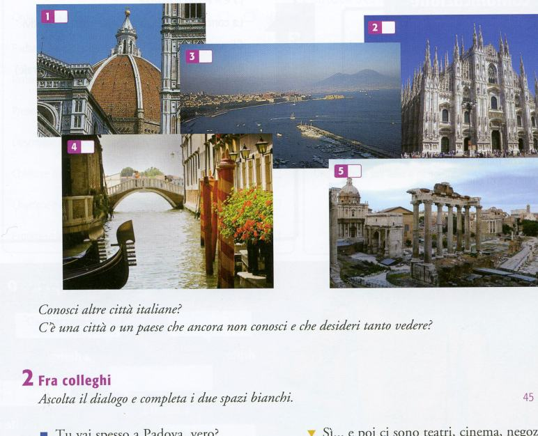
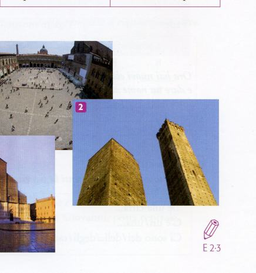
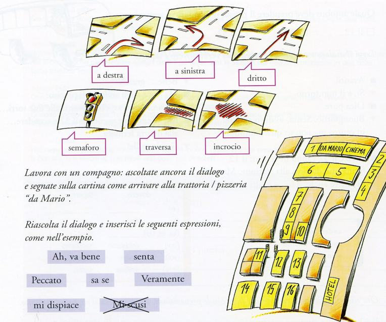
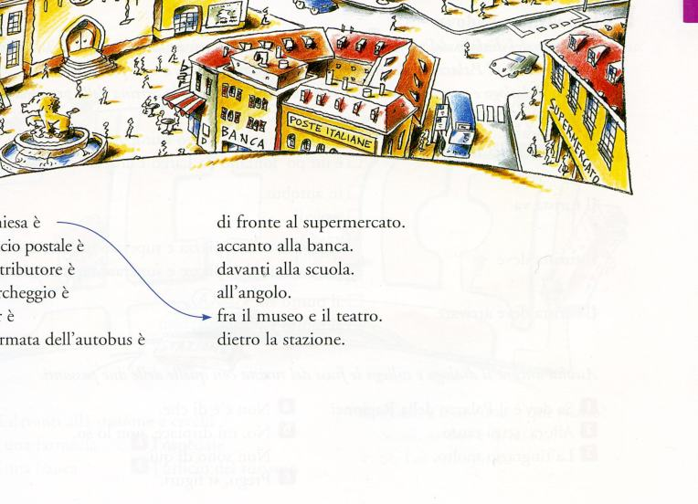
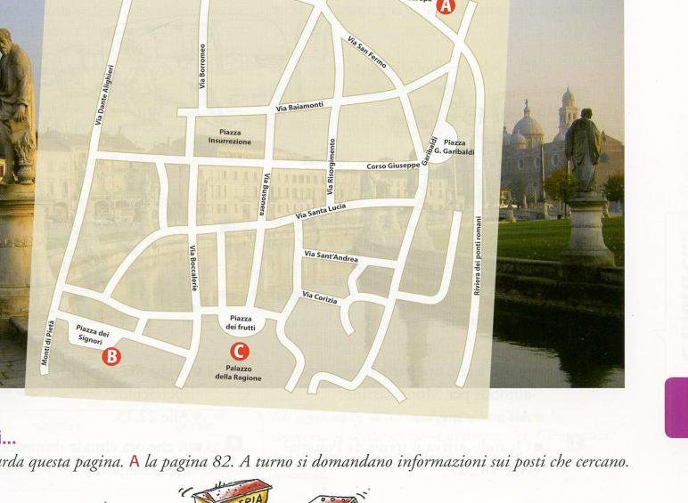

# Lezione 6 — Vocabulary in pictures, sentences and shadowing

[← Lesson](lesson.md) · [Grammar](grammar.md) · **Vocabulary** · [Exercises](exercise.md)

> **Source-based:** *Nuovo Espresso 1 Glossario* Lezione 6, about PDF pp. **39–44**, plus the picture and language activities in the main textbook pp. **75–88**. This is a **selected expanded teaching list**, not a full copy of the glossary. Italian/Persian translations are normalized for readability and the English/Persian example sentences are written for the course.

**Visual-first rule:** **real Commons photos for clearly matched concrete nouns and actions**, emoji only when a helpful, appropriately licensed photograph is not available (especially abstract structures). For picture recall, describe what you actually see. Every term has a complete **original Italian sentence**, not just a translation.

## Real book image recall — recognize, speak, remember

Name and describe items in these exact textbook visuals before checking the vocabulary table. Each cropped image is reproduced in the [picture practice](exercise.md#original-textbook-picture-practice--with-answer-checks).

**Page 76 — Five actual Italian city photographs**

**Page 77 — Bologna's piazza, towers and church**

**Page 80 — Six direction illustrations**

**Page 81 — Actual illustrated town scene**

**Page 83 — Route map of Padova**

## City places and sights

| Photo / visual + italiano | English | فارسی | Italian example |
|---|---|---|---|
| 🏛️ **piazza** | square | میدان | In centro c'è una piazza famosa. |
|  **città** | city | شهر | Bologna è una città vivace. |
|  **centro** | city centre | مرکز شهر | Vado in centro a piedi. |
| 🛍️ **mercato** | market | بازار | Il mercato è vicino alla piazza. |
|  **chiesa** | church | کلیسا | C'è una chiesa antica. |
|  **duomo** | cathedral | کلیسای جامع | Il duomo è in centro. |
|  **basilica** | basilica | کلیسای بزرگ | Visitiamo una basilica. |
| 🏛️ **museo** | museum | موزه | Ci sono due musei interessanti. |
| 🖼️ **mostra** | exhibition | نمایشگاه | La mostra è al museo. |
| 🏰 **castello** | castle | قلعه | Il castello è fuori dal centro. |
|  **torre** | tower | برج | Le torri sono antiche. |
|  **palazzo** | palace/building | کاخ / ساختمان | Ci sono dei palazzi famosi. |
| 🏢 **edificio** | building | ساختمان | È un edificio moderno. |
| 🏘️ **quartiere** | neighbourhood | محله | Questo quartiere è tranquillo. |
| 📚 **biblioteca** | library | کتابخانه | La biblioteca è vicino alla posta. |
| 🎓 **università** | university | دانشگاه | L'università è in centro. |
| 🎭 **teatro** | theatre | تئاتر | Dov'è il teatro comunale? |
|  **ristorante** | restaurant | رستوران | C'è un ristorante tipico. |
|  **albergo** | hotel | هتل | L'albergo è vicino alla stazione. |
| 🏛️ **portici** | arcades / covered walkways | رواق‌ها / طاق‌ها | Passeggiamo sotto i portici. |
| 🌳 **spazio verde** | green space | فضای سبز | Ci sono molti spazi verdi. |
| 🪟 **vetrina** | shop window | ویترین | Guardo le vetrine. |
| 🚉 **stazione** | station | ایستگاه | La stazione è a destra. |
| 📮 **ufficio postale** | post office | اداره پست | La posta è accanto alla banca. |
| 🏦 **banca** | bank | بانک | La banca è di fronte al teatro. |

## Describing towns and grammatical chunks

| Photo / visual + italiano | English | فارسی | Italian example |
|---|---|---|---|
| ⭐ **famoso / famosa** | famous | معروف | La piazza è famosa. |
| 🏛️ **antico / antica** | ancient / old | قدیمی / باستانی | La chiesa è antica. |
| 🍝 **tipico / tipica** | typical | معمول / سنتی | È un ristorante tipico. |
| 🏙️ **moderno / moderna** | modern | مدرن | Gli edifici sono moderni. |
| 💡 **interessante** | interesting | جالب | Ci sono dei musei interessanti. |
| 🌳 **tranquillo / tranquilla** | quiet | آرام | Il quartiere è tranquillo. |
| 🎉 **vivace** | lively | سرزنده | È una città molto vivace. |
| 🔍 **grande** | large | بزرگ | La piazza è grande. |
| 🔎 **piccolo / piccola** | small | کوچک | È una città piccola. |
| ➕ **molto** | very/much | خیلی / زیاد | La città è molto bella. |
| 🔢 **molti / molte** | many | زیاد / بسیاری | Ci sono molte chiese. |
| 🧩 **dei / degli / delle** | some (plural partitives) | چند / تعدادی | Ci sono dei negozi. |
| 1️⃣ **c'è** | there is | وجود دارد | C'è un museo. |
| 🔢 **ci sono** | there are | وجود دارند | Ci sono delle chiese. |
| 📍 **ci vado** | I go there | آنجا می‌روم | A Padova ci vado spesso. |
| 📍 **ci** | there (place pronoun) | آنجا | Ci andiamo domani. |
| 🚶 **a piedi** | on foot | پیاده | Vado in centro a piedi. |

## Directions and street features

| Photo / visual + italiano | English | فارسی | Italian example |
|---|---|---|---|
| ➡️ **a destra** | to the right | سمت راست | Giri a destra. |
| ⬅️ **a sinistra** | to the left | سمت چپ | Giri a sinistra. |
| ⬆️ **dritto** | straight ahead | مستقیم | Vada sempre dritto. |
| 🚦 **semaforo** | traffic light | چراغ راهنمایی | Giri al semaforo. |
| ➕ **incrocio** | intersection | چهارراه / تقاطع | Giri al primo incrocio. |
| 🛣️ **traversa** | side street | خیابان فرعی | Giri alla seconda traversa. |
| 🚏 **fermata** | bus stop | ایستگاه اتوبوس | Scenda alla terza fermata. |
| 🚌 **autobus** | bus | اتوبوس | Prendo l'autobus 32. |
| 🗺️ **cartina** | small map | نقشه کوچک | Guardo la cartina. |
| 🗺️ **percorso** | route | مسیر | Il percorso è breve. |
| 🧭 **indicazione** | direction / indication | راهنمایی | Chiedo un'indicazione. |
| ↪️ **girare** | to turn | پیچیدن | Deve girare a sinistra. |
| 🚏 **scendere** | to get off / descend | پیاده شدن | Scendo alla quarta fermata. |
| 🚌 **prendere** | to take | گرفتن / سوار شدن | Devo prendere il bus. |
| ⬆️ **andare avanti** | to go forward | جلو رفتن | Vada avanti fino alla piazza. |
| 🚶 **attraversare** | to cross | عبور کردن | Attraversi la piazza. |
| ➡️ **superare** | to pass beyond | رد شدن | Superi l'incrocio. |
| 📍 **davanti a** | in front of | جلوی | È davanti alla scuola. |
| ↔️ **di fronte a** | opposite | روبروی | È di fronte al teatro. |
| ↔️ **accanto a** | next to | کنارِ | La posta è accanto alla banca. |
| ↩️ **dietro** | behind | پشت | Il parcheggio è dietro la stazione. |
| 📐 **all'angolo** | on the corner | سر نبش | C'è un bar all'angolo. |
| ↔️ **fra / tra** | between | بین | La banca è fra due negozi. |
| 📍 **qui vicino** | near here | همین نزدیکی | C'è una farmacia qui vicino? |
| ↗️ **lontano** | far | دور | Il centro è lontano? |

## Questions, services and time

| Photo / visual + italiano | English | فارسی | Italian example |
|---|---|---|---|
| 🧳 **turista** | tourist | گردشگر | Il turista cerca il museo. |
| ℹ️ **ufficio informazioni** | information office | دفتر اطلاعات | Vado all'ufficio informazioni. |
| ❗ **dovere** | must / have to | باید | Devo andare in centro. |
| 🧠 **sapere** | to know | دانستن | Sa dove si trova il teatro? |
| 🙏 **scusi** | excuse me (formal) | ببخشید | Scusi, dov'è la stazione? |
| 🙏 **grazie mille** | many thanks | خیلی ممنون | Grazie mille per l'aiuto. |
| 🙏 **grazie lo stesso** | thanks anyway | به هر حال ممنون | Non lo sa? Grazie lo stesso. |
| 🙏 **la ringrazio** | thank you (formal) | از شما سپاسگزارم | La ringrazio molto. |
| 🙂 **non c'è di che** | you're welcome | خواهش می‌کنم | Prego, non c'è di che. |
|  **a che ora?** | at what time? | چه ساعتی؟ | A che ora apre il museo? |
|  **orario** | opening hours / timetable | ساعات کار | Qual è l'orario del museo? |
| 🔓 **aprire** | to open | باز کردن | Il museo apre alle nove. |
| 🔒 **chiudere** | to close | بستن | La mostra chiude alle sei. |
| 🎭 **spettacolo** | performance / show | اجرا / نمایش | Lo spettacolo comincia alle otto. |
| 🚆 **arrivare** | to arrive | رسیدن | Il treno arriva alle sette. |
| 🚌 **partire** | to depart | حرکت کردن | L'autobus parte alle nove. |
| ❓ **quale?** | which? | کدام؟ | Quale autobus devo prendere? |

## Streets and civic culture

| Photo / visual + italiano | English | فارسی | Italian example |
|---|---|---|---|
| 🛣️ **via** | street | خیابان | Abito in via Garibaldi. |
| 🌳 **viale** | avenue | بلوار | Il viale è largo. |
| 🛣️ **corso** | main street | خیابان اصلی | Passeggiamo lungo il corso. |
| 🏘️ **vicolo** | alley | کوچه | Il vicolo è stretto. |
| 📍 **largo** | small open square / plaza | میدان کوچک | Ci vediamo in largo Europa. |
| 🚶 **passeggiare** | to stroll | قدم زدن | Passeggiamo sotto i portici. |
|  **incontrare** | to meet | ملاقات کردن | Incontriamo gli amici in piazza. |
| 💬 **chiacchierare** | to chat | گپ زدن | Chiacchieriamo al bar. |
| 🛒 **comprare** | to buy | خریدن | Compro un biglietto. |
| 🏷️ **vendere** | to sell | فروختن | Vendono libri al mercato. |
| 🎉 **festeggiare** | to celebrate | جشن گرفتن | Festeggiamo in piazza. |

## Additional picture recall using original book crops

The main book contains **city landmark photographs (p. 76)**, **Bologna's landmarks (p. 77)**, a **street scene and two different town maps (pp. 80–83)** and **opening-hour pictures (p. 84)**.

1. Open p. 76. Name each city in Italian and describe one visible landmark using `c'è`.
2. Open p. 77. Use the Bologna photos to describe a **piazza, torri and chiesa** without copying captions.
3. Open p. 81. Locate the post office, bank and station in the *actual* street drawing; write two `di fronte a/accanto a` sentences.
4. Use map A p. 82 and map B p. 83 **as separate role-play maps**; ask for directions from a place shown on your assigned map.
5. Cover p. 84's times and say them in Italian before revealing.

## English bridges and memory traps

| Italian | Helpful English bridge | Important warning |
|---|---|---|
| `Ci sono dei musei.` | “There are **some** museums.” | `dei` is one of several partitives; singular/plural and gender matter. |
| `Una città vivace.` | A lively city | `vivace` doesn't change for singular masculine/feminine, but plural is `vivaci`. |
| `Palazzi antichi / ristoranti tipici` | Old buildings / typical restaurants | Don't make every `-co` adjective plural with `-chi`. |
| `Ci vado spesso.` | I go **there** often | This `ci` refers to a place, not the English phrase *we*. |
| `Devo scendere alla fermata.` | I **have to** get off at the stop | Don't translate the auxiliary **do** from English questions into Italian. |
| `A che ora apre?` | At what time **does** it open? | Italian uses its conjugated verb directly: `apre`. |

## Repeat aloud and shadow with authorized audio

**True shadowing = listening to natural Italian speech and speaking along with a small delay.** Without audio these scripts are **text read-aloud, echo repetition and recall**, not pronunciation verification.

### Level 1 — short chunks

`Scusi, dov'è il duomo?` · `Giri a destra.` · `Ci sono dei musei.` · `Devo scendere alla quarta fermata.` · `Alle nove e mezza.`

### Level 2 — original conversation

> **A:** Scusi, c'è un museo qui vicino?  
> **B:** Sì, è dietro la piazza.  
> **A:** Posso andarci a piedi?  
> **B:** Certo. Vada dritto, poi giri a sinistra.  
> **A:** Grazie mille!  
> **B:** Non c'è di che.

### Level 3 — transformation

Change **three details** without reading (city, destination and turn directions / location, activity and day). Then reconstruct the conversation from memory and self-check agreement.

## Retrieval drills

1. See ⬆️ ↪️ 🚦 → say **`Vada dritto, poi giri a destra al semaforo.`**
2. Picture Bologna's towers → `Ci sono delle torri antiche.`
3. A tourist asks “which bus?” → `Quale autobus devo prendere?`
4. Turn `la chiesa famosa` into a plural with a partitive.
5. Use `ci` to answer `Vai spesso a Padova?`.

Reveal example answers

4. **delle chiese famose**. 5. **Sì, ci vado spesso**. Other sentences above are examples for recall, not the only correct possible sentences.

## Spaced review plan

Try 10 picture/emoji cues **immediately**, **tomorrow**, **three days later**, and **one week later**. Start with active recall, then check your model sentences. Mix Lesson 6 directions with Lesson 7 holiday stories to avoid confusing **present directions** and **past events**.

Photos: [Commons credits and licensing](../PHOTO_CREDITS.md). The photos are externally hosted and are **not** the publisher's book images.

[← Lesson](lesson.md) · [Grammar](grammar.md) · [Exercises →](exercise.md)
