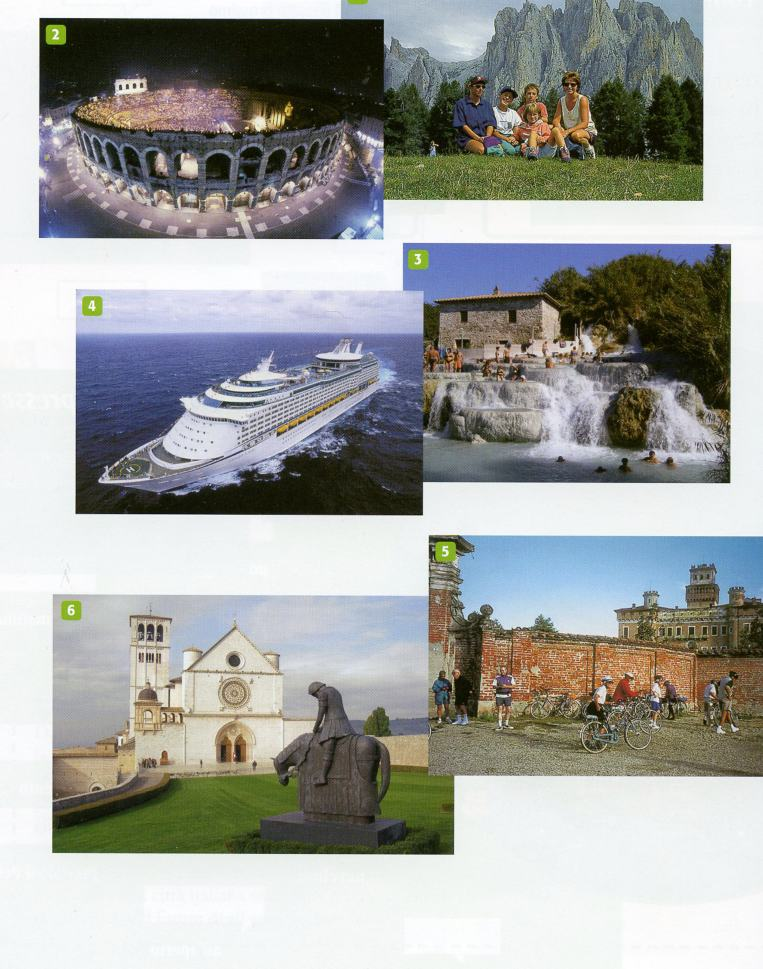
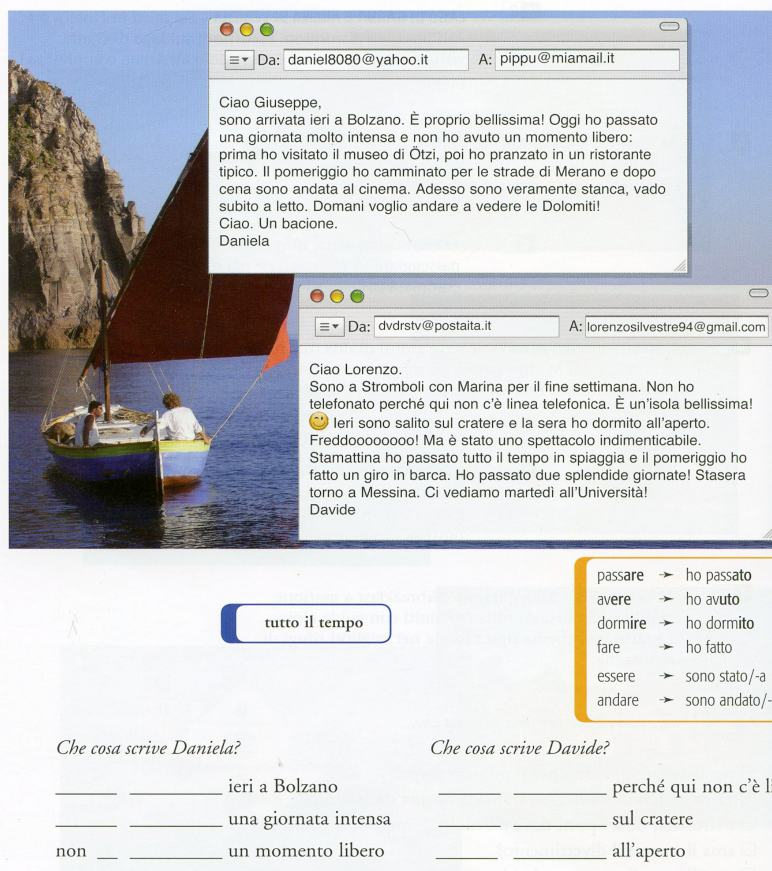
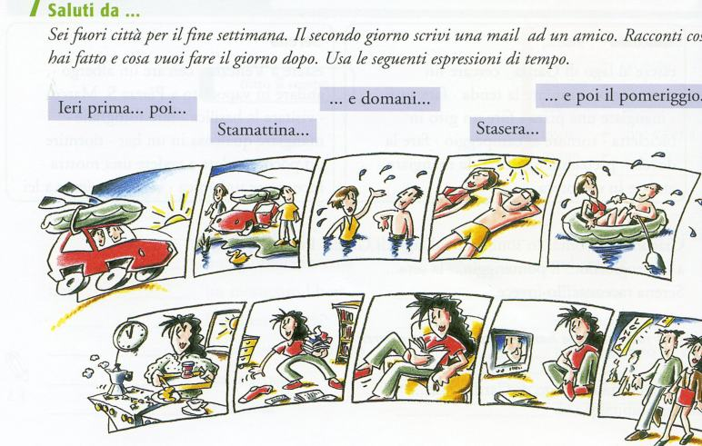
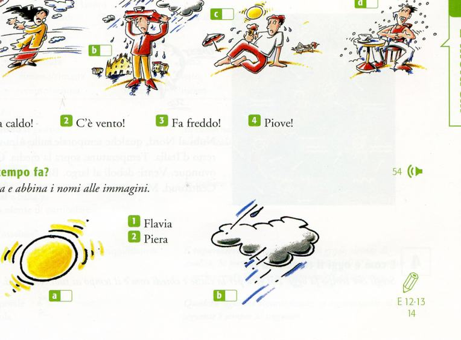
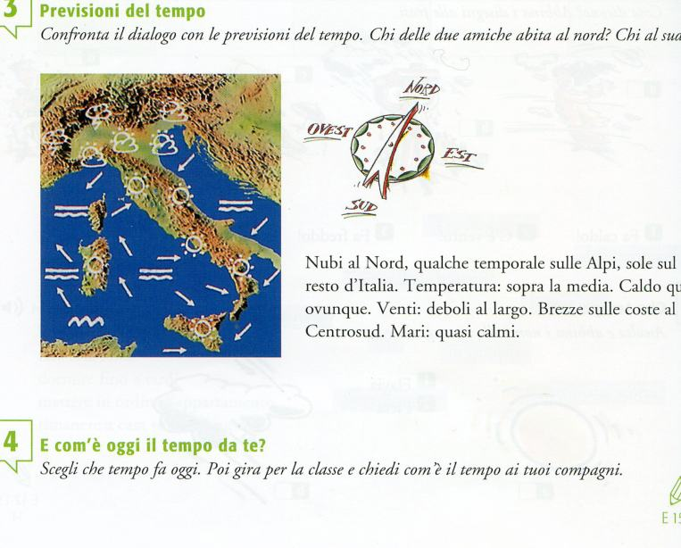
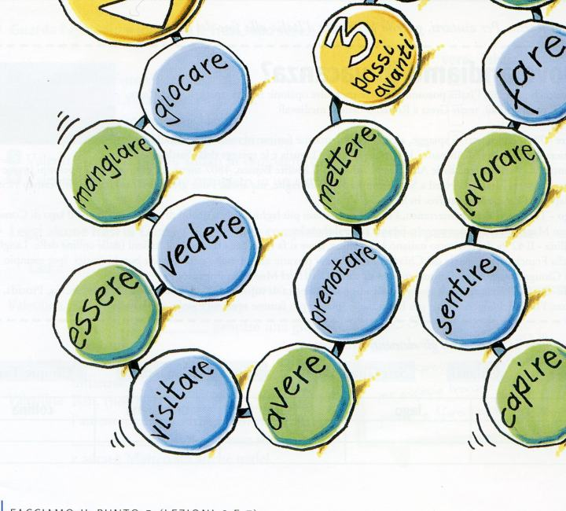

# Lezione 7 — Practice workbook: grammar, pictures and spoken recall

[← Lesson](lesson.md) · [Grammar](grammar.md) · [Vocabulary](vocabulary.md) · **Exercises**

> **Book alignment:** *Nuovo_Espresso_1.pdf* pp. **89–105**. This workbook contains **new original exercises** plus references to the publisher's pictures and activities. It does **not copy the printed publisher exercise text**, artwork, audio, video, or official answer key.

## Actual book picture practice — with model answers

These are **real focused crops of the original textbook pictures**. Attempt the companion task beside each picture, then reveal a model answer. The exercises here are new originals; any publisher audio/video comprehension requires the authorized recording.

### Picture 1 — Six holiday destination photographs (p. 90)

**Try:** Match the six original photographs to vacation types: mountains, a lake city, cruise, thermal bath, cycling trip and historic city. Explain which you prefer.

Reveal example answer

**Preferisco la montagna perché mi piace camminare.** Look carefully at source labels; the pictures are examples, not current travel advertisements.

### Picture 2 — Two illustrated vacation emails (p. 92)

**Try:** Read the source messages shown in the crop. Find at least three examples of **ho/sono + past participle**, then paraphrase the holiday in your own words.

Reveal example answer

**Ho visitato...**, **sono andato/a...**, **ho fatto...** are useful example patterns. Use the exact verbs in the pictured emails for a source-specific answer.

### Picture 3 — Holiday story picture sequence (p. 94)

**Try:** Use the actual illustrated sequence to tell a short holiday story in **passato prossimo** with *prima*, *poi* and *alla fine*.

Reveal example answer

**Prima sono partito/a, poi ho visitato una città e alla fine sono tornato/a a casa.** Adjust the story to match the source panels.

### Picture 4 — Four original weather cartoons (p. 97)

**Try:** Match the four weather pictures to *fa caldo, fa freddo, c'è vento, piove*. Ask how the weather was yesterday.

Reveal example answer

**Che tempo ha fatto ieri? — Ha piovuto.** For today's weather: **Oggi fa caldo / fa freddo / c'è vento**.

### Picture 5 — Weather map and directions (p. 98)

**Try:** Find *nord, sud, est, ovest*. Say two weather sentences using the printed map as a historical textbook example, not a live forecast.

Reveal example answer

**Al nord ci sono nuvole. Al sud c'è il sole.** These are language-model examples; check the source map before stating its specific conditions.

### Picture 6 — Facciamo il punto 3 board (p. 102)

**Try:** Choose three visible review-game spaces and create a direction request, holiday story and weather sentence using Lessons 6–7.

Reveal example answer

**Scusi, dov'è il museo? Ieri sono andato/a a Venezia. Oggi piove.** The activity is new companion practice for the original pictured game.

## Part A — Sentence and grammar recall (1–42)

Try each one **before** opening the answer. After a correct answer, make a different sentence using the same pattern.

**1.** Say `I visited Florence yesterday`.

Show answer

**Ieri ho visitato Firenze.**

**2.** Say `Anna went to the sea`.

Show answer

**Anna è andata al mare.**

**3.** Say `Marco went to the sea`.

Show answer

**Marco è andato al mare.**

**4.** Say `we (women) arrived yesterday`.

Show answer

**Siamo arrivate ieri.**

**5.** Say `they (men/mixed) left`.

Show answer

**Sono partiti.**

**6.** Conjugate: `io ___ mangiato`.

Show answer

**ho**

**7.** Conjugate: `noi ___ visitato`.

Show answer

**abbiamo**

**8.** Conjugate: `tu ___ dormito`.

Show answer

**hai**

**9.** Conjugate: `lei ___ andata`.

Show answer

**è**

**10.** Conjugate: `noi ___ partiti`.

Show answer

**siamo**

**11.** What is the past participle of `fare`?

Show answer

**fatto**

**12.** What is the past participle of `vedere`?

Show answer

**visto**

**13.** What is the past participle of `prendere`?

Show answer

**preso**

**14.** What is the past participle of `leggere`?

Show answer

**letto**

**15.** What is the past participle of `mettere`?

Show answer

**messo**

**16.** What is the past participle of `rimanere`?

Show answer

**rimasto/a**

**17.** What is the past participle of `venire`?

Show answer

**venuto/a**

**18.** Say `I took the boat`.

Show answer

**Ho preso la barca.**

**19.** Say `I read a book`.

Show answer

**Ho letto un libro.**

**20.** Say `Sara stayed at home`.

Show answer

**Sara è rimasta a casa.**

**21.** Say `I made/took photos`.

Show answer

**Ho fatto delle fotografie.**

**22.** Translate `yesterday`.

Show answer

**ieri**

**23.** Translate `the day before yesterday`.

Show answer

**l'altro ieri**

**24.** Translate `two weeks ago`.

Show answer

**due settimane fa**

**25.** Translate `last Sunday`.

Show answer

**domenica scorsa**

**26.** Translate `all day`.

Show answer

**tutto il giorno**

**27.** Translate `every day`.

Show answer

**tutti i giorni**

**28.** Complete: `Ho visto ___ museo.` (a few)

Show answer

**qualche**

**29.** Why is `qualche musei` incorrect?

Show answer

**Qualche requires a singular noun: qualche museo.**

**30.** Say `I didn't do anything`.

Show answer

**Non ho fatto niente.**

**31.** Say `It is not raining anymore`.

Show answer

**Non piove più.**

**32.** Say `I never ski`.

Show answer

**Non scio mai.**

**33.** Make `una vacanza bella` very beautiful.

Show answer

**una vacanza bellissima**

**34.** Make `un luogo tranquillo` extremely quiet.

Show answer

**un luogo tranquillissimo**

**35.** Translate `It's cold` for the weather.

Show answer

**Fa freddo.**

**36.** Translate `It's hot` for the weather.

Show answer

**Fa caldo.**

**37.** Translate `It's raining`.

Show answer

**Piove.**

**38.** Translate `It's windy`.

Show answer

**C'è vento.**

**39.** Translate `The weather is cloudy today`.

Show answer

**Oggi è nuvoloso.**

**40.** Translate `In the north there are clouds`.

Show answer

**Al nord ci sono nuvole.**

**41.** Put in order: `poi / ho / il museo / visitato`.

Show answer

**Poi ho visitato il museo.**

**42.** Correct `Ieri lei è mangiata`.

Show answer

**Ieri lei ha mangiato.**

## Part B — Use the textbook's actual pictures

**43.** **Book pp. 90–91 — six holiday pictures and six advertisements.** Match the images to the holiday descriptions (Dolomites/Corvara, Verona/Garda, Saturnia, cruise, Lombardy cycling, Assisi).

Visual-source match

1 **Corvara / Dolomites**, 2 **Lago di Garda e Arena di Verona**, 3 **Saturnia thermal baths**, 4 **Mediterranean cruise**, 5 **Lombardy by bicycle**, 6 **Assisi**.

**44.** **Book p. 92 — two travel emails.** Read the original texts and find **four** passato prossimo forms. Sort them under **avere** or **essere**.

**45.** **Book p. 93 — Giacomo and Serena.** From the book's two bullet lists, write **two different three-sentence holiday accounts** in your own words, using `prima`, `poi`, `alla fine`.

**46.** **Book p. 94 — Bingo grid.** Choose four different holiday activities and ask a partner `Hai ...?` in passato prossimo.

**47.** **Book p. 94 — holiday comic.** Retell the pictured weekend events in chronological order using **three** `ho/sono + participio` forms.

**48.** **Book p. 97 — weather cartoons a–d.** Match to `Fa caldo`, `C'è vento`, `Fa freddo`, `Piove`.

Visual-source answer key

a **C'è vento** · b **Piove** · c **Fa caldo** · d **Fa freddo**.

**49.** **Book p. 98 — weather map.** Find north, south, east and west on the compass. Summarize two conditions shown **in the printed forecast**, without pretending it is a current forecast.

**50.** **Book pp. 102–103 — Facciamo il punto 3 game.** Use the source game as your own mixed grammar prompt. Say a verb in infinitive, then the same verb in `passato prossimo`.

**51.** **Book p. 104 — Bilancio / Racconta l'Italia.** Create a 60–80-word original fictional Italian town/trip description and include a direction, one holiday event and weather.

## Part C — New transfer exercises

**52.** Make a **five-turn conversation** with a partner, without reading your prior model.

**Scene:** Two friends meet after the holidays. One tells where they went, what they did, what the weather was like and when they returned.

**53.** Correct the Italian sentences below:

- ❌ `Anna ha andata al mare.`
- ❌ `Abbiamo visto qualche musei.`
- ❌ `Non ho fatto niente mai ieri.` (prefer a clearer simple form)
- ❌ `La vacanza è stata bellissimi.`

Show corrections

`Anna è andata al mare.`; `Abbiamo visto qualche museo.`; `Ieri non ho fatto niente.` (or `Ieri non ho fatto niente di particolare.`); `La vacanza è stata bellissima.`.

**54.** Explain in **English** one major grammar difference shown here, then give the **correct Italian phrase**.

Suggested choices: `essere` versus `avere` in the past; gender agreement with `essere`; `qualche` + singular; `fa freddo`.

**55.** Turn one photo/emoji cue from [Vocabulary](vocabulary.md) into **a noun → a sentence → a question → a complete answer**.

**56.** **Read-aloud mission:** read the original model conversation on [Vocabulary](vocabulary.md) once, hide it, then act out both speakers. With accessible licensed/authorized native Italian audio, shadow the recorded speech while matching rhythm and stress.

**57.** **Spaced recall:** tomorrow, in three days, and after one week, choose ten vocabulary items and reconstruct them **without reading translations**.

## Self-assessment checklist

- [ ] I can use `passato prossimo` and choose a suitable auxiliary in the examples taught.
- [ ] I know important irregular participles and `essere` agreement.
- [ ] I can tell a 5-sentence holiday story using past-time expressions.
- [ ] I can explain `qualche` and `tutto/tutti` and describe basic weather.
- [ ] I have used the six book holiday pictures and completed the combined review.

**No official publisher listening/video answers are supplied here:** their authorized recordings are required. Practice scores and any real personal details remain private.

[← Lesson](lesson.md) · [Grammar](grammar.md) · [Vocabulary](vocabulary.md)
