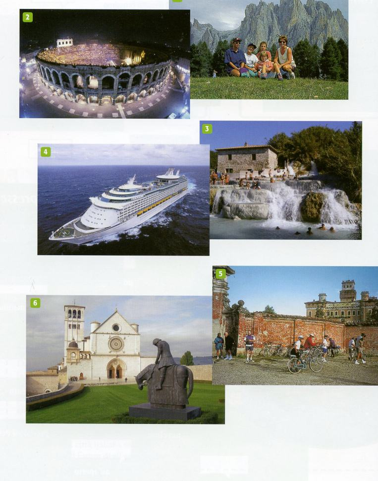
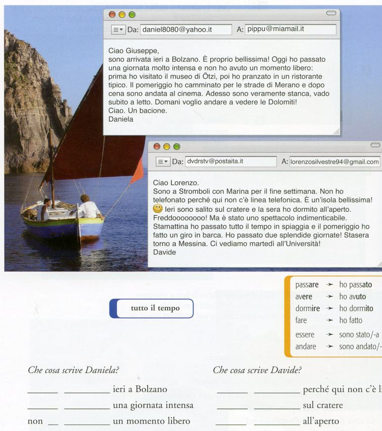
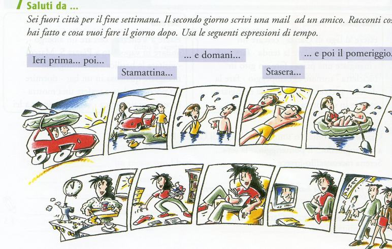
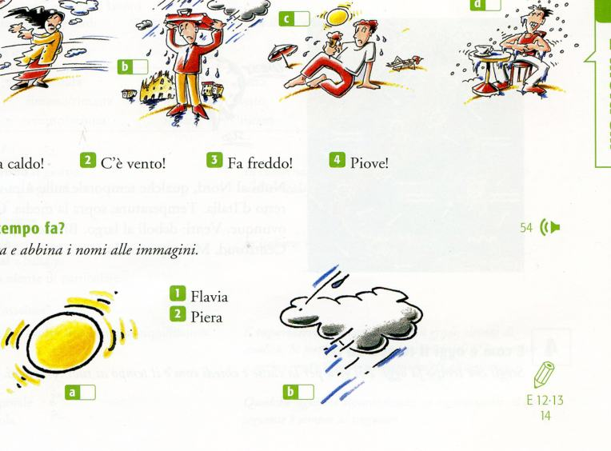
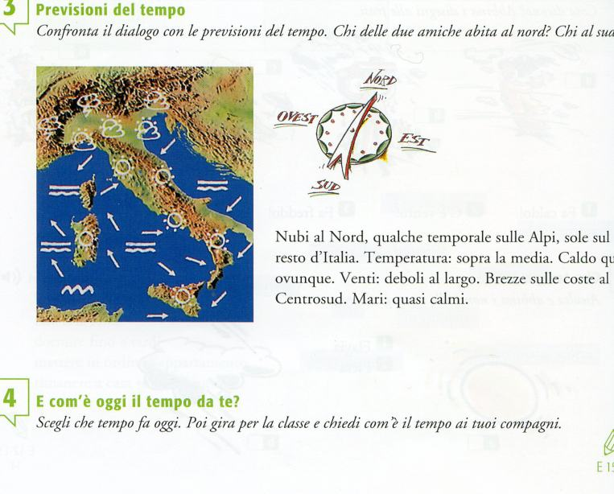
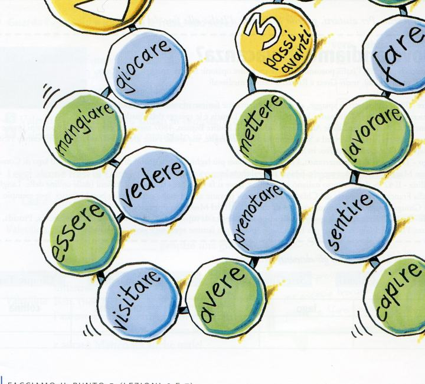

# Lezione 7 — Vocabulary in pictures, sentences and shadowing

[← Lesson](lesson.md) · [Grammar](grammar.md) · **Vocabulary** · [Exercises](exercise.md)

> **Source-based:** *Nuovo Espresso 1 Glossario* Lezione 7, about PDF pp. **44–50**, plus the picture and language activities in the main textbook pp. **89–104**. This is a **selected expanded teaching list**, not a full copy of the glossary. Italian/Persian translations are normalized for readability and the English/Persian example sentences are written for the course.

**Visual-first rule:** **real Commons photos for clearly matched concrete nouns and actions**, emoji only when a helpful, appropriately licensed photograph is not available (especially abstract structures). For picture recall, describe what you actually see. Every term has a complete **original Italian sentence**, not just a translation.

## Real source pictures for word recall

Name the original photographed destinations and illustrated holiday/weather scenes before checking their Italian terms. The exact images also appear beside the [companion answer checks](exercise.md#actual-book-picture-practice--with-model-answers).

**Book p. 90: Six holiday destination photographs**

**Book p. 92: Two illustrated vacation emails**

**Book p. 94: Holiday story picture sequence**

**Book p. 97: Four original weather cartoons**

**Book p. 98: Weather map and directions**

**Book p. 102: Facciamo il punto 3 board**

## Holiday places and travel styles

| Photo / visual + italiano | English | فارسی | Italian example |
|---|---|---|---|
| 🧳 **vacanza** | holiday / vacation | تعطیلات | La vacanza è stata bellissima. |
| 🏞️ **lago** | lake | دریاچه | Siamo andati al lago. |
|  **mare** | sea | دریا | Siamo stati al mare. |
|  **spiaggia** | beach | ساحل | Abbiamo passeggiato in spiaggia. |
| 🏔️ **montagna** | mountain | کوهستان | Sono andata in montagna. |
| 🏝️ **isola** | island | جزیره | Abbiamo visitato un'isola. |
| 🚢 **crociera** | cruise | سفر دریایی تفریحی | Abbiamo fatto una crociera. |
| 🚢 **nave** | ship | کشتی | La nave è grande. |
| ⛵ **barca** | boat | قایق | Abbiamo preso una barca. |
| 🛶 **gommone** | inflatable boat | قایق بادی | Sono saliti sul gommone. |
| ⛺ **campeggio** | camping / campground | کمپینگ | Siamo tornati al campeggio. |
| ⛺ **tenda** | tent | چادر | Abbiamo montato la tenda. |
| 🥾 **escursione** | excursion / hike | گردش / کوه‌پیمایی | Abbiamo fatto un'escursione. |
| 🧭 **visita guidata** | guided tour | بازدید با راهنما | Abbiamo fatto una visita guidata. |
|  **piscina** | swimming pool | استخر | Siamo andati in piscina. |
| ♨️ **terme** | thermal baths | حمام آب گرم | Siamo stati alle terme. |
| ♨️ **sauna** | sauna | سونا | Abbiamo provato la sauna. |
| 💆 **massaggio** | massage | ماساژ | Ho fatto un massaggio. |
|  **alloggio** | lodging | محل اقامت | L'alloggio era tranquillo. |
|  **bed & breakfast** | B&B accommodation | اقامتگاه با صبحانه | Abbiamo dormito in un B&B. |
| 🏔️ **Dolomiti** | Dolomites | دولومیت‌ها | Abbiamo visitato le Dolomiti. |
| 🌿 **natura** | nature | طبیعت | Mi piace la natura. |
| 🧘 **meditazione** | meditation | مدیتیشن | Ho fatto meditazione. |
| 😌 **relax** | relaxation | استراحت | Ho fatto una settimana di relax. |
|  **città d'arte** | art city | شهر هنری | Abbiamo visitato una città d'arte. |

## Past actions and travel verbs

| Photo / visual + italiano | English | فارسی | Italian example |
|---|---|---|---|
| ⏪ **passato prossimo** | present-perfect/simple-past construction | زمان گذشته نزدیک | Ho visitato Venezia. |
| 🧩 **avere** | to have (auxiliary) | داشتن / فعل کمکی | Ho mangiato bene. |
| 🧩 **essere** | to be (auxiliary) | بودن / فعل کمکی | Sono arrivata ieri. |
| 🚶 **andare / andato** | go / gone | رفتن / رفته | Sono andato a Roma. |
| 🚉 **arrivare / arrivato** | arrive / arrived | رسیدن / رسیده | Sono arrivato ieri. |
| 🧳 **partire / partito** | leave / left | حرکت کردن / رفته | Siamo partiti venerdì. |
| 🏛️ **visitare / visitato** | visit / visited | بازدید کردن / کرده | Ho visitato il museo. |
| 💬 **parlare / parlato** | speak / spoken | صحبت کردن / کرده | Ho parlato con Nina. |
|  **mangiare / mangiato** | eat / eaten | خوردن / خورده | Abbiamo mangiato la pasta. |
| 😴 **dormire / dormito** | sleep / slept | خوابیدن / خوابیده | Ho dormito fino a tardi. |
| 📷 **fare / fatto** | do/make / done | انجام دادن / داده | Ho fatto delle fotografie. |
| ⛵ **prendere / preso** | take / taken | گرفتن / گرفته | Ho preso una barca. |
|  **leggere / letto** | read / read | خواندن / خوانده | Ho letto un libro. |
| 🎬 **vedere / visto** | see / seen | دیدن / دیده | Ho visto un film. |
| 📦 **mettere / messo** | put / put | گذاشتن / گذاشته | Ho messo tutto in ordine. |
| 🚶 **venire / venuto** | come / come | آمدن / آمده | È venuta anche Sara. |
|  **rimanere / rimasto** | remain / stayed | ماندن / مانده | È rimasta in albergo. |
| 🏠 **restare / restato** | stay / stayed | ماندن / مانده | Siamo restati in città. |
| ↩️ **tornare / tornato** | return / returned | برگشتن / برگشته | Sono tornata a casa. |
|  **incontrare / incontrato** | meet / met | ملاقات کردن / کرده | Ho incontrato un amico. |
| 📷 **fare fotografie** | to take pictures | عکس گرفتن | Ho fatto delle fotografie. |
| ⛺ **montare la tenda** | pitch a tent | چادر زدن | Abbiamo montato la tenda. |

## When it happened and stories

| Photo / visual + italiano | English | فارسی | Italian example |
|---|---|---|---|
|  **ieri** | yesterday | دیروز | Ieri ho dormito molto. |
|  **l'altro ieri** | day before yesterday | پریروز | L'altro ieri sono uscito. |
| 🌅 **stamattina** | this morning | امروز صبح | Stamattina ho studiato. |
| 🌙 **stasera** | this evening | امشب | Stasera resto a casa. |
|  **la settimana scorsa** | last week | هفته گذشته | La settimana scorsa sono partita. |
|  **due settimane fa** | two weeks ago | دو هفته پیش | Due settimane fa ero al mare. |
| 1️⃣ **prima** | first / before | اول / قبل | Prima ho pranzato. |
| 2️⃣ **poi** | then | بعد | Poi ho visitato il museo. |
| 🏁 **alla fine** | at the end | در پایان | Alla fine siamo tornati. |
| ⏳ **durante** | during | در طول | Durante la vacanza ho letto. |
| 🔙 **l'ultima volta** | last time | آخرین بار | Quando è stata l'ultima volta? |
| ☀️ **tutto il giorno** | all day | تمام روز | Ho camminato tutto il giorno. |
|  **tutti i giorni** | every day | هر روز | Ho lavorato tutti i giorni. |
| 🔢 **qualche** | some/a few + singular noun | چند / بعضی | Ho visitato qualche museo. |
| 🚫 **non … più** | not anymore | دیگر نه | Non piove più. |
| 🚫 **non … mai** | never | هرگز | Non ho mai visto questo posto. |
| 😐 **niente di particolare** | nothing special | هیچ چیز خاصی | Non ho fatto niente di particolare. |
| 🍀 **per fortuna** | fortunately | خوشبختانه | Per fortuna c'era il sole. |

## Weather words and forecast

| Photo / visual + italiano | English | فارسی | Italian example |
|---|---|---|---|
| 🌦️ **che tempo fa?** | what's the weather like? | هوا چطور است؟ | Che tempo fa oggi? |
| 🥵 **fa caldo** | it's hot | هوا گرم است | Oggi fa caldo. |
| 🥶 **fa freddo** | it's cold | هوا سرد است | Oggi fa freddo. |
| 🌧️ **piove** | it's raining | باران می‌بارد | Oggi piove. |
| 💨 **c'è vento** | it's windy | باد می‌وزد | Oggi c'è vento. |
| ☀️ **c'è il sole** | it's sunny | آفتابی است | Oggi c'è il sole. |
| ☁️ **nuvola** | cloud | ابر | C'è una nuvola. |
| ☁️ **nuvoloso** | cloudy | ابری | Oggi è nuvoloso. |
| ⛈️ **temporale** | thunderstorm | رگبار / طوفان | C'è un temporale. |
| 🌦️ **previsioni del tempo** | weather forecast | پیش‌بینی هوا | Leggo le previsioni del tempo. |
| 🌡️ **temperatura** | temperature | دما | La temperatura è alta. |
| 🍃 **brezza** | breeze | نسیم | C'è una brezza leggera. |
|  **costa** | coast | ساحل | Sulla costa c'è vento. |
|  **mare calmo** | calm sea | دریای آرام | Oggi il mare è calmo. |
| ⬆️ **nord** | north | شمال | Al nord ci sono nuvole. |
| ⬇️ **sud** | south | جنوب | Al sud fa caldo. |
| ➡️ **est** | east | شرق | A est c'è il sole. |
| ⬅️ **ovest** | west | غرب | A ovest piove. |

## Intensity, geography and reactions

| Photo / visual + italiano | English | فارسی | Italian example |
|---|---|---|---|
| ✨ **bellissimo / bellissima** | very beautiful | بسیار زیبا | È stata una vacanza bellissima. |
| 😌 **tranquillissimo / tranquillissima** | extremely quiet | خیلی آرام | Il borgo era tranquillissimo. |
| 💫 **indimenticabile** | unforgettable | فراموش‌نشدنی | È stato un viaggio indimenticabile. |
| 🌄 **splendido / splendida** | splendid | باشکوه / عالی | Abbiamo visto un panorama splendido. |
| 🎭 **spettacolo** | show / spectacle | نمایش | Abbiamo visto uno spettacolo. |
| 🌋 **cratere** | volcanic crater | دهانه آتشفشان | Abbiamo visto il cratere. |
| 🌋 **vulcano** | volcano | آتشفشان | Sull'isola c'è un vulcano. |
| 🌄 **collina** | hill | تپه | La collina è verde. |
| 🏘️ **borgo** | small village | روستا / دهکده | Abbiamo visitato un borgo. |
| 🗺️ **itinerario** | itinerary | برنامه مسیر | Abbiamo seguito un itinerario. |
| 🗺️ **cartina** | map | نقشه | Guardo la cartina. |
| 😴 **stanco / stanca** | tired | خسته | Dopo il viaggio ero stanca. |
|  **pranzare** | to have lunch | ناهار خوردن | Abbiamo pranzato alle due. |
| ⛵ **fare un giro** | go for a stroll | گردش کردن | Abbiamo fatto un giro in barca. |
|  **fare il bagno** | to swim / bathe | آب‌تنی کردن | Ho fatto il bagno al mare. |
| ☀️ **prendere il sole** | sunbathe | آفتاب گرفتن | Abbiamo preso il sole. |
| 🔝 **superlativo assoluto** | absolute superlative | صفت بسیار عالی | Bellissimo è un superlativo assoluto. |

## Additional picture recall using original cropped book images

The book contains **six holiday photos (p. 90)**, **offers (p. 91)**, **two traveller emails (p. 92)**, an **activity Bingo board and comic (p. 94)**, **weather cartoons (p. 97)** and an **Italian forecast map (p. 98)**.

1. Match each of the six photos with the corresponding *actual book* holiday offer.
2. Read p. 92's emails; identify `ho/sono + participio` and retell each person's holiday **in your own words**.
3. Use the illustrated Bingo board to ask about **three** past holiday activities.
4. Look at weather cartoons a–d on p. 97; say `Fa caldo / Fa freddo / C'è vento / Piove`.
5. Use the source forecast map to say two weather sentences for `nord` and `sud`, without treating the printed forecast as current.

## English bridges and memory traps

| Italian | English bridge | Important warning |
|---|---|---|
| `Ho visitato Roma.` | I visited / I have visited Rome. | Past tense meaning depends on context; don't force English present-perfect usage. |
| `Sono andata al mare.` | I went to the sea. | With `essere`, `andata` agrees with a feminine singular subject. |
| `Non ho visto niente.` | I didn't see anything. | Normal Italian **non … niente**, not an incorrect double negative. |
| `Qualche museo` | A few museums | `qualche` is followed by a **singular** noun in Italian. |
| `Tutto il giorno / tutti i giorni` | All day / every day | One whole period versus repeated days. |
| `Fa freddo.` | It is cold. | Italian **fa**, not literal *è freddo*, for the general weather. |

## Repeat aloud and shadow with authorized audio

**True shadowing = listening to natural Italian speech and speaking along with a small delay.** Without audio these scripts are **text read-aloud, echo repetition and recall**, not pronunciation verification.

### Level 1 — short chunks

`Ieri sono andato/a al mare.` · `Ho fatto delle fotografie.` · `È stata bellissima!` · `Fa freddo.` · `Non piove più.`

### Level 2 — original conversation

> **A:** Com'è andato il fine settimana?  
> **B:** Benissimo! Sabato sono andata al lago.  
> **A:** Che cosa hai fatto?  
> **B:** Ho preso una barca e ho visto un borgo.  
> **A:** E domenica?  
> **B:** È stato brutto tempo, quindi sono rimasta a casa.

### Level 3 — transformation

Change **three details** without reading (city, destination and turn directions / location, activity and day). Then reconstruct the conversation from memory and self-check agreement.

## Retrieval drills

1. Cover the English column; read `ho fatto / sono arrivata / ha visto` from memory.
2. Picture a holiday boat → `Ho preso una barca.`
3. Picture one rainy day → `Ieri ha piovuto.`
4. Convert `una vacanza bella` to an absolute superlative.
5. Say one past event using `ieri` and one using `due settimane fa`.

Reveal example answers

4. **una vacanza bellissima**. For 5, examples: **Ieri ho studiato**; **Due settimane fa sono andato/a al mare**.

## Spaced review plan

Try 10 picture/emoji cues **immediately**, **tomorrow**, **three days later**, and **one week later**. Start with active recall, then check your model sentences. Mix Lesson 6 directions with Lesson 7 holiday stories to avoid confusing **present directions** and **past events**.

Photos: [Commons credits and licensing](../PHOTO_CREDITS.md). The photos are externally hosted and are **not** the publisher's book images.

[← Lesson](lesson.md) · [Grammar](grammar.md) · [Exercises →](exercise.md)
