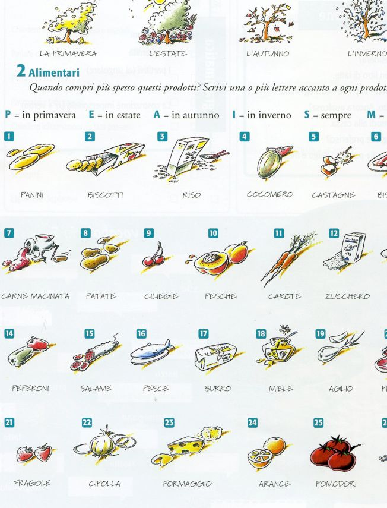
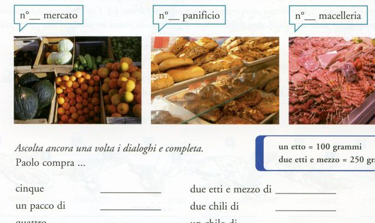
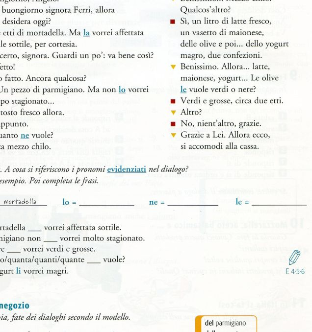
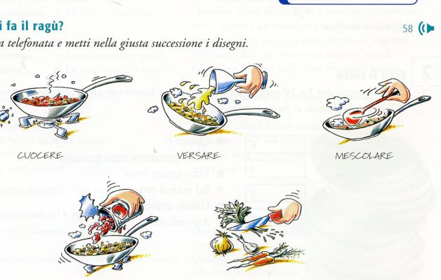
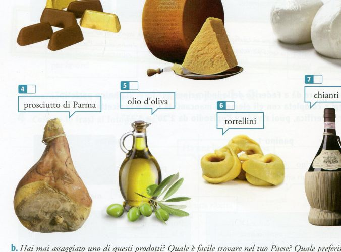

# Lezione 8 — Picture-based exercise workbook

[← Lesson](lesson.md) · [Grammar](grammar.md) · [Vocabulary](vocabulary.md) · **Exercises**

**Book basis:** scanned PDF pp. **105–116**. The companion grammar and dialogue answers below are written for this course; official listening and original publisher solutions are not claimed.

## Part A — 50 original vocabulary and grammar drills

Attempt each before expanding its answer, then invent a different sentence based on the same pattern.

**1.** What is the Italian word for season?

Check answer

**stagione**

**2.** Translate spring.

Check answer

**primavera**

**3.** Translate autumn.

Check answer

**autunno**

**4.** What is a cocomero?

Check answer

**A watermelon.**

**5.** Translate 'a biscuit'.

Check answer

**un biscotto**

**6.** Translate 'an onion'.

Check answer

**una cipolla**

**7.** Translate 'a carrot'.

Check answer

**una carota**

**8.** Translate 'the tomatoes'.

Check answer

**i pomodori**

**9.** Translate 'chestnuts'.

Check answer

**le castagne**

**10.** Translate 'strawberries'.

Check answer

**le fragole**

**11.** Say 'I buy a kilo of potatoes'.

Check answer

**Compro un chilo di patate.**

**12.** How many grams are in 'un etto'?

Check answer

**100 grams.**

**13.** Say 'two hundred grams of ham'.

Check answer

**due etti di prosciutto**

**14.** Say 'half a kilo of meat'.

Check answer

**mezzo chilo di carne**

**15.** Say 'a small jar of mayonnaise'.

Check answer

**un vasetto di maionese**

**16.** Ask for one litre of milk.

Check answer

**Vorrei un litro di latte, per favore.**

**17.** Where do you buy bread (shop name)?

Check answer

**al panificio**

**18.** Where do you buy meat?

Check answer

**in macelleria**

**19.** Translate 'the market'.

Check answer

**il mercato**

**20.** Translate 'the cashier desk'.

Check answer

**la cassa**

**21.** Ask 'How much is it?'.

Check answer

**Quant'è?**

**22.** Say 'Nothing else, thank you'.

Check answer

**Nient'altro, grazie.**

**23.** Complete: Quanta ___ vuole? (mozzarella)

Check answer

**Quanta mozzarella vuole?**

**24.** Complete: ___ panini vuole?

Check answer

**Quanti**

**25.** Complete: ___ olive vuole?

Check answer

**Quante**

**26.** Replace il prosciutto: Compro il prosciutto.

Check answer

**Lo compro.**

**27.** Replace la mozzarella: Prendo la mozzarella.

Check answer

**La prendo.**

**28.** Replace i biscotti: Compro i biscotti.

Check answer

**Li compro.**

**29.** Replace le olive: Prendo le olive.

Check answer

**Le prendo.**

**30.** Ask 'How many of them do you want?' (feminine plural).

Check answer

**Quante ne vuole?**

**31.** Reply: 'I would like five (of them)'.

Check answer

**Ne vorrei cinque.**

**32.** Reply: 'I'll take a little (of it)'.

Check answer

**Ne prendo un po'.**

**33.** Say 'some bread'.

Check answer

**del pane**

**34.** Say 'some oil'.

Check answer

**dell'olio**

**35.** Say 'some apples'.

Check answer

**delle mele**

**36.** Say 'some biscuits'.

Check answer

**dei biscotti**

**37.** Translate 'to cut'.

Check answer

**tagliare**

**38.** Translate 'to pour'.

Check answer

**versare**

**39.** Translate 'to mix'.

Check answer

**mescolare**

**40.** Translate 'to add'.

Check answer

**aggiungere**

**41.** Translate 'to cook'.

Check answer

**cuocere**

**42.** Say 'first I cut the onions'.

Check answer

**Prima taglio le cipolle.**

**43.** Say 'then I add oil'.

Check answer

**Poi aggiungo l'olio.**

**44.** Say 'one eats pasta in Italy' with si.

Check answer

**In Italia si mangia la pasta.**

**45.** Distinguish lo vs ne.

Check answer

**Lo replaces a specific masculine singular direct object; ne often refers to an amount of something.**

**46.** How do you ask if cheese is aged or fresh?

Check answer

**Lo vuole fresco o stagionato?**

**47.** Give a polite food order using vorrei.

Check answer

**Vorrei due etti di parmigiano, per favore.**

**48.** Give 'here is the change'.

Check answer

**Ecco il resto.**

**49.** Translate 'a recipe'.

Check answer

**una ricetta**

**50.** Translate 'extra-virgin olive oil'.

Check answer

**olio extravergine d'oliva**

## Part B — Actual textbook picture and reading exercises

**51.** **p. 106 — 26 food drawings.** Choose six pictures from the **actual grid**; name the foods and group them by season. Verify against the numbered labels.

How to check

Use the original visible words and details in the cropped textbook picture, or compare to its printed captions. Where the exercise requires the publisher's recorded material, do not invent the official audio result. Try an original complete sentence using the [Vocabulary](vocabulary.md) words.

**52.** **p. 107 — food memory grid.** Cover the item names and recover at least eight Italian food words from the printed icons.

How to check

Use the original visible words and details in the cropped textbook picture, or compare to its printed captions. Where the exercise requires the publisher's recorded material, do not invent the official audio result. Try an original complete sentence using the [Vocabulary](vocabulary.md) words.

**53.** **p. 108 — three shop photographs.** Write `mercato`, `panificio`, `macelleria` under the appropriate **original photographs**. Make three short purchases.

How to check

Use the original visible words and details in the cropped textbook picture, or compare to its printed captions. Where the exercise requires the publisher's recorded material, do not invent the official audio result. Try an original complete sentence using the [Vocabulary](vocabulary.md) words.

**54.** **p. 109 — store conversation.** Read the source shopping conversation, find an order by weight and a request using **ne**.

How to check

Use the original visible words and details in the cropped textbook picture, or compare to its printed captions. Where the exercise requires the publisher's recorded material, do not invent the official audio result. Try an original complete sentence using the [Vocabulary](vocabulary.md) words.

**55.** **p. 110 — customer and shopkeeper.** With the book's customer/seller roles, produce an original five-turn sale including a quantity and a price.

How to check

Use the original visible words and details in the cropped textbook picture, or compare to its printed captions. Where the exercise requires the publisher's recorded material, do not invent the official audio result. Try an original complete sentence using the [Vocabulary](vocabulary.md) words.

**56.** **p. 111 — five recipe drawings.** Say **cuocere, versare, mescolare, aggiungere, tagliare** while pointing to the matching real drawing; then invent a vegetable recipe.

How to check

Use the original visible words and details in the cropped textbook picture, or compare to its printed captions. Where the exercise requires the publisher's recorded material, do not invent the official audio result. Try an original complete sentence using the [Vocabulary](vocabulary.md) words.

**57.** **p. 112 — price examples.** Write out three euro amounts in words, then make change from a hypothetical €20 purchase.

How to check

Use the original visible words and details in the cropped textbook picture, or compare to its printed captions. Where the exercise requires the publisher's recorded material, do not invent the official audio result. Try an original complete sentence using the [Vocabulary](vocabulary.md) words.

**58.** **p. 113 — grammar summary.** Make one sentence each with `la`, `lo`, `li`, `le`, `ne` and impersonal `si`.

How to check

Use the original visible words and details in the cropped textbook picture, or compare to its printed captions. Where the exercise requires the publisher's recorded material, do not invent the official audio result. Try an original complete sentence using the [Vocabulary](vocabulary.md) words.

**59.** **p. 114–115 — video stills.** Describe what the customer and deli worker are doing in the actual video stills. Official comprehension requires the authorized video.

How to check

Use the original visible words and details in the cropped textbook picture, or compare to its printed captions. Where the exercise requires the publisher's recorded material, do not invent the official audio result. Try an original complete sentence using the [Vocabulary](vocabulary.md) words.

**60.** **p. 116 — Italian food products.** Identify at least four products from the actual seven-product image. Say which you would like to try.

How to check

Use the original visible words and details in the cropped textbook picture, or compare to its printed captions. Where the exercise requires the publisher's recorded material, do not invent the official audio result. Try an original complete sentence using the [Vocabulary](vocabulary.md) words.

## Part C — Real-life transfer and recall

**61.** Write a six-turn conversation between a customer and shopkeeper using *vorrei*, *quanto*, *lo/la*, *ne* and a price.

**62.** Describe an original recipe in 6–8 sentences: include amounts and at least three cooking verbs.

**63.** Recite the source picture vocabulary from memory, not reading the words, then quiz yourself the next day, after three days and after one week.

**64.** Read the original model exchange from [Vocabulary](vocabulary.md) aloud, then rebuild it with changed information. For true shadowing use accessible authorized native-speaker Italian audio.

## Self-assessment

- [ ] I can name familiar foods and the three source shop types.
- [ ] I can order exact quantities in Italian.
- [ ] I can replace objects with **lo/la/li/le** and mention quantities with **ne**.
- [ ] I can describe cooking steps using the five book pictures.

[← Lesson](lesson.md) · [Grammar](grammar.md) · [Vocabulary](vocabulary.md)
