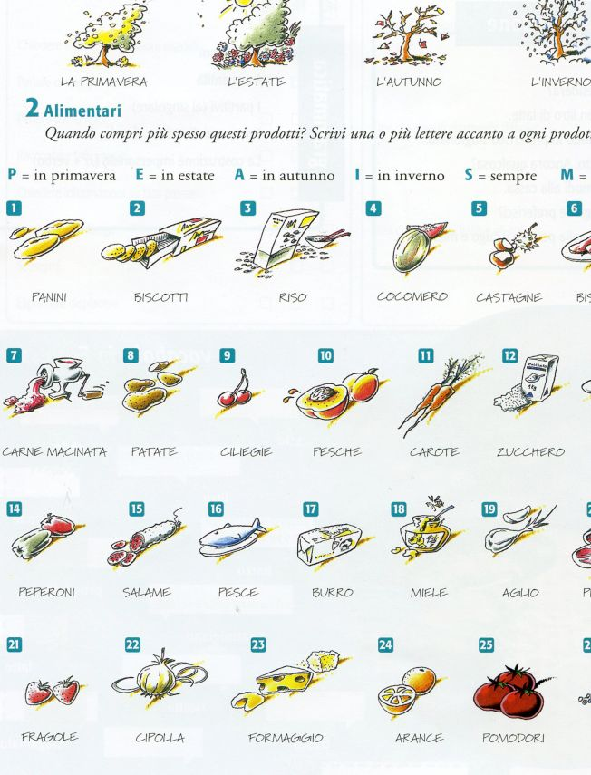
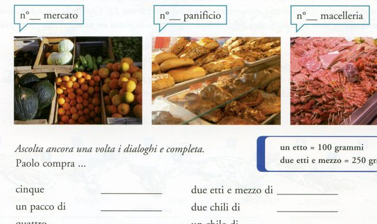
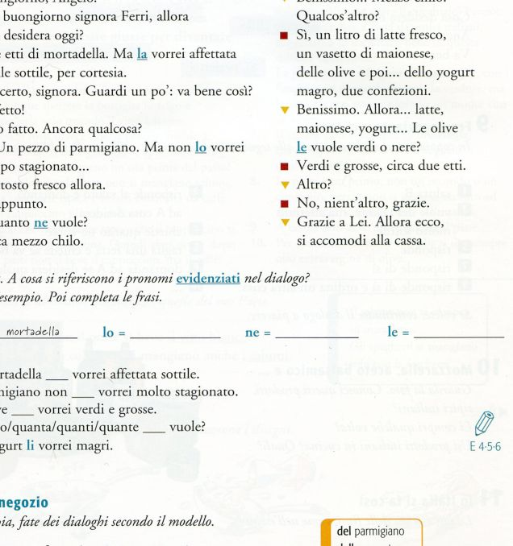
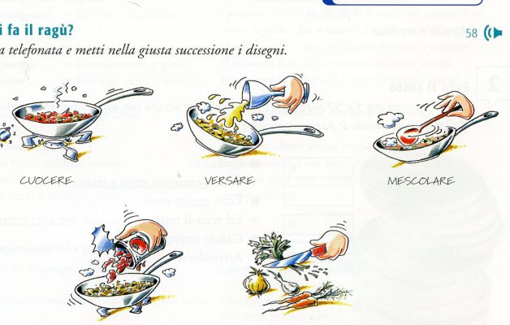
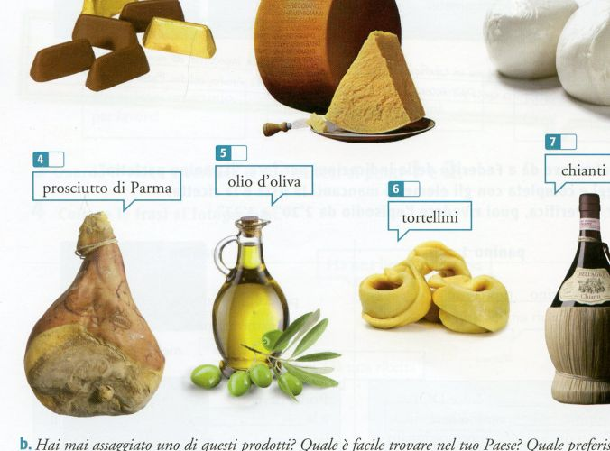

# Lezione 8 — Vocabulary · Italiano / English / فارسی

[← Lesson](lesson.md) · [Grammar](grammar.md) · **Vocabulary** · [Exercises](exercise.md)

**Source-led selection:** *Nuovo Espresso 1* Lezione 8, textbook PDF pp. 105–116, cross-checked with the Italian–Persian glossary. Each Italian model sentence is **new educational text**, not a copied publisher dialogue. Pictures in the textbook are identified in [Lesson](lesson.md).

**Visual method:** each Italian entry has a quick emoji memory cue and the concrete groups are now illustrated by **actual cropped textbook pictures below**; when an exact, licensed external photo is available, it takes priority. The word spelling, translation and example remain the definitive reference.

## Stagioni e alimenti

| Visual + italiano | English | فارسی | Original Italian example |
|---|---|---|---|
| 👅 **sapore** | flavour | طعم | Questo formaggio ha un sapore forte. |
| 🍂 **stagione** | season | فصل | Qual è la tua stagione preferita? |
| 🌷 **primavera** | spring | بهار | In primavera mangio le fragole. |
| ☀️ **estate** | summer | تابستان | In estate compro il cocomero. |
| 🍁 **autunno** | autumn | پاییز | In autunno mangio le castagne. |
| ❄️ **inverno** | winter | زمستان | In inverno preferisco la zuppa. |
| ❤️ **preferito / preferita** | favourite | موردعلاقه | L'estate è la mia stagione preferita. |
| 🥪 **panino** | sandwich / bread roll | ساندویچ / نان | Vorrei un panino al formaggio. |
| 🍪 **biscotto** | biscuit | بیسکویت | Mangio due biscotti. |
| 🍚 **riso** | rice | برنج | Il riso è sul tavolo. |
| 🍉 **cocomero** | watermelon | هندوانه | Compro un cocomero. |
| 🌰 **castagna** | chestnut | شاه‌بلوط | Le castagne sono buone. |
| 🥩 **bistecca** | steak | استیک | Vorrei una bistecca. |
| 🥩 **carne macinata** | minced meat | گوشت چرخ‌کرده | Prendo mezzo chilo di carne macinata. |
| 🥔 **patata** | potato | سیب‌زمینی | Compro due chili di patate. |
| 🍒 **ciliegia** | cherry | گیلاس | Le ciliegie sono dolci. |
| 🍑 **pesca** | peach | هلو | Mangio una pesca. |
| 🥕 **carota** | carrot | هویج | Taglio tre carote. |
| 🍬 **zucchero** | sugar | شکر | Metto poco zucchero nel caffè. |
| 🥚 **uovo** | egg | تخم‌مرغ | Per la ricetta serve un uovo. |
| 🫑 **peperone** | bell pepper | فلفل دلمه‌ای | Taglio un peperone. |
| 🥓 **salame** | salami | سالامی | Vorrei del salame. |
| 🐟 **pesce** | fish | ماهی | Compro del pesce fresco. |
| 🧈 **burro** | butter | کره | Mi serve un po' di burro. |
| 🍯 **miele** | honey | عسل | Prendo un vasetto di miele. |
| 🧄 **aglio** | garlic | سیر | Aggiungo due spicchi d'aglio. |
| 🥓 **prosciutto** | ham | ژامبون | Vorrei un etto di prosciutto. |
| 🍓 **fragola** | strawberry | توت‌فرنگی | Le fragole sono fresche. |
| 🧅 **cipolla** | onion | پیاز | Taglio la cipolla. |
| 🧀 **formaggio** | cheese | پنیر | Lo vuole fresco o stagionato? |
| 🍊 **arancia** | orange | پرتقال | Compro tre arance. |
| 🍅 **pomodoro** | tomato | گوجه‌فرنگی | La ricetta ha due pomodori. |
| 🍇 **uva** | grapes | انگور | L'uva è dolce. |

## Negozi, quantità e acquisti

| Visual + italiano | English | فارسی | Original Italian example |
|---|---|---|---|
| 🛒 **fare la spesa** | to shop for groceries | خرید مواد غذایی کردن | Sabato faccio la spesa. |
| 🛍️ **mercato** | market | بازار | Compro frutta al mercato. |
| 🥖 **panificio** | bakery | نانوایی | Il pane è al panificio. |
| 🥩 **macelleria** | butcher's shop | قصابی | La carne è in macelleria. |
| 🏪 **negozio di alimentari** | food store | فروشگاه مواد غذایی | Vado al negozio di alimentari. |
| 🧑‍🍳 **negoziante** | shopkeeper | فروشنده | Il negoziante è gentile. |
| 🛍️ **cliente** | customer | مشتری | Il cliente chiede il prezzo. |
| ⚖️ **un etto** | 100 grams | صد گرم | Vorrei un etto di prosciutto. |
| ⚖️ **due etti** | 200 grams | دویست گرم | Prendo due etti di parmigiano. |
| ⚖️ **un chilo** | one kilogram | یک کیلو | Compro un chilo di patate. |
| ⚖️ **mezzo chilo** | half a kilogram | نیم کیلو | Vorrei mezzo chilo di pomodori. |
| 🥛 **un litro** | one litre | یک لیتر | Prendo un litro di latte. |
| 🫙 **un vasetto** | small jar | شیشه کوچک | Compro un vasetto di maionese. |
| 📦 **un pacco** | a packet | یک بسته | Mi dà un pacco di biscotti? |
| 📦 **una confezione** | package | بسته | Una confezione di yogurt, grazie. |
| 🧩 **un pezzo** | a piece | یک تکه | Vorrei un pezzo di formaggio. |
| 🤏 **un po' di** | a little of | کمی از | Mi dà un po' di pane? |
| ❓ **quanto / quanta** | how much | چقدر | Quanta mozzarella vuole? |
| 🔢 **quanti / quante** | how many | چند تا | Quante olive vuole? |
| 🥬 **fresco / fresca** | fresh | تازه | Il pesce è fresco. |
| 🧀 **stagionato / stagionata** | aged (food) | رسیده / کهنه | Il parmigiano è stagionato. |
| 🥓 **affettato / affettata** | sliced | ورقه‌شده | Vorrei mortadella affettata sottile. |
| 📏 **sottile** | thin | نازک | La fetta è molto sottile. |
| 🥩 **magro / magra** | lean | کم‌چرب | Preferisco un prosciutto magro. |
| 📦 **grosso / grossa** | large / thick | درشت | Ne vorrei un pezzo grosso. |
| 💶 **la cassa** | cash desk | صندوق | Pago alla cassa. |
| 💶 **il resto** | change (money) | باقی پول | Ecco il resto. |
| 💰 **quant'è?** | how much is it? | چقدر می‌شود؟ | Quant'è in tutto? |
| 🚫 **nient'altro** | nothing else | چیز دیگری نه | Nient'altro, grazie. |
| 🙏 **me ne dà...?** | could you give me some...? | مقداری به من می‌دهید؟ | Me ne dà due etti? |
| 🧩 **lo / la / li / le** | direct-object pronouns | ضمیر مفعولی مستقیم | La compro e li porto a casa. |
| 🧩 **ne** | of it / of them (quantity) | از آن / از آن‌ها | Ne prendo due etti. |
| 🧩 **della / del / dell'** | some (partitive) | مقداری | Vorrei del pane. |
| 🧩 **delle / dei / degli** | some (plural partitives) | چند / مقداری | Prendo delle mele. |

## Cibo, ricette e cultura

| Visual + italiano | English | فارسی | Original Italian example |
|---|---|---|---|
| 🥓 **mortadella** | mortadella cold cut | مورتادلا | La mortadella è un salume. |
| 🥣 **maionese** | mayonnaise | مایونز | Vorrei un vasetto di maionese. |
| 🫒 **oliva** | olive | زیتون | Compro due etti di olive. |
| 🧀 **mozzarella** | mozzarella cheese | پنیر موتزارلا | La mozzarella è fresca. |
| 🍾 **aceto balsamico** | balsamic vinegar | سرکه بالزامیک | Uso poco aceto balsamico. |
| 🫒 **olio d'oliva** | olive oil | روغن زیتون | Aggiungo olio d'oliva. |
| 🫒 **olio extravergine** | extra-virgin olive oil | روغن زیتون فرابکر | Preferisco l'olio extravergine. |
| 🥓 **prosciutto di Parma** | Parma ham | ژامبون پارما | È un prodotto italiano. |
| 🧀 **parmigiano reggiano** | Parmesan cheese | پنیر پارمیجانو | Compro del parmigiano reggiano. |
| 🍫 **gianduiotto** | Piedmont chocolate sweet | شکلات جیاندویوتو | Assaggio un gianduiotto. |
| 🍝 **tortellini** | filled pasta rings | تورتلینی | I tortellini sono buoni. |
| 🍇 **chianti** | Chianti wine (cultural product) | شراب کیانتی | Il Chianti è un prodotto toscano. |
| 📋 **ricetta** | recipe | دستور غذا | Leggo una ricetta. |
| 🍝 **ragù** | meat-based pasta sauce | سس راگو | Preparo un ragù. |
| 🔪 **tagliare** | to cut | بریدن | Taglio le carote. |
| 🍲 **cuocere** | to cook | پختن | Cuocio le verdure. |
| 🫗 **versare** | to pour | ریختن | Verso l'acqua. |
| 🥄 **mescolare** | to mix/stir | هم زدن | Mescolo il sugo. |
| ➕ **aggiungere** | to add | اضافه کردن | Aggiungo il sale. |
| 🫒 **condire** | to season / dress | چاشنی زدن | Condisco l'insalata. |
| 🥬 **sedano** | celery | کرفس | Taglio il sedano. |
| 🍅 **passata di pomodoro** | tomato purée | پوره گوجه‌فرنگی | Aggiungo la passata. |
| 🍲 **cotto / cotta** | cooked | پخته | La carne è cotta. |
| 🥗 **crudo / cruda** | raw | خام | La carota è cruda. |
| 🥦 **verdura** | vegetable | سبزیجات | Mangio molta verdura. |
| 🥗 **alimento** | food item | ماده غذایی | È un alimento fresco. |
| 🧊 **frigo** | fridge | یخچال | Metto il latte in frigo. |
| 🍽️ **a tavola** | at the table | سر میز غذا | A tavola si mangia insieme. |
| 🍽️ **si mangia** | people eat / one eats | خورده می‌شود | In Italia si mangia pasta. |
| 🚫 **vietato** | forbidden | ممنوع | È vietato entrare. |
| 👅 **assaggiare** | to taste | چشیدن | Vorrei assaggiare il formaggio. |
| 🔁 **abitudine** | habit | عادت | È un'abitudine comune. |
| 🥗 **dieta mediterranea** | Mediterranean diet | رژیم مدیترانه‌ای | Conosco la dieta mediterranea. |
| 📦 **prodotto** | product | محصول | È un prodotto locale. |

## Original book images — see, say, recall

These illustrations are actual cropped textbook assets. Say the Italian words for what you see, then form full sentences. **They are separate from the emoji mnemonic cues in the tables.**

### Book page 106

### Book page 108

### Book page 109

### Book page 111

### Book page 116

## Picture-to-word learning with the **actual textbook**

- **p. 106–107:** point to the book's numbered food drawings and name the food without reading the lower captions. Sort the items into **frutta, verdura, carne, altro**.
- **p. 108:** compare the three real shop photos: **mercato, panificio, macelleria**. Order a different item from each shop.
- **p. 111:** the five real recipe drawings demonstrate **cuocere, versare, mescolare, aggiungere, tagliare**. Describe their actions in a new recipe.
- **p. 116:** identify the illustrated traditional products. Say which you have tried and which you would like to taste.

## English bridges and memory traps

| Italian | English | Avoid confusing |
|---|---|---|
| `un etto` | 100 g | Not 1 kilogram |
| `la compro` | I buy it | `la` is feminine singular direct object, not always `the` |
| `ne prendo due` | I'll take two (of them) | `ne` refers to a quantity, not just `it` |
| `si mangia` | people eat / one eats | Impersonal `si` ≠ reflexive `si lava` (next lesson) |

## Original two-person conversation: repeat, hide, change

> **A:** Buongiorno! Vorrei due etti di parmigiano.
> **B:** Lo vuole fresco o stagionato?
> **A:** Stagionato, per favore. E delle olive?
> **B:** Certo. Quante ne vuole?
> **A:** Un etto, grazie. Quant'è in tutto?

**Repeat aloud** until fluent; without native audio this is not genuine shadowing. Replace three details, then perform both roles from memory. Check your endings and grammatical agreement with [Grammar](grammar.md).

## Spaced retrieval

Review after 10 minutes, the next day, three days later and seven days later. Every time, look only at the **visual cue**, attempt the Italian term, and invent a sentence before revealing the table.

[← Lesson](lesson.md) · [Grammar](grammar.md) · [Exercises](exercise.md)
