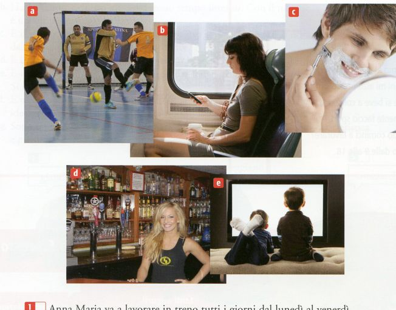
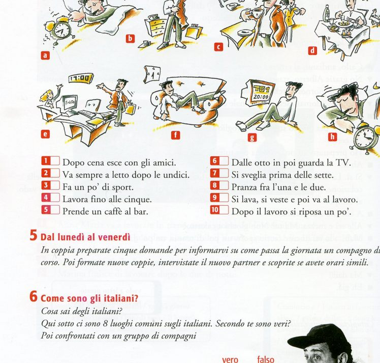
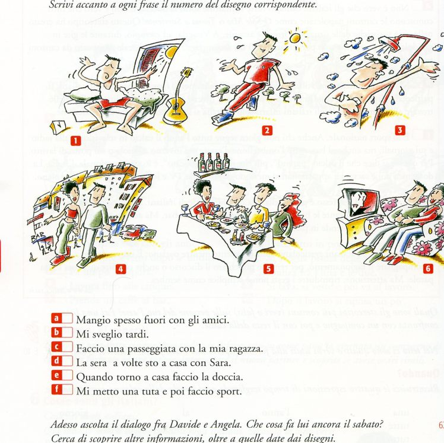
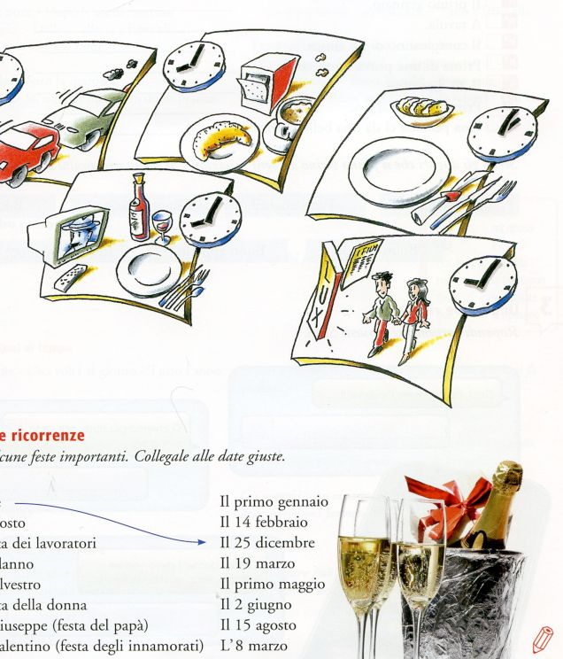
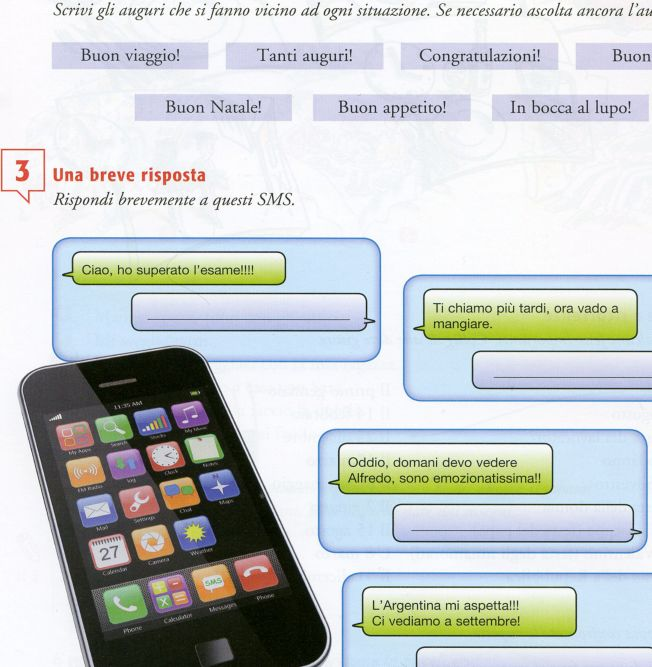
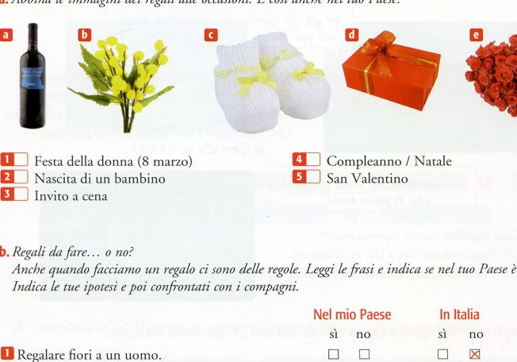

# Lezione 9 — Picture-based exercise workbook

[← Lesson](lesson.md) · [Grammar](grammar.md) · [Vocabulary](vocabulary.md) · **Exercises**

**Book basis:** scanned PDF pp. **117–128**. The companion grammar and dialogue answers below are written for this course; official listening and original publisher solutions are not claimed.

## Part A — 50 original vocabulary and grammar drills

Attempt each before expanding its answer, then invent a different sentence based on the same pattern.

**1.** Translate 'to wake up'.

Check answer

**svegliarsi**

**2.** Translate 'to get up'.

Check answer

**alzarsi**

**3.** Translate 'to get dressed'.

Check answer

**vestirsi**

**4.** Translate 'to wash oneself'.

Check answer

**lavarsi**

**5.** Say 'I get up at seven'.

Check answer

**Mi alzo alle sette.**

**6.** Say 'She gets up at six'.

Check answer

**Si alza alle sei.**

**7.** Say 'You (tu) wash yourself'.

Check answer

**Ti lavi.**

**8.** Say 'We get dressed'.

Check answer

**Ci vestiamo.**

**9.** Say 'They wake up'.

Check answer

**Si svegliano.**

**10.** Say 'I shave'.

Check answer

**Mi faccio la barba.**

**11.** Contrast mi sveglio and mi alzo.

Check answer

**I wake up vs I get out of bed / get up.**

**12.** Say 'I have breakfast at eight'.

Check answer

**Faccio colazione alle otto.**

**13.** Translate 'I have lunch at one'.

Check answer

**Pranzo all'una.**

**14.** Say 'I have dinner at nine'.

Check answer

**Ceno alle nove.**

**15.** Say 'I go to bed early'.

Check answer

**Vado a letto presto.**

**16.** Say 'I study every day'.

Check answer

**Studio ogni giorno.**

**17.** Say 'I go to work'.

Check answer

**Vado al lavoro.**

**18.** Say 'I work from nine to five'.

Check answer

**Lavoro dalle nove alle cinque.**

**19.** Say 'I leave before eight'.

Check answer

**Esco prima delle otto.**

**20.** Say 'I arrive after six'.

Check answer

**Arrivo dopo le sei.**

**21.** Say 'I study until ten'.

Check answer

**Studio fino alle dieci.**

**22.** Say 'I get home around seven'.

Check answer

**Torno a casa verso le sette.**

**23.** Say 'I start working'.

Check answer

**Comincio a lavorare.**

**24.** Say 'I finish working'.

Check answer

**Finisco di lavorare.**

**25.** Translate 'always'.

Check answer

**sempre**

**26.** Translate 'often'.

Check answer

**spesso**

**27.** Translate 'sometimes'.

Check answer

**qualche volta**

**28.** Translate 'rarely'.

Check answer

**raramente**

**29.** Translate 'never'.

Check answer

**mai**

**30.** Say 'I never go to bed late'.

Check answer

**Non vado mai a letto tardi.**

**31.** Say 'I usually get up early'.

Check answer

**Di solito mi alzo presto.**

**32.** Translate 'the football match'.

Check answer

**la partita di calcio**

**33.** Translate 'tournament'.

Check answer

**torneo**

**34.** Ask 'Do you want to go to the cinema tonight?'.

Check answer

**Andiamo al cinema stasera?**

**35.** Ask 'Do you feel like going out?'

Check answer

**Ti va di uscire?**

**36.** Accept an invitation informally.

Check answer

**Sì, volentieri!**

**37.** Decline politely.

Check answer

**Mi dispiace, non posso.**

**38.** Suggest another time.

Check answer

**Facciamo un'altra volta?**

**39.** Translate 'good luck' idiom.

Check answer

**In bocca al lupo!**

**40.** Translate 'happy birthday / best wishes'.

Check answer

**Tanti auguri!**

**41.** Translate 'congratulations'.

Check answer

**Congratulazioni!**

**42.** Translate 'have a good trip'.

Check answer

**Buon viaggio!**

**43.** Translate 'Merry Christmas'.

Check answer

**Buon Natale!**

**44.** Translate 'Happy New Year'.

Check answer

**Buon anno!**

**45.** Say 'I send a message'.

Check answer

**Mando un messaggio.**

**46.** Say 'I have an appointment'.

Check answer

**Ho un appuntamento.**

**47.** Say 'I'm free Friday'.

Check answer

**Sono libero/a venerdì.**

**48.** Translate 'gift'.

Check answer

**regalo**

**49.** Say 'I give flowers as a gift'.

Check answer

**Regalo dei fiori.**

## Part B — Actual textbook picture and reading exercises

**50.** **p. 118 — daily-life photographs.** Match a new routine phrase to each of the **five original photographs**; distinguish an observation from a guess.

How to check

Visible scenes include **playing football, working at a computer, shaving, working in a shop, and watching television**. Example: `Lui si fa la barba la mattina.`

**51.** **p. 119 — Il grande giorno.** Read the printed dialogue and identify why the person must sleep early; practise two time questions.

How to check

Read the print for the person's own reason; a model response is: `Domani ha una partita importante, quindi va a letto presto.` Do not claim an official listening answer without audio.

**52.** **p. 120 — eight-panel daily routine.** Describe each original numbered panel using at least one reflexive verb; then reorder as a day.

How to check

The panels show a mixture of **waking, dressing, sport, work, television, and going to bed**. A sample timeline: `Mi sveglio, mi lavo, mi vesto, lavoro, faccio sport, guardo la TV, vado a letto.`

**53.** **p. 121 — frequency and timeline.** Read the source short texts and express three different schedules with `dalle…alle` and `prima/dopo`.

How to check

Sample schedule: `Lavoro dalle nove alle cinque`; `Esco prima delle otto`; `Torno dopo le sei`. Check your specific source readings against these expressions.

**54.** **p. 122 — Davide's Saturday.** Describe all **six** real comic frames; rewrite the story in first person.

How to check

Use **all six original panels**. An original retelling: `Sabato mi sveglio tardi, esco, faccio una passeggiata, incontro gli amici e torno a casa.` Confirm scene details from the image rather than forcing this model onto the book characters.

**55.** **p. 123 — Ernesto's day.** Read the clocks from the actual illustration and retell his actions using `prima, poi, dopo`.

How to check

Follow the depicted clocks in sequence, then say: `Prima fa colazione, poi esce, dopo pranza e la sera torna a casa.` The precise times must be read from the visible clocks.

**56.** **p. 123 — celebrations.** Connect the printed occasions with their source dates; say the dates aloud.

How to check

For example: `Natale — 25 dicembre`; `Capodanno — 1 gennaio`; `Festa della donna — 8 marzo`. The source activity gives other celebrations as well.

**57.** **p. 124 — illustrated SMS replies.** Read the messages and write a brief natural response to each; choose the appropriate greeting.

How to check

Original responses: `Ho superato l'esame!` → `Congratulazioni!`; `Domani vieni al cinema?` → `Volentieri!`; `Non posso venire` → `Peccato, un'altra volta!`

**58.** **p. 125 — grammar summary.** Conjugate `svegliarsi` for io, tu, lei, noi, voi and loro.

How to check

`mi sveglio, ti svegli, si sveglia, ci svegliamo, vi svegliate, si svegliano`.

**59.** **p. 126–127 — agenda video.** Use the printed weekly agenda to ask an original availability question; the official video question needs video.

How to check

Possible question: `Sei libero mercoledì sera?`; possible response: `No, ho un appuntamento. Facciamo venerdì?`. Verify the source agenda/video separately.

**60.** **p. 128 — gift photographs.** Identify the real depicted gift objects, then choose a plausible occasion for each.

How to check

The five images depict **a bottle, flowers, baby booties, a wrapped gift and red flowers/plant material**. Choose a plausible occasion, and explain why; multiple answers can be acceptable.

## Part C — Real-life transfer and recall

**61.** Write a six-turn conversation inviting a friend out, arranging a time, accepting or suggesting another day.

**62.** Describe a fictional weekday and Saturday in 8–10 Italian sentences, with three reflexive verbs and four time expressions.

**63.** Recite the source picture vocabulary from memory, not reading the words, then quiz yourself the next day, after three days and after one week.

**64.** Read the original model exchange from [Vocabulary](vocabulary.md) aloud, then rebuild it with changed information. For true shadowing use accessible authorized native-speaker Italian audio.

## Self-assessment

- [ ] I can conjugate common reflexive verbs.
- [ ] I can describe a complete day with times and frequency adverbs.
- [ ] I can make, accept and decline invitations politely.
- [ ] I can choose suitable greetings and use the source comics/photographs.

[← Lesson](lesson.md) · [Grammar](grammar.md) · [Vocabulary](vocabulary.md)
