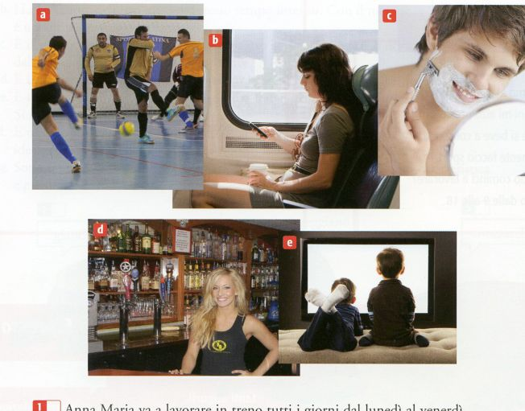
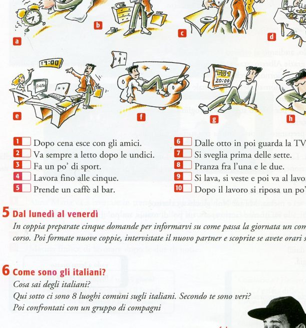
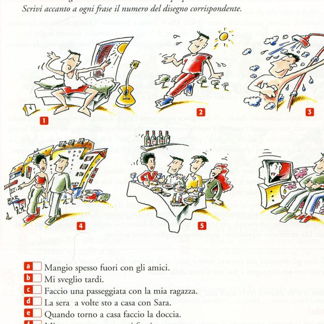
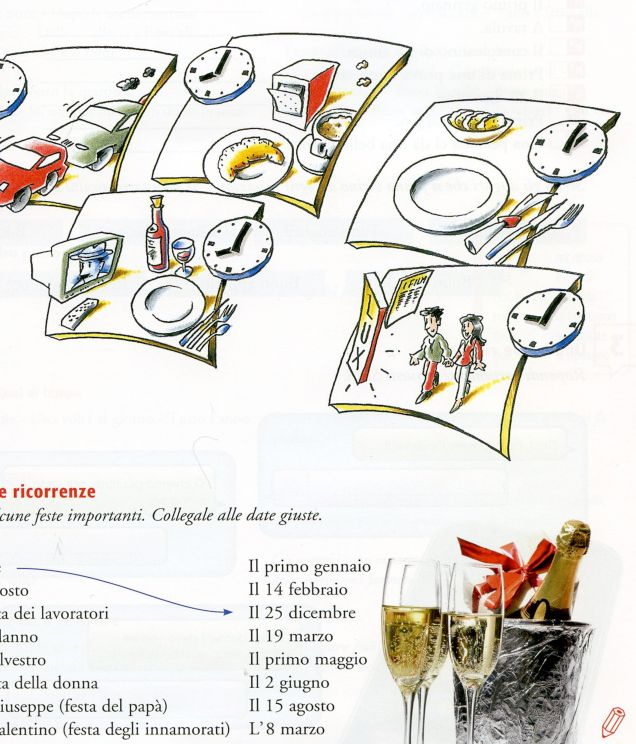
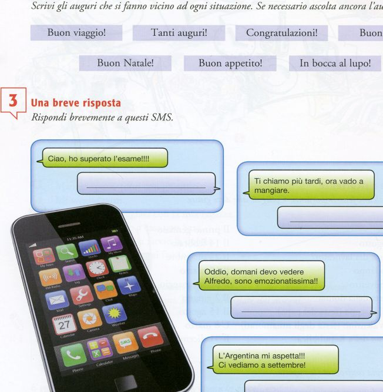
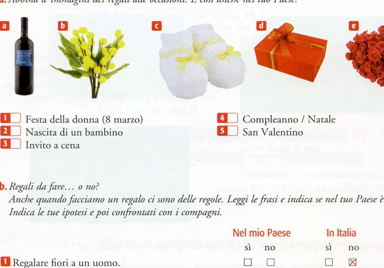

# A1 · Lezione 9 — Vita quotidiana

[← A1 index](../README.md) · **Lesson** · [Grammar](grammar.md) · [Vocabulary](vocabulary.md) · [Exercises](exercise.md)

**Book:** *Nuovo Espresso 1*, requested PDF pages **117–129**, actual chapter **117–128**. The next chapter begins on the final boundary page. This module follows the scanned source and gives **original, self-contained companion education**. Publisher images are separately credited in [Photo credits](../PHOTO_CREDITS.md).

## What you will learn

You will discuss study/work schedules, say when actions begin and finish, use reflexive verbs such as **alzarsi / svegliarsi / vestirsi**, state frequency, describe a full day, propose invitations, send short responses and recognize holidays and suitable greetings.

## Real cropped textbook illustrations

The images immediately below are **actual focused crops from the uploaded book**, not replacements or generic internet photos. Use the image first, then answer the next exercise. Their publisher provenance and rights status are documented in [PHOTO_CREDITS](../PHOTO_CREDITS.md).

### Source page 118

### Source page 120

### Source page 122

### Source page 123

### Source page 124

### Source page 128

## The original-book visual route

| Page | Actual textbook section | Learning task |
|---|---|---|
| 117 | **Apertura: Vita quotidiana** | Study the introductory vocabulary cloud and communication examples. |
| 118 | **1 Chi è?; 2 Lavoro o scuola** | Match five actual photos to the printed daily schedule statements. |
| 119 | **3 Il grande giorno!** | Answer who does what, what time they plan to sleep, and why. |
| 120 | **4 Una giornata normale; 5 Dal lunedì al venerdì; 6 Come sono gli italiani?** | Put the eight **actual** comic pictures into a plausible order. |
| 121 | **Reading about Italian lifestyle; 7 Quando?** | Compare time phrases and identify time intervals on the source time-line. |
| 122 | **8 Il sabato di Davide** | Reconstruct the six pictured actions, then retell them in the first person. |
| 123 | **9 La giornata di Ernesto; Feste e ricorrenze** | Tell a day in sequence using the clocks, and match holiday dates. |
| 124 | **E inoltre... 2 Tanti auguri; 3 Una breve risposta** | Choose an appropriate greeting or reply to each message. |
| 125 | **Comunicazione e grammatica** | Rebuild reflexive verb forms and expressions without looking. |
| 126–127 | **Videocorso 9 — L'agenda di Laura** | Use the agenda image to create original scheduling questions and replies. |
| 128 | **Caffè culturale 9 — Cosa regalano gli italiani?** | Identify the gift objects and decide which occasion suits each. |
| 129 | **Lesson transition** | Continue with [Lesson 10](../lesson-10/lesson.md). |

## Learn through the source pictures and new conversations

### 1. Apertura: Vita quotidiana — p. 117

**What the book contains:** Chapter goals introduce reflexive verbs, time expressions, frequency, invitations and celebrations.

**Image/reading challenge:** Study the introductory vocabulary cloud and communication examples.

> **A:** Che cosa fai ogni mattina?  
> **B:** Mi alzo alle sette e faccio colazione.

**Active recall:** cover the answer and repeat the question in your own words, then substitute two words. The dialogues are independently written teaching examples, not publisher listening transcripts.

### 2. 1 Chi è?; 2 Lavoro o scuola — p. 118

**What the book contains:** Five photos of people in different daily-life situations and a schedule-comparison activity.

**Image/reading challenge:** Match five actual photos to the printed daily schedule statements.

> **A:** Lavori o studi?  
> **B:** Lavoro dalle nove alle cinque.

**Active recall:** cover the answer and repeat the question in your own words, then substitute two words. The dialogues are independently written teaching examples, not publisher listening transcripts.

### 3. 3 Il grande giorno! — p. 119

**What the book contains:** A dialogue about a sports tournament, schedules, going to bed early and reflexive forms.

**Image/reading challenge:** Answer who does what, what time they plan to sleep, and why.

> **A:** Domani c'è la partita?  
> **B:** Sì, quindi stasera vado a letto presto.

**Active recall:** cover the answer and repeat the question in your own words, then substitute two words. The dialogues are independently written teaching examples, not publisher listening transcripts.

### 4. 4 Una giornata normale; 5 Dal lunedì al venerdì; 6 Come sono gli italiani? — p. 120

**What the book contains:** Eight numbered cartoon panels present a daily routine, followed by frequency and stereotype prompts.

**Image/reading challenge:** Put the eight **actual** comic pictures into a plausible order.

> **A:** A che ora ti svegli?  
> **B:** Alle sette; poi mi lavo e mi vesto.

**Active recall:** cover the answer and repeat the question in your own words, then substitute two words. The dialogues are independently written teaching examples, not publisher listening transcripts.

### 5. Reading about Italian lifestyle; 7 Quando? — p. 121

**What the book contains:** Short textual opinions, everyday scheduling, and expressions of time and duration.

**Image/reading challenge:** Compare time phrases and identify time intervals on the source time-line.

> **A:** Vai spesso in palestra?  
> **B:** Qualche volta, ma raramente in inverno.

**Active recall:** cover the answer and repeat the question in your own words, then substitute two words. The dialogues are independently written teaching examples, not publisher listening transcripts.

### 6. 8 Il sabato di Davide — p. 122

**What the book contains:** Six comic panels illustrate a Saturday routine and comprehension sentences.

**Image/reading challenge:** Reconstruct the six pictured actions, then retell them in the first person.

> **A:** Che cosa fai sabato?  
> **B:** Prima faccio la spesa, poi incontro gli amici.

**Active recall:** cover the answer and repeat the question in your own words, then substitute two words. The dialogues are independently written teaching examples, not publisher listening transcripts.

### 7. 9 La giornata di Ernesto; Feste e ricorrenze — p. 123

**What the book contains:** Clock-marked illustrations present a person's day; holiday/date matching follows.

**Image/reading challenge:** Tell a day in sequence using the clocks, and match holiday dates.

> **A:** Quando fai colazione?  
> **B:** Verso le otto; dopo vado in ufficio.

**Active recall:** cover the answer and repeat the question in your own words, then substitute two words. The dialogues are independently written teaching examples, not publisher listening transcripts.

### 8. E inoltre... 2 Tanti auguri; 3 Una breve risposta — p. 124

**What the book contains:** Occasion-based well-wishes and illustrated SMS short-message replies.

**Image/reading challenge:** Choose an appropriate greeting or reply to each message.

> **A:** Che cosa si festeggia oggi?  
> **B:** Un compleanno: tanti auguri!

**Active recall:** cover the answer and repeat the question in your own words, then substitute two words. The dialogues are independently written teaching examples, not publisher listening transcripts.

### 9. Comunicazione e grammatica — p. 125

**What the book contains:** Official recap: reflexives, frequency expressions, time phrases and formal/informal invitations.

**Image/reading challenge:** Rebuild reflexive verb forms and expressions without looking.

> **A:** Ti va di uscire stasera?  
> **B:** Mi dispiace, domani mi alzo presto.

**Active recall:** cover the answer and repeat the question in your own words, then substitute two words. The dialogues are independently written teaching examples, not publisher listening transcripts.

### 10. Videocorso 9 — L'agenda di Laura — p. 126–127

**What the book contains:** Photos of Laura and Federico with weekly agenda and invitation plans; source listening requires video.

**Image/reading challenge:** Use the agenda image to create original scheduling questions and replies.

> **A:** Quando sei libero?  
> **B:** Venerdì dopo il lavoro.

**Active recall:** cover the answer and repeat the question in your own words, then substitute two words. The dialogues are independently written teaching examples, not publisher listening transcripts.

### 11. Caffè culturale 9 — Cosa regalano gli italiani? — p. 128

**What the book contains:** Five gift-product photographs and a true/false social customs comparison.

**Image/reading challenge:** Identify the gift objects and decide which occasion suits each.

> **A:** Che cosa regali a Giulia?  
> **B:** Le regalo dei fiori.

**Active recall:** cover the answer and repeat the question in your own words, then substitute two words. The dialogues are independently written teaching examples, not publisher listening transcripts.

## Original reading — read, infer, answer

> **La giornata inventata di Chiara.** Dal lunedì al venerdì Chiara si sveglia alle sette, si lava, si veste e fa colazione. Comincia a lavorare alle nove e finisce alle cinque. Il mercoledì sera gioca a tennis. Sabato si alza più tardi, fa la spesa e incontra gli amici. Domenica di solito si riposa. Questa settimana invita una collega a cena: «Ti va di venire venerdì?» — «Volentieri!»

**Comprehension:** A che ora si sveglia? Quando finisce di lavorare? Che cosa fa il mercoledì? Quando si alza più tardi? Qual è la formula informale per invitare qualcuno?

Model answers

Alle sette; alle cinque; gioca a tennis; sabato; **Ti va di venire venerdì?**

## Speaking and listening routine

1. **See:** identify the book illustration or the compact vocabulary picture.
2. **Say:** name the visible item/activity without checking the table.
3. **Build:** say a complete Italian sentence using the appropriate grammar.
4. **Converse:** ask a partner one question and answer it.
5. **Retell:** use three connected sentences without looking.

**Shadowing** requires an actual, authorized Italian recording; without one, the written model dialogues offer read-aloud/echo practice rather than authentic audio shadowing. See [Vocabulary](vocabulary.md) and [Exercises](exercise.md).

## Revision

Study ten new terms immediately, then review tomorrow, after three days and one week. Mix Lesson 8's shopping conversations with Lesson 9's daily routine questions to learn when to use different grammar structures.

[Grammar](grammar.md) · [Vocabulary](vocabulary.md) · [Exercises](exercise.md)
