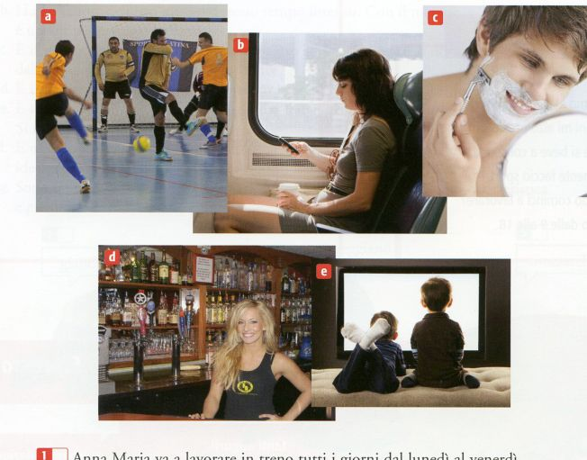
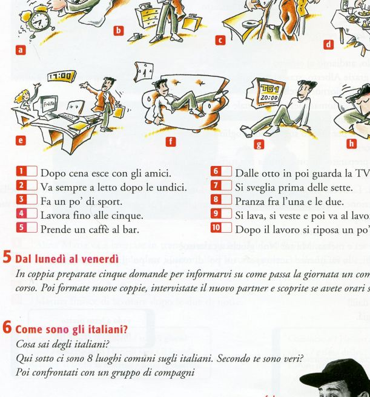
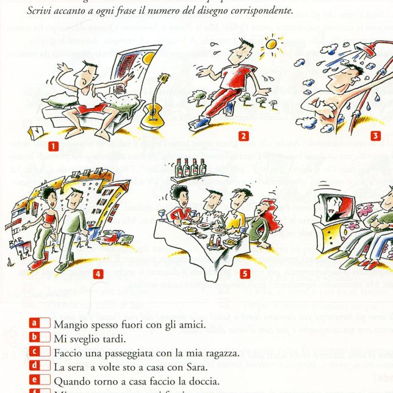
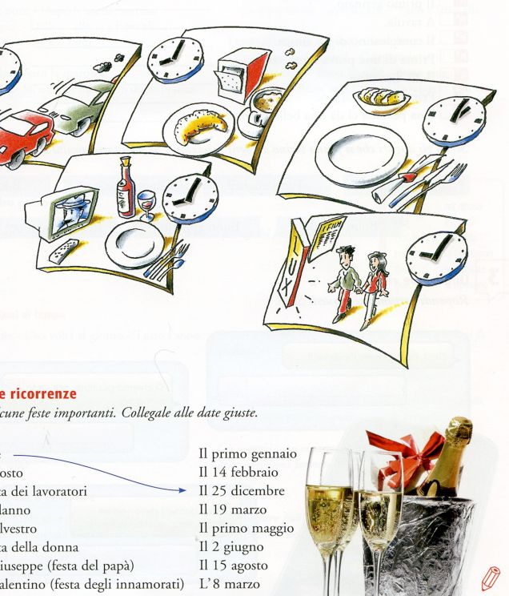
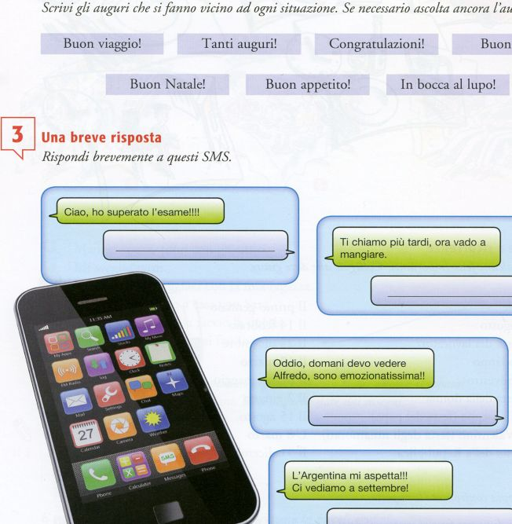
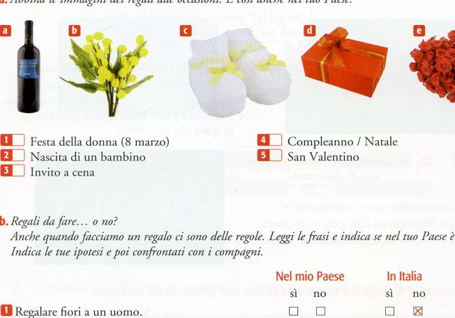

# Lezione 9 — Vocabulary · Italiano / English / فارسی

[← Lesson](lesson.md) · [Grammar](grammar.md) · **Vocabulary** · [Exercises](exercise.md)

**Source-led selection:** *Nuovo Espresso 1* Lezione 9, textbook PDF pp. 117–128, cross-checked with the Italian–Persian glossary. Each Italian model sentence is **new educational text**, not a copied publisher dialogue. Pictures in the textbook are identified in [Lesson](lesson.md).

**Visual method:** each Italian entry has a quick emoji memory cue and the concrete groups are now illustrated by **actual cropped textbook pictures below**; when an exact, licensed external photo is available, it takes priority. The word spelling, translation and example remain the definitive reference.

## Routine and reflexive verbs

| Visual + italiano | English | فارسی | Original Italian example |
|---|---|---|---|
| 🏡 **vita quotidiana** | daily life | زندگی روزمره | Descrivo la mia vita quotidiana. |
| ⏰ **svegliarsi** | to wake up | بیدار شدن | Mi sveglio alle sette. |
| 🛏️ **alzarsi** | to get up | بلند شدن | Mi alzo subito. |
| 🚿 **lavarsi** | to wash oneself | شستن خود | Mi lavo prima di colazione. |
| 👕 **vestirsi** | to get dressed | لباس پوشیدن | Mi vesto alle otto. |
| 🪒 **farsi la barba** | to shave | ریش تراشیدن | Mio fratello si fa la barba. |
| 🪮 **pettinarsi** | to comb one's hair | شانه کردن مو | Mi pettino davanti allo specchio. |
| 💄 **truccarsi** | to put on makeup | آرایش کردن | Si trucca prima di uscire. |
| 🚿 **farsi la doccia** | to take a shower | دوش گرفتن | Mi faccio la doccia la sera. |
| 🥐 **fare colazione** | to have breakfast | صبحانه خوردن | Faccio colazione alle otto. |
| 🍝 **pranzare** | to have lunch | ناهار خوردن | Pranzo all'una. |
| 🍽️ **cenare** | to have dinner | شام خوردن | Ceno alle otto. |
| 💼 **andare al lavoro** | to go to work | سر کار رفتن | Vado al lavoro alle nove. |
| 💻 **lavorare** | to work | کار کردن | Lavoro fino alle cinque. |
| 📚 **studiare** | to study | درس خواندن | Studio italiano ogni giorno. |
| 🛋️ **riposare / riposarsi** | to rest | استراحت کردن | Domenica mi riposo. |
| 🛏️ **andare a letto** | to go to bed | به تختخواب رفتن | Vado a letto presto. |
| 😴 **dormire** | to sleep | خوابیدن | Dormo sette ore. |
| ▶️ **cominciare a** | to begin to | شروع کردن به | Comincio a lavorare. |
| 🏁 **finire di** | to finish doing | تمام کردن | Finisco di studiare. |
| 🥱 **stancarsi** | to get tired | خسته شدن | Mi stanco dopo il lavoro. |
| 👦 **figlio** | son / child | پسر / فرزند | Mio figlio si sveglia presto. |
| 📺 **cartone animato** | cartoon | کارتون | Il bambino guarda un cartone. |
| ⚽ **calcetto** | five-a-side football | فوتسال | Gioco a calcetto. |
| ⚽ **partita** | match / game | بازی / مسابقه | La partita è domani. |
| 🏆 **torneo** | tournament | مسابقات | Domani c'è un torneo. |

## Time and frequency

| Visual + italiano | English | فارسی | Original Italian example |
|---|---|---|---|
| 🌄 **mattina** | morning | صبح | La mattina lavoro. |
| 🌤️ **pomeriggio** | afternoon | بعدازظهر | Il pomeriggio studio. |
| 🌙 **sera** | evening | عصر / شب | La sera leggo. |
| 🌌 **notte** | night | شب | Di notte dormo. |
| 📆 **ogni giorno** | every day | هر روز | Studio ogni giorno. |
| 📅 **dal lunedì al venerdì** | Monday through Friday | از دوشنبه تا جمعه | Lavoro dal lunedì al venerdì. |
| 📆 **sabato** | Saturday | شنبه | Sabato faccio la spesa. |
| 📆 **domenica** | Sunday | یکشنبه | Domenica mi riposo. |
| ⏮️ **prima delle** | before (time) | قبل از ساعت | Esco prima delle otto. |
| ⏭️ **dopo le** | after (time) | بعد از ساعت | Torno dopo le sei. |
| 🕒 **dalle ... alle ...** | from ... to ... (time) | از ساعت ... تا ... | Lavoro dalle nove alle cinque. |
| ⌛ **fino alle** | until (time) | تا ساعت | Studio fino alle dieci. |
| ➡️ **in poi** | onwards | به بعد | Dalle sette in poi sono libero. |
| 🕒 **verso le** | around (time) | حدود ساعت | Ceno verso le otto. |
| 🔁 **sempre** | always | همیشه | Mi alzo sempre presto. |
| 🔁 **spesso** | often | اغلب | Esco spesso. |
| 🔄 **di solito** | usually | معمولاً | Di solito lavoro in casa. |
| 🔄 **qualche volta** | sometimes | گاهی | Qualche volta gioco a tennis. |
| 🤏 **raramente** | rarely | به‌ندرت | Raramente guardo la TV. |
| 🚫 **mai** | never | هرگز | Non corro mai. |
| ❄️ **d'inverno** | in winter | در زمستان | D'inverno mi sveglio tardi. |
| 🌅 **presto** | early / soon | زود | Vado a letto presto. |
| 🌙 **tardi** | late | دیر | Torno a casa tardi. |
| ⏱️ **mezz'ora** | half an hour | نیم ساعت | Studio per mezz'ora. |
| ⏱️ **un'ora** | one hour | یک ساعت | Leggo per un'ora. |
| 🧘 **calma** | calm / peace | آرامش | Mi preparo con calma. |

## Activities, invitations and greetings

| Visual + italiano | English | فارسی | Original Italian example |
|---|---|---|---|
| 🛒 **fare la spesa** | to shop for groceries | خرید کردن | Sabato faccio la spesa. |
| 🤝 **incontrare gli amici** | to meet friends | دوستان را دیدن | Incontro gli amici al bar. |
| 🏃 **fare sport** | to exercise / do sport | ورزش کردن | Faccio sport il martedì. |
| 📺 **guardare la TV** | to watch television | تلویزیون تماشا کردن | Guardo la TV la sera. |
| 🎾 **giocare a tennis** | to play tennis | تنیس بازی کردن | Gioco a tennis. |
| ⚽ **giocare a calcetto** | to play five-a-side | فوتسال بازی کردن | Gioco a calcetto sabato. |
| 🎬 **andare al cinema** | to go to the cinema | سینما رفتن | Andiamo al cinema stasera? |
| ✉️ **invitare** | to invite | دعوت کردن | Invito un'amica a cena. |
| ✅ **accettare** | to accept | پذیرفتن | Accetto l'invito. |
| 🚫 **rifiutare** | to decline | رد کردن | Rifiuto con gentilezza. |
| 💬 **ti va di ...?** | do you feel like ...? | مایلی ...؟ | Ti va di uscire? |
| 😊 **volentieri** | gladly | با میل | Sì, volentieri. |
| 😔 **mi dispiace** | I'm sorry | متأسفم | Mi dispiace, non posso. |
| 🔁 **un'altra volta** | another time | یک وقت دیگر | Facciamo un'altra volta. |
| 🧳 **buon viaggio** | have a good trip | سفر خوبی داشته باشی | Buon viaggio! |
| 🎂 **tanti auguri** | best wishes / happy birthday | تبریک / تولدت مبارک | Tanti auguri per il compleanno! |
| 🎉 **congratulazioni** | congratulations | تبریک | Congratulazioni per l'esame! |
| 🎄 **buon Natale** | Merry Christmas | کریسمس مبارک | Buon Natale! |
| 🎆 **buon anno** | Happy New Year | سال نو مبارک | Buon anno a tutti! |
| 🍽️ **buon appetito** | enjoy your meal | نوش جان | Buon appetito! |
| 🍀 **in bocca al lupo** | good luck | موفق باشی | In bocca al lupo per l'esame! |
| 🎂 **compleanno** | birthday | تولد | Oggi è il mio compleanno. |
| 🎊 **festa** | party / holiday | جشن | Organizzo una festa. |
| 📅 **ricorrenza** | recurring celebration | مناسبت | È una ricorrenza importante. |
| 🎄 **Natale** | Christmas | کریسمس | A Natale vedo gli amici. |
| 🎆 **Capodanno** | New Year's Day | روز سال نو | A Capodanno siamo a casa. |
| 🐣 **Pasqua** | Easter | عید پاک | A Pasqua ci sono le vacanze. |
| 💐 **festa della donna** | International Women's Day | روز زن | L'otto marzo è la festa della donna. |
| ❤️ **San Valentino** | Valentine's Day | روز ولنتاین | A San Valentino si regalano fiori. |

## Culture, people and objects

| Visual + italiano | English | فارسی | Original Italian example |
|---|---|---|---|
| 🧠 **stereotipo** | stereotype | کلیشه | Non tutti gli stereotipi sono veri. |
| 💬 **luogo comune** | cliché | کلیشه | Questo è un luogo comune. |
| 🤷 **assurdo** | absurd | بی‌معنی | È un'idea assurda. |
| ☁️ **irreale** | unreal | غیرواقعی | L'immagine è irreale. |
| 🇮🇹 **napoletano / napoletana** | Neapolitan | ناپلی | La mia amica è napoletana. |
| 🛶 **gondola** | gondola | گوندولا | Vedo una gondola a Venezia. |
| 🤌 **gesticolare** | to gesture | با دست اشاره کردن | Gesticola quando parla. |
| 🎤 **cantare** | to sing | آواز خواندن | Mi piace cantare. |
| 🎁 **regalo** | gift | هدیه | Compro un regalo. |
| 🎁 **regalare** | to give as a gift | هدیه دادن | Regalo un libro a Maria. |
| 💐 **fiori** | flowers | گل‌ها | Regalo dei fiori. |
| 🍾 **bottiglia** | bottle | بطری | Porto una bottiglia. |
| 🎁 **bomboniera** | party favour | یادبود مهمانی | Compro una bomboniera. |
| ✨ **augurio** | good wish | آرزوی خوب | Scrivo un augurio. |
| 📱 **messaggio** | message | پیام | Mando un messaggio. |
| 📱 **SMS** | text message | پیامک | Rispondo all'SMS. |
| 📒 **agenda** | planner / agenda | دفتر برنامه‌ریزی | Guardo l'agenda. |
| 📅 **appuntamento** | appointment | قرار ملاقات | Ho un appuntamento. |
| 🗓️ **occupato / occupata** | busy | مشغول | Domani sono occupata. |
| 🆓 **libero / libera** | free / available | آزاد | Venerdì sono libero. |
| 🤝 **promettere** | to promise | قول دادن | Prometto di chiamarti. |

## Original book images — see, say, recall

These illustrations are actual cropped textbook assets. Say the Italian words for what you see, then form full sentences. **They are separate from the emoji mnemonic cues in the tables.**

### Book page 118

### Book page 120

### Book page 122

### Book page 123

### Book page 124

### Book page 128

## Picture-to-word learning with the **actual textbook**

- **p. 118:** associate the five real photos with possible everyday actions.
- **p. 120:** follow the eight original daily-routine cartoons and create a timeline with reflexive verbs.
- **p. 122–123:** tell **Davide's Saturday** and **Ernesto's day** using the source comic panels and clocks.
- **p. 124:** use the printed SMS illustrations to practise one-line responses.
- **p. 128:** match the actual gift-product pictures to suitable celebrations.

## English bridges and memory traps

| Italian | English | Avoid confusing |
|---|---|---|
| `mi alzo` | I get up | Not the English reflexive *myself* in every sentence |
| `mi sveglio` | I wake up | Different from getting out of bed |
| `comincio a lavorare` | I start working | After `cominciare`, use **a** |
| `finisco di lavorare` | I finish working | After `finire`, use **di** |
| `non ... mai` | never | Italian uses `non` plus `mai` in this position |

## Original two-person conversation: repeat, hide, change

> **A:** A che ora ti svegli di solito?
> **B:** Mi sveglio alle sette, mi lavo e mi vesto.
> **A:** E a che ora cominci a lavorare?
> **B:** Alle nove. Finisco alle cinque.
> **A:** Ti va di uscire sabato?
> **B:** Sì, volentieri!

**Repeat aloud** until fluent; without native audio this is not genuine shadowing. Replace three details, then perform both roles from memory. Check your endings and grammatical agreement with [Grammar](grammar.md).

## Spaced retrieval

Review after 10 minutes, the next day, three days later and seven days later. Every time, look only at the **visual cue**, attempt the Italian term, and invent a sentence before revealing the table.

[← Lesson](lesson.md) · [Grammar](grammar.md) · [Exercises](exercise.md)
