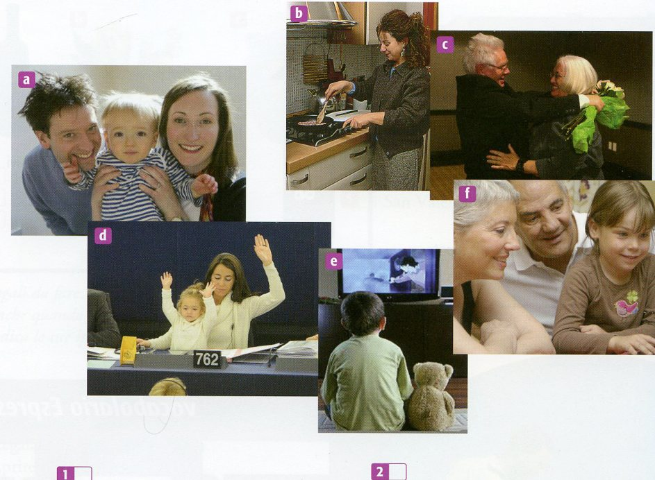
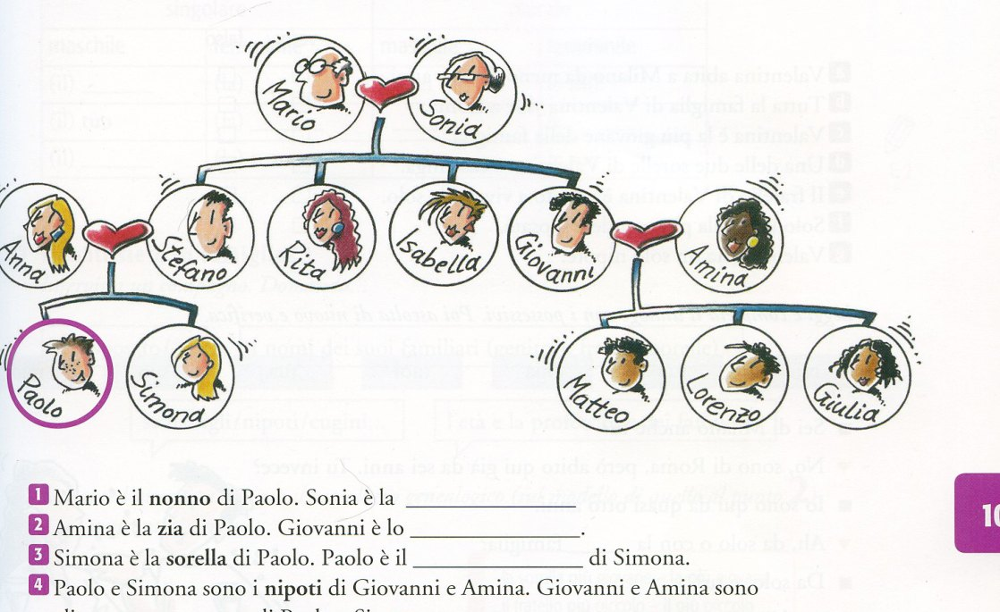
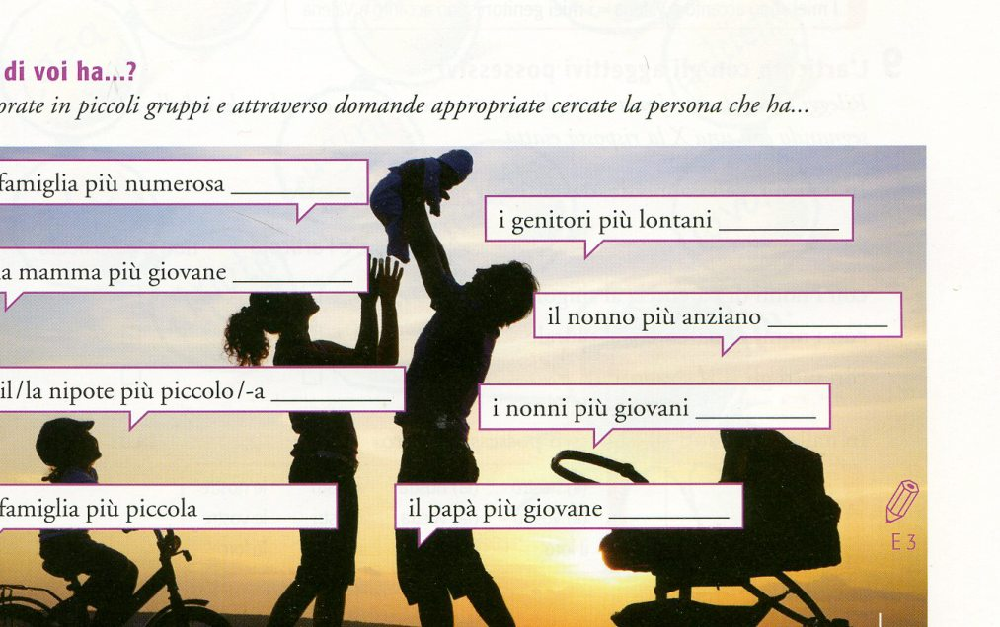
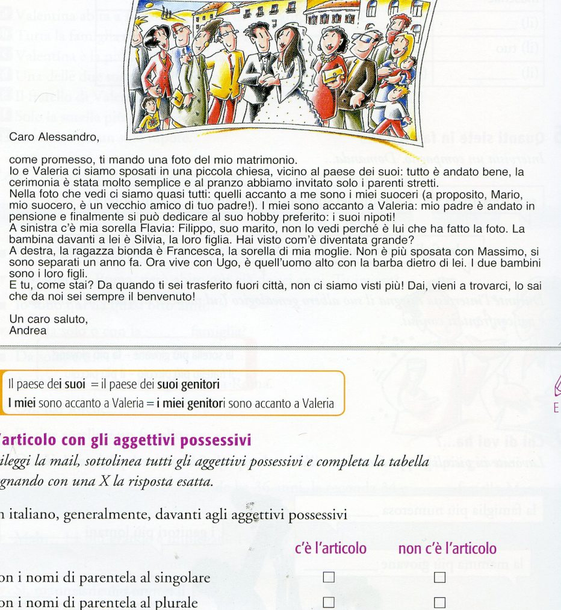
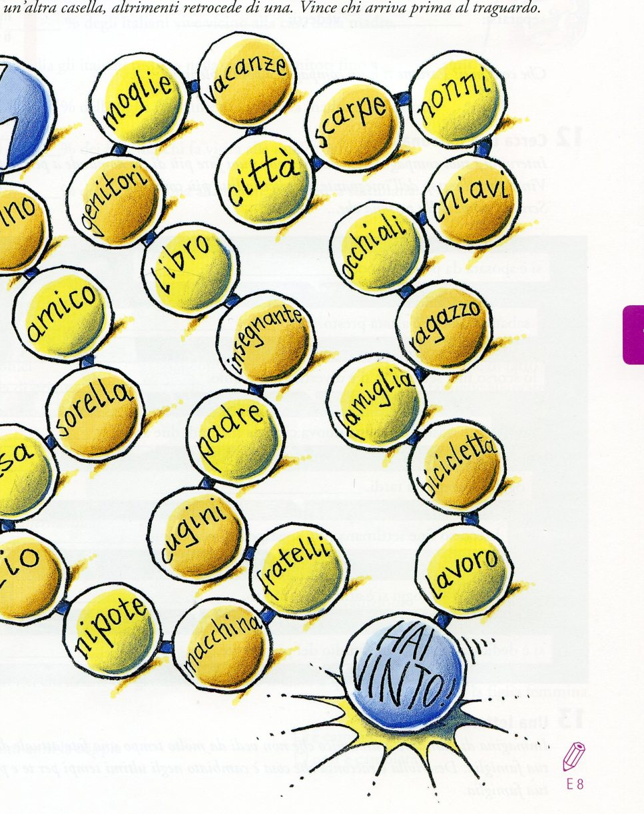
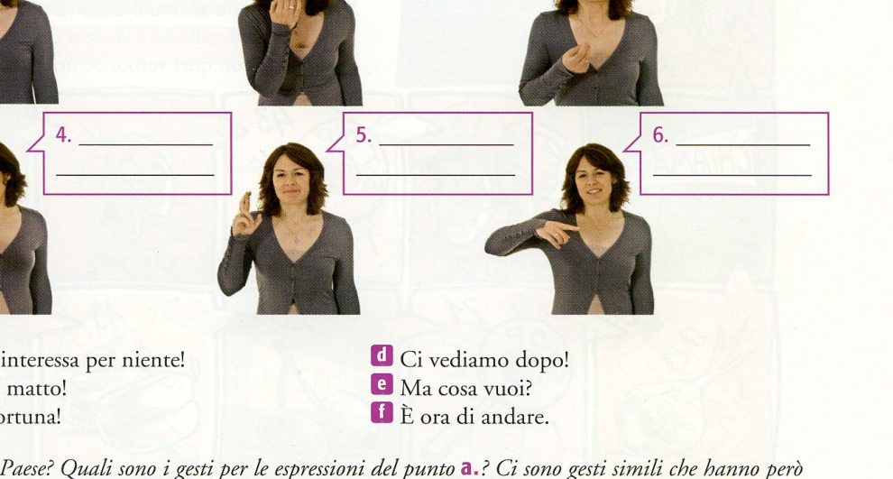

# Lezione 10 — Exercise workbook and final A1 review

[← Lesson](lesson.md) · [Grammar](grammar.md) · [Vocabulary](vocabulary.md) · **Exercises**

> **Based on original source pp. 129–144.** These are **new original exercises** and the book's real cropped pictures and readings alongside original companion exercises, not a reproduction of the printed exercises or an official publisher answer key.

## Study approach
Try the sentence from memory, then reveal the answer. The relevant **actual textbook image crops are embedded in Part E below**. Observe the image first, then answer. Avoid inventing identities for real people in photographs.

## Part A — Family relationships

**1.** Translate 'mother'.

Reveal answer

**madre**

**2.** Translate 'father'.

Reveal answer

**padre**

**3.** Translate 'grandparents'.

Reveal answer

**nonni**

**4.** Translate 'aunt'.

Reveal answer

**zia**

**5.** Translate 'uncle'.

Reveal answer

**zio**

**6.** Translate 'cousin (female)'.

Reveal answer

**cugina**

**7.** Translate 'brother-in-law'.

Reveal answer

**cognato**

**8.** Translate 'sister-in-law'.

Reveal answer

**cognata**

**9.** Give two possible meanings of nipote.

Reveal answer

**Grandchild; nephew or niece.**

**10.** Say 'I am an only child' (female speaker).

Reveal answer

**Sono figlia unica.**

**11.** Say 'My grandfather lives in Rome'.

Reveal answer

**Mio nonno abita a Roma.**

**12.** Say 'My parents are here'.

Reveal answer

**I miei genitori sono qui.**

**13.** Ask 'How many are in your family?'.

Reveal answer

**Quanti siete in famiglia?**

## Part B — Possessives and articles

**14.** Translate 'my brother'.

Reveal answer

**mio fratello**

**15.** Translate 'my sister'.

Reveal answer

**mia sorella**

**16.** Translate 'my brothers'.

Reveal answer

**i miei fratelli**

**17.** Translate 'your parents' (tu).

Reveal answer

**i tuoi genitori**

**18.** Translate 'their mother'.

Reveal answer

**la loro madre**

**19.** Translate 'our aunt'.

Reveal answer

**nostra zia**

**20.** Translate 'our cousins' (male/mixed).

Reveal answer

**i nostri cugini**

**21.** Translate 'your (plural) daughters'.

Reveal answer

**le vostre figlie**

**22.** Translate 'his sister'.

Reveal answer

**sua sorella**

**23.** Complete: ___ miei genitori (article).

Reveal answer

**i**

**24.** Complete: ___ mia madre (article).

Reveal answer

**No article in the standard unmodified kinship pattern.**

**25.** Complete: ___ loro padre (article).

Reveal answer

**il**

**26.** Correct 'mio zia'.

Reveal answer

**mia zia**

**27.** Correct 'nostre nonno'.

Reveal answer

**nostro nonno**

**28.** Say 'Sara and her father'.

Reveal answer

**Sara e suo padre**

**29.** Say 'Marco and his sister'.

Reveal answer

**Marco e sua sorella**

## Part C — Comparatives and superlatives

**30.** Translate 'Luca is taller than Marco'.

Reveal answer

**Luca è più alto di Marco.**

**31.** Translate 'Anna is younger than me'.

Reveal answer

**Anna è più giovane di me.**

**32.** Say 'My sister is older than my brother'.

Reveal answer

**Mia sorella è più grande di mio fratello.**

**33.** Say 'He is the youngest of the family'.

Reveal answer

**È il più giovane della famiglia.**

**34.** Say 'She is the oldest of the family'.

Reveal answer

**È la più grande della famiglia.**

**35.** Explain 'bellissimo' vs 'il più bello'.

Reveal answer

**Very beautiful (absolute superlative) vs the most beautiful (relative superlative).**

**36.** Finish: 'Luca è ___ alto di Marco'.

Reveal answer

**più / meno (depending on intended meaning).**

**37.** Correct 'la più giovani'.

Reveal answer

**la più giovane**

**38.** Correct 'più alto che mia sorella' (basic comparison).

Reveal answer

**più alto di mia sorella**

**39.** Make 'Sara è giovane' into the relative superlative.

Reveal answer

**Sara è la più giovane.**

## Part D — Family news and daily life

**40.** Say 'My cousin (female) is getting married'.

Reveal answer

**Mia cugina si sposa.**

**41.** Say 'Her husband is a teacher'.

Reveal answer

**Suo marito è insegnante.**

**42.** Say 'I live with my parents'.

Reveal answer

**Vivo con i miei genitori.**

**43.** Say 'He lives alone'.

Reveal answer

**Lui vive da solo.**

**44.** Say 'My aunt is retired'.

Reveal answer

**Mia zia è in pensione.**

**45.** Say 'My uncle has a beard'.

Reveal answer

**Mio zio ha la barba.**

**46.** Say 'This is good news'.

Reveal answer

**Questa è una bella notizia.**

**47.** Say 'We are five in the family'.

Reveal answer

**Siamo in cinque in famiglia.**

**48.** Complete: 'Ci ___ due ore'.

Reveal answer

**vogliono**

**49.** Complete: 'Ci ___ tempo'.

Reveal answer

**vuole**

**50.** Use 'quasi' in an Italian sentence.

Reveal answer

**Quasi tutti i parenti sono qui. (example)**

**51.** Ask whether a person has siblings.

Reveal answer

**Hai fratelli o sorelle?**

## Part E — Practice directly with the book's actual pictures and readings

**52.** **Book p. 130 — five family news photos.** Point to each of the five photographs. Identify the visible relationship only if supported by the printed caption/news snippet; otherwise make a fictional caption. Match the source snippets in your book.

Model answer or checking rule

Example: `Questa è una famiglia. Hanno due bambini.` Other answers depend on the actual pictures.

**53.** **Book p. 131 — family tree.** Using the actual genealogy diagram, locate grandparent, parent, aunt/uncle, sibling and cousin connections. Ask five Italian relationship questions.

Model answer or checking rule

`Chi è il fratello di mia madre? — È mio zio.`

**54.** **Book p. 131 — children in costume.** Write two *fictional* captions from the two pictures and connect one with `miei cugini`.

Model answer or checking rule

`Questi bambini sono i miei cugini.` (invented sentence, not identification).

**55.** **Book p. 132 — adults with parents.** Read the actual source statements. Discuss one reason someone may live with their parents; do not generalize from old statistics.

Model answer or checking rule

`Vivere con i genitori può essere una scelta economica.`

**56.** **Book p. 133 — possessive grammar table.** Before reading the answers, reconstruct all four forms of `mio`: singular masculine/feminine and plural masculine/feminine.

Model answer or checking rule

`mio, mia, miei, mie`.

**57.** **Book p. 133 — comparative silhouettes.** Describe who is taller, younger, oldest or youngest from the book's silhouette scene. Use `più ... di` and `il/la più`.

Model answer or checking rule

`Luca è più alto di Sara. Sara è la più giovane.` (fictional model, not book identity).

**58.** **Book p. 134 — wedding email.** Read the *actual email* and underline family terms, possessives, marriage vocabulary and any mention of the relatives.

Model answer or checking rule

Write a list of at least five source vocabulary terms; check against [Vocabulary](vocabulary.md).

**59.** **Book p. 135 — coloured possessive circles.** Cover the word circles and say what each possessive means. Write sentences using `mio`, `nostra`, `suoi`, `loro`.

Model answer or checking rule

`Mio fratello lavora; nostra zia è simpatica; i suoi genitori sono qui; il loro padre è anziano.`

**60.** **Book p. 136 — physical descriptions.** Make two new descriptions from the textbook portrait/photo prompts. Include age or appearance and family relationship.

Model answer or checking rule

`Mio cognato è alto, biondo e ha la barba.`

**61.** **Book p. 137 — living arrangements.** Read the source figures and create two sentences that compare people living independently or with parents. Clearly indicate that the figures are **from the textbook**, not current data.

Model answer or checking rule

`Secondo il testo, alcuni giovani vivono con i genitori.`

**62.** **Book p. 138 — opinion questions.** Choose two printed questions and answer using a fictional family or hypothetical situations. Use `secondo me` and `dipende`.

Model answer or checking rule

`Secondo me dipende dal lavoro e dalla situazione.`

**63.** **Book p. 141 — Italian gestures.** Look at all six images and try to match gestures to their descriptions. Use `Che cosa significa questo gesto?` as a conversation opening.

Model answer or checking rule

Meanings depend on the book's actual captions, and gestures vary by context.

**64.** **Book pp. 142–143 — final board game.** Choose five spaces from the *actual* board and turn them into one-minute spoken challenges. Mix food, daily routine, family and travel from Lessons 1–10.

Model answer or checking rule

`Prima mi alzo, poi faccio colazione. Dopo incontro mio zio.`

**65.** **Book p. 144 — Bilancio and project.** Complete the book's A1 self-check. For the video project, write a fictional 6-line script with a narrator and two family characters; avoid personal photos.

Model answer or checking rule

`Questa è la nostra famiglia inventata. Mio zio vive a Roma. Mia zia lavora...`

## Part F — Original reading and conversation challenge

**66.** Read the fictional email in [lesson.md](lesson.md#original-reading--a-fictional-family-email). Identify all possessive adjectives and explain whether each needs an article.

Model key

`mia sorella` (no article), `il suo futuro marito` (article: modified noun phrase), `i nostri genitori` (plural), `mia nonna` (no article), `i miei zii` (plural), `mio fratello` (no article).

**67.** Write 60–80 words describing an **invented** family: number of people, three relationships, one appearance detail, two possessives with different article patterns, and one comparison.

**68.** Speak for 60 seconds about an imaginary family without reading. Repeat, correcting article agreement and adjective endings.

**69.** Create a five-line wedding or family-news dialogue using `sposarsi`, `marito` or `moglie`, `i nostri` and `più...di`.

**70.** Mix Lessons 1–10: introduce yourself, say where you live and work, explain a daily routine, talk about a past holiday, order something, ask for directions and finish by introducing two relatives.

## Final review and audio boundary

For the source's Videocorso 10 (pp. 140–141), complete listening and comprehension questions **with authorized publisher video/audio**. The printed screenshots alone cannot verify all answers.

The book's **Facciamo il punto 4** (pp. 142–144) is the final A1 recap. Review your results privately; the public repository should not contain real classmates' names, family photographs or contact details.

### Personal checklist
- [ ] I can use possessives accurately with singular and plural family nouns.
- [ ] I can ask about relatives and describe fictional family relationships.
- [ ] I know how to compare two people and say who is the oldest/youngest.
- [ ] I can read a family-news email and draft a reply.
- [ ] I completed the textbook image tasks using the actual book.
- [ ] I completed or appropriately skipped tasks needing publisher audio/video.

[← Lesson](lesson.md) · [Grammar](grammar.md) · [Vocabulary](vocabulary.md)
