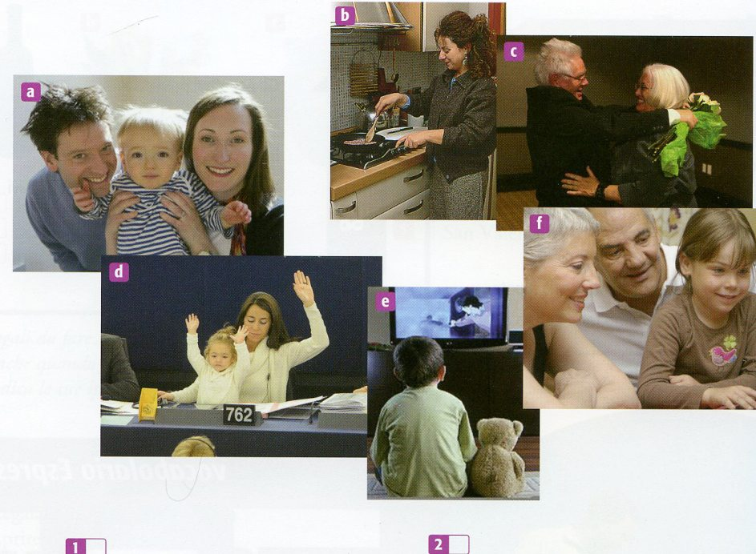
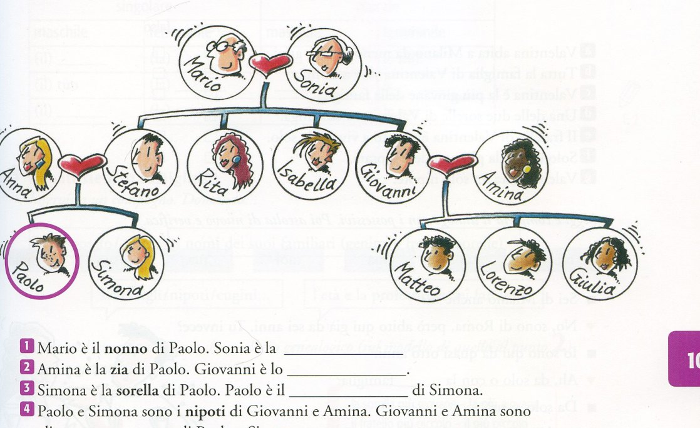
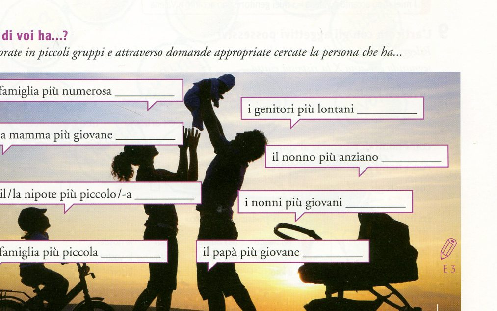
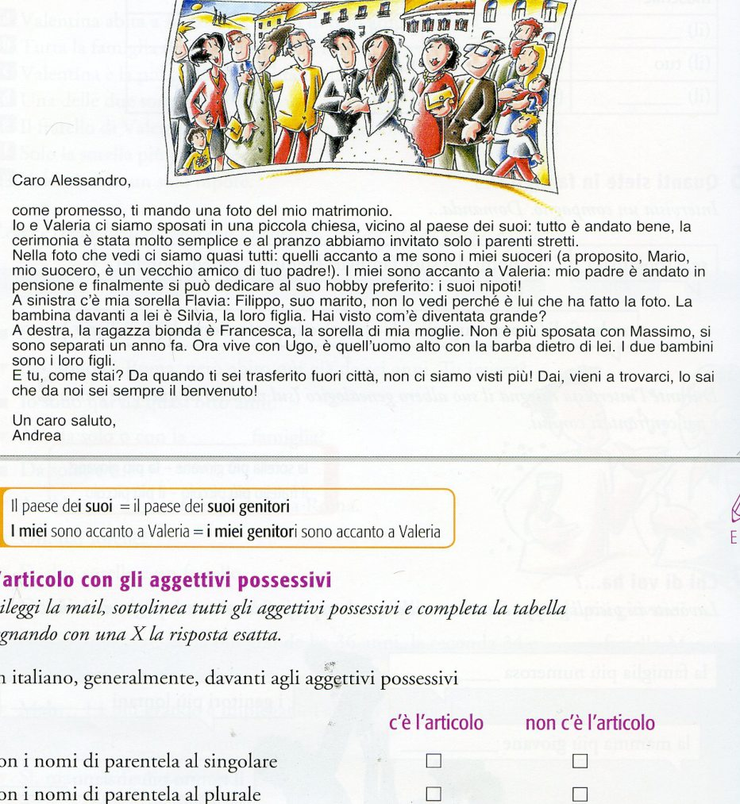
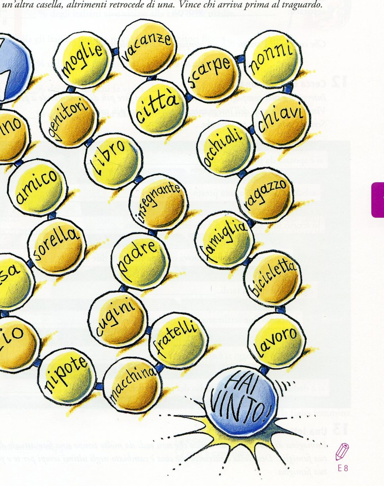
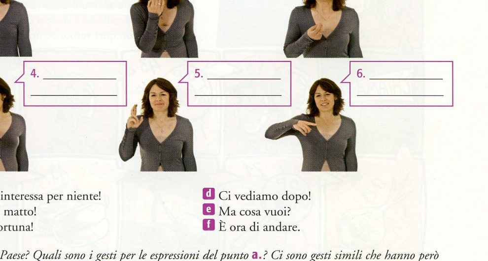

# Lezione 10 — La famiglia

[← A1 index](../README.md) · **Lesson** · [Grammar](grammar.md) · [Vocabulary](vocabulary.md) · [Exercises](exercise.md)

**Textbook:** *Nuovo_Espresso_1.pdf* **pp. 129–144**. Activities 130–138, grammar 139, video and culture 140–141, **Facciamo il punto 4** 142–144.

## Objectives
Talk about relatives, household and family news; describe people; use possessives with and without articles; compare ages; form relative superlatives; read a family wedding message; write a short letter; understand gestures; review the A1 course.

## Exact source page and picture reference
| Page | Book activity | Visual/reading practice |
|---|---|---|
| 129 | **Opening** | Family vocabulary cloud; introducing relatives |
| 130 | **1 La famiglia fa notizia** | Five family photos and family-news snippets |
| 131 | **2 I nomi della famiglia** | Illustrated multigenerational family tree |
| 131 | **3 Travestiti a tavola** | Two photos of children and a family gathering |
| 132 | **4 Vive ancora con i genitori** | Listening/reading about adults living with parents |
| 133 | **5 Completa** | Possessive adjective gender and plural table |
| 133 | **6 Quanti siete in famiglia?** | Size of household and family composition |
| 133 | **7 Chi di voi ha...?** | Silhouette scene and comparative family expressions |
| 134 | **8 Una mail speciale** | Wedding email: family relationships and announcement |
| 134 | **9 L'articolo con gli aggettivi possessivi** | Article usage with relatives and possessives |
| 135 | **10 Mio, tuo...** | Coloured picture-word circles for possessives |
| 136 | **11 Si è sposato...** | Marriage news and relationship expressions |
| 136 | **12 Cerca una persona che...** | Visual character descriptions, age and appearance |
| 136 | **13 Una lettera** | Original family letter writing task |
| 137 | **14 Genitori vicini e lontani** | Reading and statistics about adults and parents |
| 138 | **15 E voi?** | Questions about family arrangements and opinions |
| 139 | **Comunicazione e grammatica** | Chapter grammar summary and communication recap |
| 140–141 | **Videocorso 10 & Caffè culturale** | Marriage-video comprehension and six gesture photographs |
| 142–143 | **Facciamo il punto 4 — Gioco** | Two-page illustrated final review board |
| 144 | **Bilancio e Progetto** | Self-assessment and fictional classroom video project |

**The six actual cropped textbook visuals are embedded below**, and repeated beside their practice in [Vocabulary](vocabulary.md#picture-lab--actual-photographs-and-diagrams-from-the-book). They are extracted from the user's uploaded PDF (not substitute photographs). The [exercise workbook](exercise.md#part-e--practice-directly-with-the-books-actual-pictures-and-readings) also displays the matching visuals.

## Original textbook visuals — preview

| Family photographs · p. 130 | Family tree · p. 131 |
|---|---|
|  |  |

| Comparisons · p. 133 | Wedding email · p. 134 |
|---|---|
|  |  |

| Possessive word circles · p. 135 | Italian gestures · p. 141 |
|---|---|
|  |  |

## Original conversations aligned with the book
### 1. Companion dialogue — p. 130
> **A: Chi sono queste persone?**  
> **B: Sono i miei parenti. Mia zia è accanto a mio nonno.**

**Practice:** replace two details and perform both roles without the text; use the relevant book image/reading as your prompt.

### 2. Companion dialogue — p. 131
> **A: Chi è il fratello di tua madre?**  
> **B: È mio zio.**

**Practice:** replace two details and perform both roles without the text; use the relevant book image/reading as your prompt.

### 3. Companion dialogue — p. 132
> **A: Vivi con i tuoi genitori?**  
> **B: No, vivo da sola. Mio fratello vive ancora con loro.**

**Practice:** replace two details and perform both roles without the text; use the relevant book image/reading as your prompt.

### 4. Companion dialogue — p. 133
> **A: Quanti siete in famiglia?**  
> **B: Siamo quattro: i miei genitori, mia sorella e io.**

**Practice:** replace two details and perform both roles without the text; use the relevant book image/reading as your prompt.

### 5. Companion dialogue — p. 134
> **A: Che notizia!**  
> **B: Mia cugina si sposa in settembre!**

**Practice:** replace two details and perform both roles without the text; use the relevant book image/reading as your prompt.

### 6. Companion dialogue — p. 135
> **A: Questi sono i tuoi cugini?**  
> **B: Sì, e questa è nostra nonna.**

**Practice:** replace two details and perform both roles without the text; use the relevant book image/reading as your prompt.

### 7. Companion dialogue — p. 136
> **A: Com'è tuo cognato?**  
> **B: È alto, biondo e ha la barba.**

**Practice:** replace two details and perform both roles without the text; use the relevant book image/reading as your prompt.

### 8. Companion dialogue — p. 137
> **A: Tua sorella è più grande di te?**  
> **B: No, è più giovane di me.**

**Practice:** replace two details and perform both roles without the text; use the relevant book image/reading as your prompt.

### 9. Companion dialogue — p. 138
> **A: Ti piacerebbe abitare da solo?**  
> **B: Dipende dal lavoro e dalla famiglia.**

**Practice:** replace two details and perform both roles without the text; use the relevant book image/reading as your prompt.

### 10. Companion dialogue — p. 140–141
> **A: Chi è questa persona?**  
> **B: È un parente della sposa.**

**Practice:** replace two details and perform both roles without the text; use the relevant book image/reading as your prompt.

### 11. Companion dialogue — p. 142–144
> **A: Che cosa hai imparato?**  
> **B: So descrivere la mia famiglia e usare i possessivi.**

**Practice:** replace two details and perform both roles without the text; use the relevant book image/reading as your prompt.

## Reading — a new fictional wedding email
> Cara Giulia,
>
> Ho una bella notizia: mia sorella Sara si sposa a settembre! Il suo futuro marito si chiama Davide. I nostri genitori sono molto contenti. Mia nonna vive in campagna, ma i miei zii abitano vicino a noi. Mio fratello è più giovane di me e vuole preparare un discorso. Ci vediamo presto!
>
> Un abbraccio, Emma.

**Questions:** Who is getting married? What is the partner's name? Who lives in the countryside? Who is younger than Emma? Name four possessives.

Reading key

Sara; Davide; Emma's grandmother; Emma's brother. `mia sorella`, `il suo futuro marito`, `i nostri genitori`, `mia nonna`, `i miei zii`, `mio fratello`.

## Shadowing and recall
Read the exchange `Quanti siete in famiglia? — Siamo quattro` aloud, repeat at natural pace, cover the script, then change the family count. **True shadowing requires authorized spoken Italian audio**; text-only practice is read-aloud and delayed repetition. Review tomorrow, after three days and after a week, retrieving sentences before checking answers.

[Grammar](grammar.md) · [Vocabulary](vocabulary.md) · [Exercises](exercise.md)
