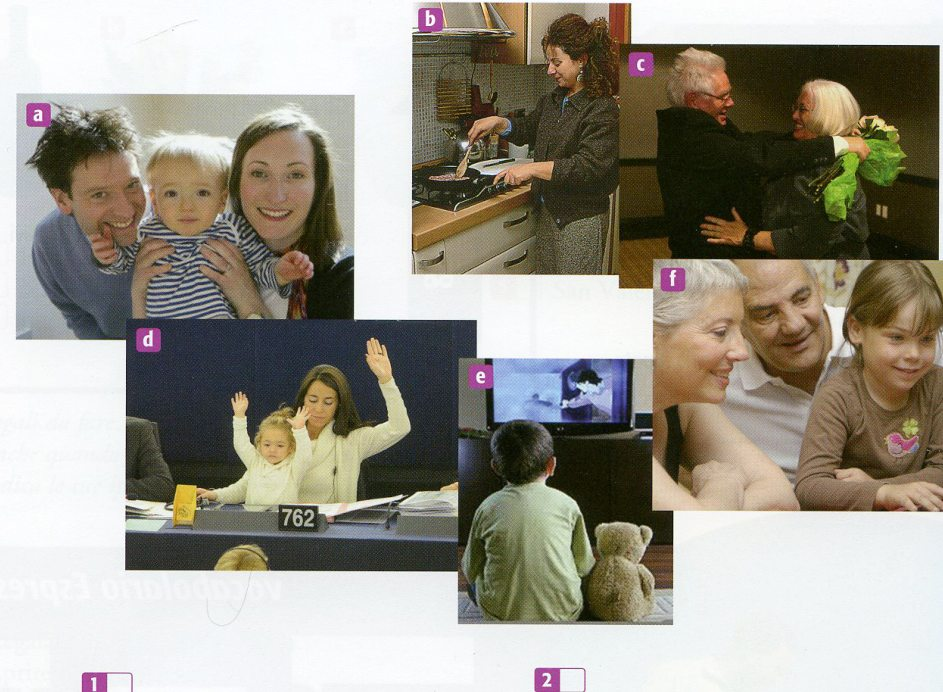
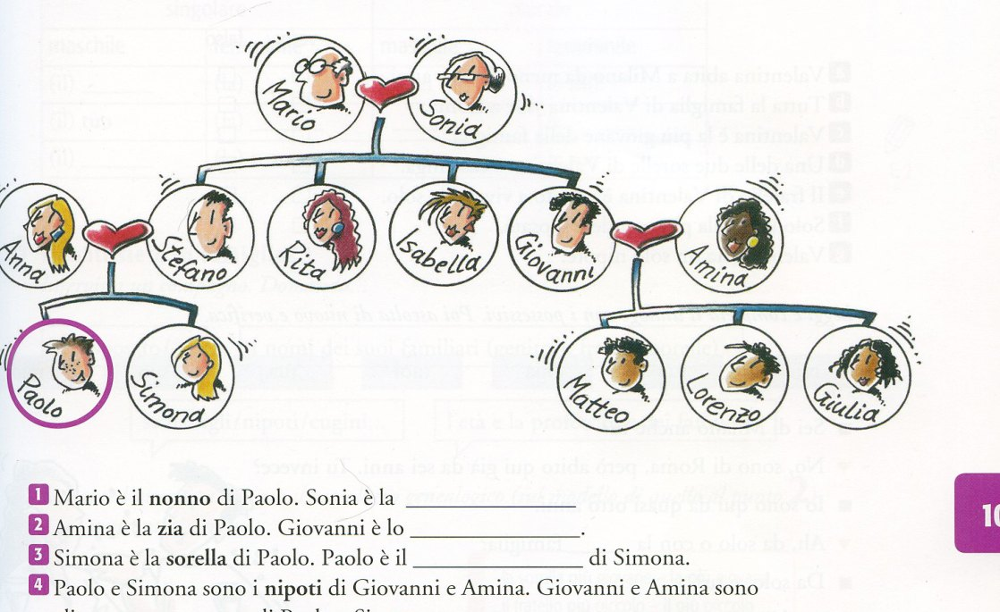
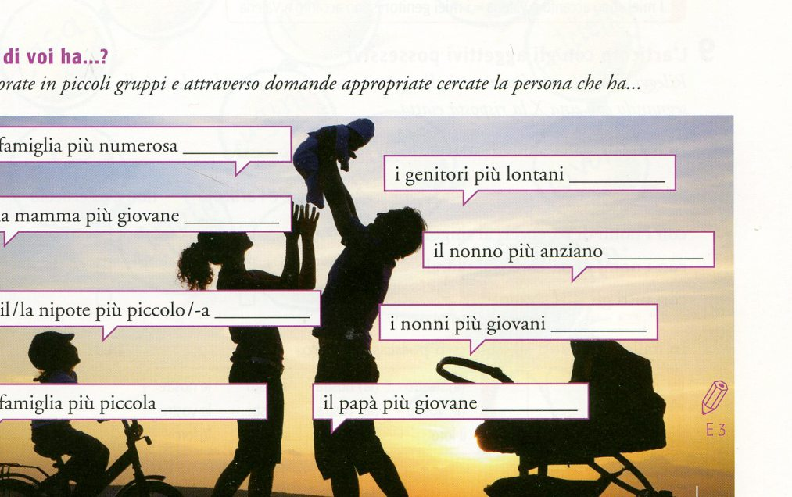
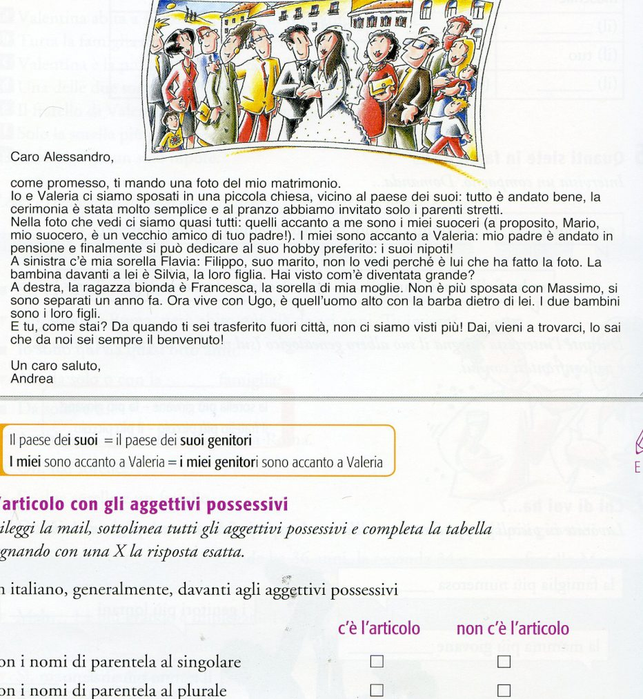
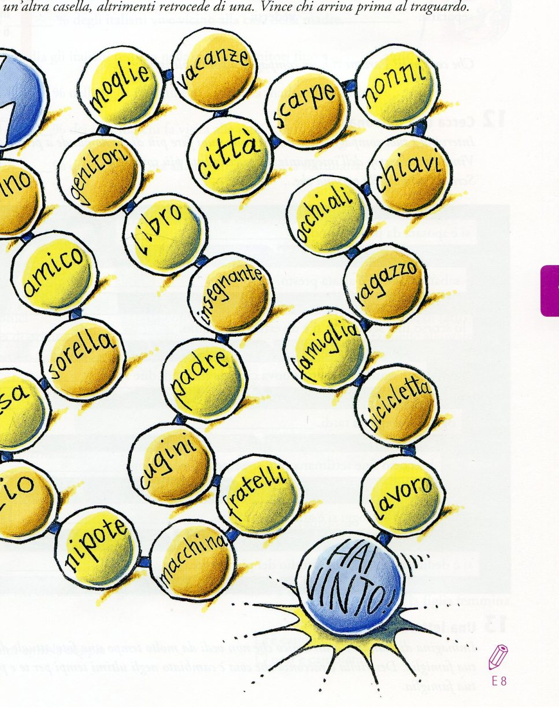
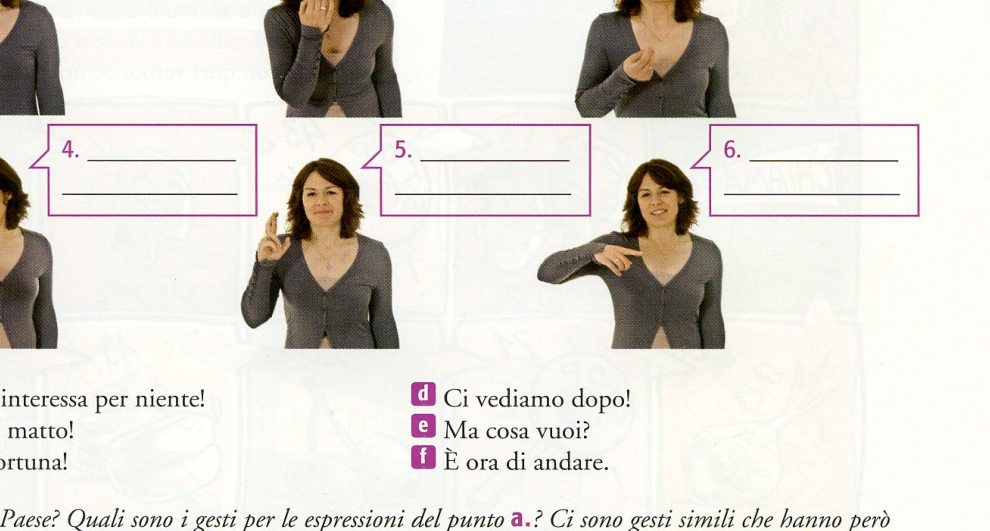

# Lezione 10 — Visual vocabulary, Italian · English · فارسی

[← Lesson](lesson.md) · [Grammar](grammar.md) · **Vocabulary** · [Exercises](exercise.md)

> Based on family terminology and contextual phrases from *Nuovo Espresso 1 Glossario*, **Lezione 10**, with source activity references on textbook pp. 129–144. Entries are a curated educational selection with original example sentences, not a copy of the glossary.

**Picture-first practice:** real online Commons photographs are preferred for an exact concrete match. For abstract words and family relationships that cannot be reliably depicted by a single photograph, an emoji serves as a **memory cue**, not a precise translation. Keep the Italian article and complete sentence in your memory.

## Family members

| Foto / visual · Italiano | English | فارسی | Original Italian sentence |
|---|---|---|---|
| 👨‍👩‍👧‍👦 **famiglia** | family | خانواده | La mia famiglia è numerosa. |
| 👩 **madre** | mother | مادر | Mia madre lavora in una scuola. |
| 👨 **padre** | father | پدر | Mio padre è in pensione. |
| 👩 **mamma** | mum | مامان | La mamma è a casa. |
| 👨 **papà** | dad | بابا | Il papà cucina. |
| 👪 **genitori** | parents | والدین | I miei genitori vivono a Torino. |
| 👦 **figlio** | son | پسر | Mio figlio studia italiano. |
| 👧 **figlia** | daughter | دختر | Sua figlia ha vent'anni. |
| 🧒 **figli** | children | فرزندان | I nostri figli vanno a scuola. |
| 👨 **fratello** | brother | برادر | Mio fratello è più grande. |
| 👩 **sorella** | sister | خواهر | Mia sorella è sposata. |
| 👴 **nonno** | grandfather | پدربزرگ | Mio nonno legge il giornale. |
| 👵 **nonna** | grandmother | مادربزرگ | Mia nonna abita vicino. |
| 👵 **nonni** | grandparents | پدربزرگ و مادربزرگ | I nonni ci visitano spesso. |
| 🧒 **nipote** | grandchild / nephew / niece | نوه / خواهرزاده / برادرزاده | Mio nipote ha cinque anni. |
| 👨 **zio** | uncle | عمو / دایی | Mio zio vive a Roma. |
| 👩 **zia** | aunt | عمه / خاله | Mia zia è insegnante. |
| 👦 **cugino** | male cousin | پسرعمو / پسرخاله / ... | Mio cugino lavora a Napoli. |
| 👧 **cugina** | female cousin | دخترعمو / دخترخاله / ... | Mia cugina si sposa. |
| 👨 **marito** | husband | شوهر | Suo marito si chiama Davide. |
| 👩 **moglie** | wife | همسر / زن | Sua moglie è architetta. |
| 👴 **suocero** | father-in-law | پدرزن / پدرشوهر | Mio suocero è simpatico. |
| 👵 **suocera** | mother-in-law | مادرزن / مادرشوهر | Mia suocera abita qui. |
| 👨 **cognato** | brother-in-law | برادرزن / برادرشوهر | Mio cognato è alto. |
| 👩 **cognata** | sister-in-law | خواهرزن / خواهرشوهر | Mia cognata parla francese. |
| 👥 **parenti** | relatives | خویشاوندان | Ho molti parenti in Italia. |
| 🔗 **parentela** | kinship / relations | خویشاوندی | Parliamo della nostra parentela. |
| 👦 **figlio unico** | only son / only child (male) | تک‌فرزند پسر | Luca è figlio unico. |
| 👧 **figlia unica** | only daughter / only child (female) | تک‌فرزند دختر | Sara è figlia unica. |
| 🌳 **albero genealogico** | family tree | شجره‌نامه | Disegno un albero genealogico. |

## Possessives and reference words

| Foto / visual · Italiano | English | فارسی | Original Italian sentence |
|---|---|---|---|
| 🔖 **mio / mia** | my (singular) | مال من / من | Questa è mia sorella. |
| 🔖 **miei / mie** | my (plural) | مال من / من | I miei fratelli sono qui. |
| 🔖 **tuo / tua** | your informal (singular) | مال تو | Tua madre è simpatica. |
| 🔖 **tuoi / tue** | your informal (plural) | مال تو | I tuoi nonni abitano qui? |
| 🔖 **suo / sua** | his/her/your formal | مال او / شما | Sua sorella lavora. |
| 🔖 **suoi / sue** | his/her plural | مال او | I suoi amici sono qui. |
| 🔖 **nostro / nostra** | our (singular) | مال ما | Nostra zia è francese. |
| 🔖 **nostri / nostre** | our (plural) | مال ما | I nostri figli sono piccoli. |
| 🔖 **vostro / vostra** | your plural (singular noun) | مال شما | Vostra figlia studia. |
| 🔖 **vostri / vostre** | your plural (plural noun) | مال شما | I vostri parenti arrivano. |
| 🔖 **loro** | their | مال آن‌ها | Il loro padre lavora. |
| 📚 **possessivo** | possessive | ملکی | Questo è un aggettivo possessivo. |
| 📖 **articolo** | article | حرف تعریف | Con 'miei' uso l'articolo. |
| 1️⃣ **singolare** | singular | مفرد | Mia sorella è singolare. |
| 🔢 **plurale** | plural | جمع | I miei fratelli: plurale. |

## Family life and relationships

| Foto / visual · Italiano | English | فارسی | Original Italian sentence |
|---|---|---|---|
| 💒 **sposarsi** | to get married | ازدواج کردن | Mia sorella si sposa. |
| 💍 **sposato / sposata** | married | متأهل | È sposata da tre anni. |
| 💒 **matrimonio** | marriage / wedding | ازدواج / عروسی | Il matrimonio è in settembre. |
| 💐 **nozze** | wedding | عروسی | Le nozze sono sabato. |
| 🎉 **cerimonia** | ceremony | مراسم | La cerimonia è semplice. |
| 💍 **fidanzato** | fiancé / boyfriend | نامزد / دوست‌پسر | Il suo fidanzato è gentile. |
| 💍 **fidanzata** | fiancée / girlfriend | نامزد / دوست‌دختر | La sua fidanzata è simpatica. |
| 🏠 **convivenza** | cohabitation | زندگی مشترک | Parliamo della convivenza. |
| 🏠 **casalinga** | homemaker (female) | خانه‌دار | Mia zia è casalinga. |
| 🏠 **vivere con** | to live with | با ... زندگی کردن | Vivo con i miei genitori. |
| 🏠 **vivere da solo / sola** | to live alone | تنها زندگی کردن | Luca vive da solo. |
| 🏡 **restare** | to stay/remain | ماندن | Preferisce restare a casa. |
| 📦 **trasferirsi** | to move home | اسباب‌کشی کردن | I miei zii si trasferiscono. |
| 👶 **nascere** | to be born | متولد شدن | Sono nato a Torino. |
| 🌱 **crescere** | to grow up | بزرگ شدن | Sono cresciuta a Pisa. |
| 👴 **in pensione** | retired | بازنشسته | Mio nonno è in pensione. |
| 🗓️ **andare in pensione** | to retire | بازنشسته شدن | Mia zia va in pensione. |
| 🤲 **occuparsi di** | to take care of | مراقبت کردن از | Si occupa dei bambini. |
| 📰 **dare una notizia** | to share news | خبری دادن | Ti do una bella notizia. |
|  **lettera** | letter | نامه | Scrivo una lettera a Marco. |
|  **e-mail** | email | ایمیل | Ho ricevuto un'e-mail. |
| 🤝 **incontro** | meeting | ملاقات | È un incontro di famiglia. |

## Description, comparisons and opinions

| Foto / visual · Italiano | English | فارسی | Original Italian sentence |
|---|---|---|---|
| 🧑 **giovane** | young | جوان | Mia cugina è giovane. |
| 👴 **anziano / anziana** | elderly | مسن | Il nonno è anziano. |
| 📏 **alto / alta** | tall | بلندقد | Mia sorella è alta. |
| 📏 **basso / bassa** | short (height) | کوتاه‌قد | Mio fratello è basso. |
| 💇 **biondo / bionda** | blond | بور | È biondo e ha gli occhi azzurri. |
| 🧔 **barba** | beard | ریش | Mio zio ha la barba. |
| 🙂 **simpatico / simpatica** | nice / likable | دوست‌داشتنی | Mio padre è simpatico. |
| 👪 **numeroso / numerosa** | numerous / large | پرجمعیت | È una famiglia numerosa. |
| 📐 **grande** | big / older | بزرگ / بزرگ‌تر | Luca è più grande di me. |
| 📐 **piccolo / piccola** | small / younger | کوچک / کوچک‌تر | Sara è la più piccola. |
| ⬆️ **più ... di** | more ... than | بیشتر از | È più alto di me. |
| ⬇️ **meno ... di** | less ... than | کمتر از | È meno giovane di lui. |
| 🏆 **il più / la più** | the most | بیشترین / ترین | È la più giovane. |
| 🤔 **secondo te** | in your opinion | به نظر تو | Secondo te è normale? |
| 💭 **ritenere** | to consider/believe | معتقد بودن | Ritengo che sia importante. |
| 🎯 **probabile** | likely / probable | محتمل | È probabile. |
| 🔄 **di solito** | usually | معمولاً | Di solito vedo la famiglia. |
| 🔄 **generalmente** | generally | معمولاً | Generalmente lavoro di mattina. |
| ➗ **quasi** | almost | تقریباً | Quasi tutti sono qui. |
| ✅ **già** | already | قبلاً / دیگر | È già sposato. |
| 🗺️ **lontano** | far | دور | Abitano lontano. |
| 📍 **vicino** | near | نزدیک | Abitano vicino a noi. |

## Celebrations, gestures and study words

| Foto / visual · Italiano | English | فارسی | Original Italian sentence |
|---|---|---|---|
| 🎁 **regalo** | gift | هدیه | Porto un regalo alle nozze. |
| 📃 **lista di nozze** | wedding gift registry | فهرست هدایای عروسی | Hanno una lista di nozze. |
| ✈️ **viaggio di nozze** | honeymoon | ماه‌عسل | Fanno un viaggio di nozze. |
| 🍀 **buona fortuna** | good luck | موفق باشی | Buona fortuna per domani! |
| 🤌 **gesto** | gesture | اشاره / حرکت دست | Questo gesto significa qualcosa. |
| 🤌 **gesticolare** | to gesture | با دست اشاره کردن | Gesticola quando parla. |
| 🌍 **cultura** | culture | فرهنگ | La cultura è diversa. |
| 🔁 **abitudine** | habit / custom | عادت | È un'abitudine di famiglia. |
| 👥 **parentela allargata** | extended family | خانواده گسترده | Conosco la parentela allargata. |
| 🎤 **intervista** | interview | مصاحبه | Faccio un'intervista. |
| 📝 **descrivere** | to describe | توصیف کردن | Descrivo mia sorella. |
| ✏️ **disegnare** | to draw | کشیدن | Disegno una famiglia inventata. |
| ⚖️ **confrontare** | to compare | مقایسه کردن | Confronto due famiglie. |
| ☑️ **scegliere** | to choose | انتخاب کردن | Scelgo una risposta. |
| 📋 **bilancio** | self-assessment | ارزیابی | Completo il bilancio. |
| 🛠️ **progetto** | project | پروژه | Prepariamo un progetto. |
| 🎥 **filmino** | short video | ویدئوی کوتاه | Registriamo un filmino inventato. |
| 🎬 **scena** | scene | صحنه | Prepariamo una scena. |
| 🎬 **regista** | director | کارگردان | La regista organizza il video. |
| 🎞️ **montaggio** | editing | تدوین | Faccio il montaggio del video. |
| ⏳ **ci vuole** | it takes / is needed (sing.) | لازم است | Ci vuole tempo. |
| ⏳ **ci vogliono** | it takes / are needed (plural) | لازم هستند | Ci vogliono due ore. |

## Picture lab — actual photographs and diagrams from the book

These are **real, focused crops from the uploaded Nuovo Espresso 1 textbook**, not stock-photo substitutes. The new exercises follow each original picture; reveal the model answer only after attempting the task.

### 1. Page 130 — La famiglia fa notizia

Look at **the actual five photographs**. Describe two using `c'è`, `ci sono`, or `questa è una famiglia...`. Match them to the short source news snippets using your copy's original choices.

### 2. Page 131 — I nomi della famiglia

Look at the printed names and lines. Complete: `Mario è il ___ di Paolo.`; `Sonia è la ___ di Paolo.`; `Paolo è il ___ di Simona.`

Check answers

`nonno`; `nonna`; `fratello`.

### 3. Page 133 — Family comparisons

Use the pictured labels `il nonno più anziano`, `la mamma più giovane`, etc. Make your own comparative sentence with `più ... di` and a question using `il/la più`.

### 4. Page 134 — Una mail speciale

Read **the original source email shown above**. Find four family terms and three possessives. Decide which expressions have a definite article, then explain your choices using [Grammar](grammar.md).

### 5. Page 135 — Mio, tuo... word circles

Pick five exact words you can see, then make five correct family phrases: `mio padre`, `mia sorella`, `i miei fratelli`, `le mie sorelle`, `il loro cugino`.

### 6. Page 141 — Italian gesture photos

Look at all **six original gesture photographs** and match each to its expression on the same source activity. Practise `Che cosa significa questo gesto?` and discuss why the same gesture can mean different things in different contexts.

*Source: cropped illustrations and photographs from the user's uploaded Nuovo Espresso 1, pages 130, 131, 133, 134, 135 and 141. Images are included here for focused lesson study; they are not original course artwork.*

## English bridges and false assumptions

| Italian | English reminder | Warning |
|---|---|---|
| `mia sorella` | my sister | Usually **no** definite article with an unmodified singular family noun. |
| `i miei genitori` | my parents | **Plural** normally takes **i**. |
| `suo fratello` | his/her brother | `suo` agrees with **fratello**, not the owner's gender. |
| `nipote` | niece/nephew or grandchild | Context determines which relationship is intended. |
| `più alto di` | taller than | Italian does not add English `-er` to the adjective. |
| `la più giovane` | the youngest | Relative superlative ≠ `giovanissima` (very young). |
| `ci vogliono due ore` | it takes two hours | Plural **vogliono** agrees with **due ore**. |

## Shadowing ladder (original text; recording needed for true shadowing)

**Level 1:** `mia madre`, `i miei genitori`, `sua sorella`, `il loro padre`, `la più giovane`.

**Level 2, conversation:**

> **A:** Quanti siete in famiglia?  
> **B:** Siamo cinque. Ho due sorelle e un fratello.  
> **A:** Chi è il più grande?  
> **B:** Mio fratello. Le mie sorelle sono più giovani.

**Level 3:** Change the number of people, the relatives, and a comparison; reconstruct without reading. Listen to suitable authorized Italian speech to practise *true shadowing*. Without recording, this is **read-aloud and repetition** only.

## Seven-day recall plan

**Now:** name ten words using visual cues; **tomorrow:** write five new sentences; **after three days:** explain possessives without notes; **after seven days:** write a fictional wedding announcement and role-play a family interview.

Five retrieval answers

1. *my mother* → `mia madre`; 2. *my parents* → `i miei genitori`; 3. *their father* → `il loro padre`; 4. *my younger sister* → `mia sorella minore`; 5. *the oldest* → `il più grande / la più grande`.

[← Lesson](lesson.md) · [Grammar](grammar.md) · [Exercises](exercise.md) · [Photo credits](../PHOTO_CREDITS.md)
